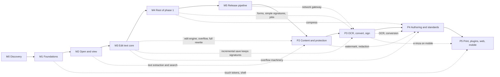

# Ferman roadmap

Status: Milestones 0 and 1 are complete and approved (2026-10-15 and 2026-10-16). The owner approved
the [M2 plan](PROGRESS.md#m2-plan) on 2026-10-17, the go-ahead for Milestone 2: phase 0, the design
sync, is pull request #3 from `m2-open-and-view`, and M2 follows as pull request #4.

This document details the roadmap in [brief](BRIEF.md) §7 and covers brief §8 item 4. For every
milestone it gives the goal, the scope from the brief, the deliverables, the artboards it covers,
the engine capabilities and crates, new dependencies, acceptance criteria, the design gaps to settle
and the exit checks.

- The brief's roadmap is fixed. This document only details it. If the two disagree, the brief wins
  and this document has a bug.
- Anything marked **Proposed** is a new decision. It waits for the owner, through an ADR or an entry
  in [QUESTIONS.md](QUESTIONS.md). Until then the brief's wording stands.
- One milestone at a time (brief §9). A milestone starts only after the previous one is accepted.

Related: [architecture](ARCHITECTURE.md) · [design inventory](DESIGN_INVENTORY.md) ·
[component spec](COMPONENTS.md) · [design gaps](DESIGN_GAPS.md) · [dependencies](DEPENDENCIES.md) · [questions](QUESTIONS.md) ·
[backlog](BACKLOG.md) · [progress](PROGRESS.md) · [ADRs](adr/README.md)

## Contents

1. [How to read this roadmap](#1-how-to-read-this-roadmap)
2. [Overview](#2-overview)
3. [Rules for every milestone](#3-rules-for-every-milestone)
4. [M0: discovery and plan](#4-m0-discovery-and-plan)
5. [M1: foundations](#5-m1-foundations)
6. [M2: open and view](#6-m2-open-and-view)
7. [M3: edit text core](#7-m3-edit-text-core)
8. [M4: rest of phase 1](#8-m4-rest-of-phase-1)
9. [M5: release pipeline](#9-m5-release-pipeline)
10. [Phase 2: editing content and protecting documents](#10-phase-2-editing-content-and-protecting-documents)
11. [Phase 3: OCR, conversion, certificate signatures and compare](#11-phase-3-ocr-conversion-certificate-signatures-and-compare)
12. [Phase 4: authoring, standards, accessibility, batch and AI](#12-phase-4-authoring-standards-accessibility-batch-and-ai)
13. [Phase 5: print production, plugins, web and mobile](#13-phase-5-print-production-plugins-web-and-mobile)
14. [Not scheduled yet](#14-not-scheduled-yet)
15. [Risk register](#15-risk-register)

## 1. How to read this roadmap

**Codes.** M0 to M5 make up phase 1 (the brief calls M4 "rest of phase 1"). P2 to P5 are the
brief's phases 2 to 5. Step numbers inside a milestone give the order of work.

**Status values.** Not started · In progress · Complete, pending owner approval · Complete.

**Artboards.** Ids are the ones in [DESIGN_INVENTORY.md](DESIGN_INVENTORY.md#5-artboards). Each of
the 253 boards (244 artboards plus 9 fix boards) is listed under exactly one milestone: its primary
milestone. A board can show parts that land later. The inventory row says which, and those parts stay
visible but disabled until they ship. The owner's design export `519d42a` (2026-10-17) added 30 of
the boards. A `-m1` or `-m2` suffix names a milestone build: `a1-5-m1` is `a1-5` as M1 ships it,
while the board without the suffix stays the finished product. 29 of the new boards switch between
English, Turkish and Arabic, and `tools/design-refs` renders each of them in all three.

**Acceptance criteria** are checklists. Each item must be provable by a test, a CI job or a recorded
measurement. A box is ticked only with a link to that evidence (exit check E1). The standard gates
S1 to S9 and exit checks E1 to E8 in [section 3](#3-rules-for-every-milestone) apply to every
milestone from M1 on, in addition to the milestone's own list.

**Reference hardware and budgets** come from [ARCHITECTURE.md §14](ARCHITECTURE.md#14-performance-budgets).
R1 is a MacBook Air with an Apple M1 and 8 GB. R2 is a 2020-class Windows 11 laptop (Core i5-1135G7
class, 8 GB, NVMe SSD). Both are **Proposed**. Flutter numbers come from profile builds, Rust numbers
from release builds.

**Corpus files** used in the criteria have working names. The final names, licences and SHA-256 sums
live in `tests/corpus/README.md` (the file exists since M1; the first files come in M2). Generated
files come from `tools/corpus` and mirror the design's sample documents
([DESIGN_INVENTORY.md §9](DESIGN_INVENTORY.md#9-fixes-flows-and-sample-documents)); how they are
generated is the Proposed [ADR 0020](adr/0020-test-corpus.md), part of the M2 plan.

| Working name | What it is | Source in the design |
|---|---|---|
| `kira-tr` | 3-page Turkish rental contract, subset-embedded fonts, one subset without "ğ" (Madde 6), a tight frame above the IBAN line (Madde 4), three attachments, signature fields on page 3 | `DocKira` |
| `kira-tr-signed`, `kira-tr-signed-changed` | the contract signed (PAdES with a timestamp), and the same file with an incremental update after signing | "Kira sözleşmesi — imzalı.pdf", "… imzalı (2).pdf" |
| `kira-tr-damaged` | broken cross-reference table; page 3 uses a non-embedded TimesNewRomanPSMT | "Kira sözleşmesi (eski).pdf" |
| `ekstre-tr` | 2-page bank statement with a transaction table, checksum-valid fictitious T.C. Kimlik No and IBAN, metadata and earlier revisions | `DocEkstre` |
| `form-aks1-tr`, `form-aks1-flat` | 1-page e-Devlet AcroForm with 20 fields (15 required), and a flat twin with no form fields | `DocForm` ([G59](DESIGN_GAPS.md#g59)) |
| `fatura-tr` | 1-page e-Arşiv invoice with a real column layout and dependent totals | `a3-9` |
| `tez-tr` | 64-page tagged thesis: nested outline, page labels, Turkish with an English block quote | thesis in `a2-1d`, `a2-3a`, `a3-14` |
| `cv-tr` | untagged 1-page CV with a photo, a low-contrast line and visual-only lists | `DocCv` |
| `plan-tr` | vector floor plan at a known 1:75 scale | `DocPlan` |
| `nda-en` | 4-page English contract with a digital signature | "Mutual NDA — Northwind.pdf" |
| `mietvertrag-de` | 6-page German contract with umlauts and ß | "Mietvertrag Berlin.pdf" |
| `report-ar` | 12-page Arabic report with an embedded Arabic font and mixed left-to-right numbers | "التقرير السنوي 2025.pdf" |
| `letter-ja-vertical` | Japanese letter with vertical text (縦書き), tate-chu-yoko and kinsoku | `a3-15` |
| `quote-ja-scan`, `scan-tr` | image-only scans: a 2-page Japanese quotation and a 3-page Turkish letter | "見積書_2026-10.pdf", "Kira artış bildirimi (tarama).pdf" |
| `payslip-aes256` | AES-256 encrypted payslip whose password contains ı, ş and ü | "Maaş bordrosu Eylül 2026.pdf" |
| `imar-2400` | generated 2,400-page report | "İmar planı açıklama raporu.pdf" (`a1-7`) |
| `long-500` | generated 500-page text document for the performance budgets | [ARCHITECTURE.md §14](ARCHITECTURE.md#14-performance-budgets) |
| `truncated` | file cut off at 18 KB, not repairable | "Tarama_0042.pdf" (`a1-9b`) |
| `xfa-visa` | dynamic XFA-only form | "Vize başvuru formu.pdf" (`a11-7c`) |
| `preflight-x4` | generated print file with seeded PDF/X-4 issues (an RGB image, a font that is not embedded, a missing bleed box, ink coverage over the limit) and roman page labels | thesis in `a9-4b` |
| `separations-cmyk` | generated CMYK page with one spot colour (PANTONE 2945 C), overprinting black text and known ink coverage per area | `a9-6d` |
| `office-sources` | freely licensed Word, Excel and PowerPoint source files (`.docx`, `.odt`, `.xlsx`, `.ods`, `.pptx`, `.odp`), each with the PDF its own application exports | `a7-1` "To PDF" |
| script samples | generated paragraphs: `fa-zwnj` (Persian with ZWNJ), `he-para` (Hebrew), `zh-hans`, `zh-hant`, `ko-para` | brief §1 languages |
| real-world set | freely licensed files from Word, Google Docs, LibreOffice, LaTeX, scanners, forms, signed, encrypted and damaged files | brief §5 |

## 2. Overview

| Code | Name | Goal in one line | Status | Boards | Needs first |
|---|---|---|---|---|---|
| M0 | Discovery and plan | Inventory the design, fix the architecture, plan the work (docs only) | Complete (approved 2026-10-15) | 0 | — |
| M1 | Foundations | An empty Ferman shell that matches the design, talks to the engine, and is built by green CI on three systems | Complete (approved 2026-10-16) | 18 | M0 approval (given 2026-10-15) |
| M2 | Open and view | Open any PDF safely and view, navigate and search it fast | Approved, starting | 43 | M1 (approved 2026-10-16); the [M2 plan](PROGRESS.md#m2-plan), approved by the owner on 2026-10-17. [ADR 0009](adr/0009-threading-and-jobs.md) is Accepted and [Q07](QUESTIONS.md#q07), [Q13](QUESTIONS.md#q13), [Q18](QUESTIONS.md#q18) and [Q19](QUESTIONS.md#q19) are answered (2026-10-16) |
| M3 | Edit text core | Click any text and edit it; save without ever corrupting the file | Not started | 41 | M2; [Q07](QUESTIONS.md#q07), [Q08](QUESTIONS.md#q08) group 4 and [Q09](QUESTIONS.md#q09) are answered (2026-10-16) |
| M4 | Rest of phase 1 | Organize, comment, fill, sign simply, compress and the full app frame | Not started | 36 | M3; [Q08](QUESTIONS.md#q08) group 3 is answered (2026-10-16) |
| M5 | Release pipeline | Signed, notarized, updatable releases on GitHub, Homebrew and winget | Not started | 4 | M4; the owner's signing accounts and certificates; [Q02](QUESTIONS.md#q02), [Q12](QUESTIONS.md#q12) (packaging) and [Q15](QUESTIONS.md#q15) are answered (2026-10-16) |
| P2 | Phase 2 | Add text and images, find and replace, page marks, redaction, hidden information | Not started | 18 | M5 |
| P3 | Phase 3 | OCR, conversion, certificate signatures, e-imza, validation, compare | Not started | 23 | P2; the OCR engine, chosen at the start of phase 3 ([Q16](QUESTIONS.md#q16)); [Q06](QUESTIONS.md#q06) is answered (2026-10-16) |
| P4 | Phase 4 | Form authoring, PDF/A and preflight, PDF/UA tools, batch, translation, local AI | Not started | 17 | P3 |
| P5 | Phase 5 | Print production, plugins, then web, then tablet and mobile | Not started | 53 | P4 |
| | | | | **253** | |

The milestones run in this order. The dotted edges show which capability each later milestone takes
from an earlier one, so a slip in one place shows where it lands.

| Milestone | Takes from earlier milestones |
|---|---|
| M2 | M1: CI, bridge, tokens, components, shell, l10n |
| M3 | M2: open path, interpreter read path, ToUnicode and encodings, words and lines, render keys, tiles, signature detection |
| M4 | M3: transactions and undo, incremental save, recovery journal, review list; M2: thumbnails and jobs |
| M5 | M1: CI matrix; M4: the notices screen and full settings |
| P2 | M2: search; M3: edit engine, missing-glyph steps, full rewrite (redaction always rewrites) |
| P3 | M3: incremental save; M4: signature fields, simple signatures, background tasks; M5: network gateway (timestamps, language packs) |
| P4 | M3: overflow (translation); M4: compress; P2: watermark and redaction; P3: OCR and conversion (batch steps) |
| P5 | Everything above. Mobile e-imza over NFC needs P3. |

## 3. Rules for every milestone

### 3.1 Working rhythm

From brief §9: plan the milestone in [PROGRESS.md](PROGRESS.md), implement, test, update the docs,
commit in small Conventional Commits, push, then stop with a summary for the owner. The owner added
a limit on 2026-10-16: at most 15 to 20 commits per pull request, so work is committed and pushed in
checked batches, and the owner is told when a pull request is ready to merge. Ask the owner
before changing an architectural decision, adding a dependency with an unusual licence, touching
`design/`, or deleting work someone else created. Put open questions in [QUESTIONS.md](QUESTIONS.md)
and continue with the safest option.

### 3.2 Standard gates (part of every milestone's acceptance from M1 on)

- [ ] **S1 CI green** on macOS, Windows and Linux: `cargo fmt --all --check`,
  `cargo clippy --workspace --all-targets -- -D warnings`, `cargo test --workspace`,
  `cargo deny check`, `flutter analyze` and `dart analyze --fatal-infos` with zero issues (the
  riverpod_lint analyzer plugin reports only through `dart analyze`), `flutter test`, and the desktop
  build for each system.
- [ ] **S2 Rust quality**: no `unwrap`, `expect`, `panic`, `todo` or `unimplemented` in library code
  (Clippy lints denied outside tests); `thiserror` errors; every public item documented; unit and
  integration tests for new code ([ADR 0010](adr/0010-error-handling-no-panics.md)).
- [ ] **S3 Fuzzing** (from M2): every new parser has a cargo-fuzz target; the pull-request smoke run
  of every target is clean.
- [ ] **S4 Goldens**: every screen implemented or changed in the milestone has alchemist goldens in
  light and dark × en, tr and ar, with the real bundled fonts, compared with `build/design-refs/`.
- [ ] **S5 Strings**: every UI string is in `app_en.arb` and `app_tr.arb` (Turkish complete, CI
  key-parity check); Arabic exists for every string in the goldens and is reviewed by a native
  speaker; nothing is machine-translated silently.
- [ ] **S6 Flutter rules** (CI checks): no colour, size, radius or duration literals in widgets
  outside `app/lib/design/`; no Material or Cupertino dialog implementations, no `TabBarView`, no
  GetX; `EdgeInsetsDirectional` and `AlignmentDirectional` only; form validators return `bool` and
  check null and empty values explicitly.
- [ ] **S7 Dependencies**: every new dependency is in [DEPENDENCIES.md](DEPENDENCIES.md) with version
  and licence; `cargo deny check` and the Dart licence check (`very_good packages check licenses`)
  pass; nothing AGPL, non-commercial, MuPDF or Ghostscript ([ADR 0016](adr/0016-dependency-licence-policy.md)).
- [ ] **S8 Budgets**: every performance budget that applies to the milestone is measured on R1 and
  R2, recorded in [PROGRESS.md](PROGRESS.md), and guarded by a CI benchmark where
  [ARCHITECTURE.md §14](ARCHITECTURE.md#14-performance-budgets) defines one.
- [ ] **S9 Honest UI**: every entry point that does not work yet is visible exactly as designed,
  disabled, with the tooltip "Available in a future version", and has an entry in
  [BACKLOG.md](BACKLOG.md). One feature registry in Dart drives these disabled states, and a CI
  script checks that every disabled feature in it has a BACKLOG entry (approved by the owner on
  2026-10-16; built as the first M2 commit, part of the [M2 plan](PROGRESS.md#m2-plan): the `Feature`
  enum in `app/lib/app/feature_registry.dart` and the `tools/checks` check `feature_registry`).

### 3.3 Standard exit checks

- [ ] **E1** This roadmap: the milestone's status is updated and every ticked box links to its
  evidence (CI run, test name or measurement).
- [ ] **E2** [PROGRESS.md](PROGRESS.md): milestone ticked, session log written, next step named.
- [ ] **E3** [ARCHITECTURE.md](ARCHITECTURE.md) and the ADRs describe what was built. New decisions
  are recorded as Proposed ADRs, and architecture changes wait for the owner.
- [ ] **E4** [DESIGN_GAPS.md](DESIGN_GAPS.md): every conflict or gap met during the milestone is
  recorded with the option chosen; the entries listed for the milestone are resolved or decided.
- [ ] **E5** [BACKLOG.md](BACKLOG.md): every disabled entry point, deferred state and skipped item is
  listed. Nothing is silently skipped.
- [ ] **E6** [QUESTIONS.md](QUESTIONS.md), [DEPENDENCIES.md](DEPENDENCIES.md) and the commands in
  [CLAUDE.md](../CLAUDE.md) are current.
- [ ] **E7** Work is committed in Conventional Commits, at most 15 to 20 per pull request (from M2,
  the owner's rule of 2026-10-16), each with a DCO sign-off by its author (from M2,
  [Q14](QUESTIONS.md#q14); the `dco_signoff` check), and pushed; CI is green on the pushed branch.
- [ ] **E8** A short summary goes to the owner. The next milestone waits for the owner's go-ahead.

## 4. M0: discovery and plan

**Status:** Complete. The owner approved M0 on 2026-10-15: pull request #1 was merged into `main`
(merge commit `fe99894`) and the owner gave the go-ahead for M1. **Boards:** none; this milestone
produced the inventory.

### Goal

Understand the design completely, fix the architecture in writing, and plan every later milestone,
without writing application code (brief §8).

### Scope (brief §7)

> M0 Discovery and plan (docs only).

### Deliverables

| File | Content |
|---|---|
| [docs/BRIEF.md](BRIEF.md) | the owner's brief, verbatim |
| [docs/DESIGN_INVENTORY.md](DESIGN_INVENTORY.md) | all 223 boards of the export of the time mapped to feature, milestone and engine capability (253 since export `519d42a`); tokens, components, icons, fonts, flows, fixes, sample documents; missing screens and states |
| [docs/ARCHITECTURE.md](ARCHITECTURE.md) | crates, API boundary, threading, data flow, text editing pipeline, file safety, errors, security, privacy, localization, platform integration, testing strategy, performance budgets, risks |
| [docs/adr/](adr/README.md) | index, template and ADRs 0001 to 0018; decisions from the brief are "Accepted (brief)", new ones are "Proposed" (0007, 0009, 0018, and 0013 in part; the owner accepted 0007 and 0013 on 2026-10-15, and 0009 and 0018 on 2026-10-16) |
| docs/ROADMAP.md | this document |
| [docs/PROGRESS.md](PROGRESS.md) | milestone checklist and session log |
| [docs/DEPENDENCIES.md](DEPENDENCIES.md) | licence policy, planned dependencies per milestone with versions and licences, bundled assets, proposed `deny.toml` |
| [docs/DESIGN_GAPS.md](DESIGN_GAPS.md) | 61 verified gaps and conflicts, G01 to G61 (G61 from the review of the documents), each with the option chosen |
| [docs/QUESTIONS.md](QUESTIONS.md) | 17 questions for the owner, Q01 to Q17 (Q18 was added in M1) |
| [docs/BACKLOG.md](BACKLOG.md) | entry format only; empty until M1 disables its first feature |
| [CLAUDE.md](../CLAUDE.md), [.claude/rules/rust.md](../.claude/rules/rust.md), [.claude/rules/flutter.md](../.claude/rules/flutter.md) | session rules, repo map, definition of done; path-scoped Rust and Flutter rules |
| [README.md](../README.md), [LICENSE](../LICENSE), [CONTRIBUTING.md](../CONTRIBUTING.md), [CODE_OF_CONDUCT.md](../CODE_OF_CONDUCT.md), [SECURITY.md](../SECURITY.md), [THIRD_PARTY_NOTICES.md](../THIRD_PARTY_NOTICES.md), `.gitignore` | community files; Apache-2.0 licence text; licence texts for the third-party material inside `design/` |

The brief asks for empty DESIGN_GAPS.md and QUESTIONS.md files. During planning the owner chose to
fill them with the verified M0 findings instead. BACKLOG.md stays an empty template.

### Acceptance criteria

- [x] BRIEF.md holds the brief verbatim, sections 1 to 9.
- [x] Every one of the 223 boards appears in DESIGN_INVENTORY.md with a primary milestone; missing
  screens and states are flagged and linked to DESIGN_GAPS.md. (The 30 boards of export `519d42a`
  were added to the inventory on 2026-10-17, for 253.)
- [x] ARCHITECTURE.md covers crates, API boundary, threading, data flow, file safety, error handling,
  testing strategy and performance budgets (brief §8 item 3), with ADRs for the main decisions.
- [x] This roadmap gives every milestone acceptance criteria (brief §7).
- [x] CLAUDE.md is under 200 lines; the rules files carry `paths:` frontmatter for `crates/**` and
  `app/**`.
- [x] Nothing under `design/` was changed, moved or deleted.
- [x] No application code: no `Cargo.toml`, `pubspec.yaml`, `.rs`, `.dart` or CI workflow files.

### Exit checks

- [x] Committed and pushed; summary and questions sent to the owner (brief §8 item 7). Evidence:
  pull request #1 from `m0-plan`, merged into `main` as `fe99894`.
- [x] The owner approves M0. No application code is written before that. Evidence: the merge of
  pull request #1 (`fe99894`) and the owner's go-ahead on 2026-10-15.
- [x] The owner answers at least [Q01](QUESTIONS.md#q01) bundle identifier, [Q02](QUESTIONS.md#q02)
  code-signing publisher name and [Q03](QUESTIONS.md#q03) minimum OS versions. Evidence:
  [QUESTIONS.md](QUESTIONS.md#summary): Q01 (`io.github.kerembas.ferman`) and Q03 were answered on
  2026-10-15, and Q02 on 2026-10-16 (one publisher name on both platforms).
- [x] Proposed ADRs (0007, 0009, 0013 in part, 0018), the Proposed details in 0003, 0004, 0006 and
  0008, and the licence exceptions in [Q17](QUESTIONS.md#q17) are approved, changed or rejected, or
  carried into M1 as open questions with the safest option in force. Evidence: on 2026-10-15 the owner
  accepted ADR 0007 ([Q04](QUESTIONS.md#q04)) and the Hebrew and Devanagari part of ADR 0013
  ([Q08](QUESTIONS.md#q08)) and approved Q17 parts 1 to 3. ADR 0009, ADR 0018, the Proposed details
  and Q17 part 4 are carried into M1 unapproved, with the safest option in force
  ([PROGRESS.md](PROGRESS.md#adr-status)); the owner approved all of them on 2026-10-16.
- [ ] The owner enables GitHub private vulnerability reporting, which [SECURITY.md](../SECURITY.md)
  and [CODE_OF_CONDUCT.md](../CODE_OF_CONDUCT.md) rely on (see
  [PROGRESS.md](PROGRESS.md#owner-actions)). Not known to be done on 2026-10-15.

## 5. M1: foundations

**Status:** Complete, approved by the owner on 2026-10-16: pull request #2 from `m1-foundations`
merged into `main` (merge commit `aa7ad21`); the plan, its phases and the session log are in
[PROGRESS.md](PROGRESS.md#m1-plan). Every box below that a test, a CI run or a measurement can prove
is ticked with its evidence; the open ones wait on the owner's checks on R1, R2 and arm64 hardware
and on native-speaker review ([BACKLOG.md](BACKLOG.md) B100). The Proposed items were approved on
2026-10-16 (the 640 px canvas minimum on 2026-10-17), and their boxes are ticked.
**Needs first:** owner approval of M0, given on 2026-10-15. The questions M1 needed were answered
the same day: [Q01](QUESTIONS.md#q01) bundle identifier `io.github.kerembas.ferman`,
[Q03](QUESTIONS.md#q03) minimum OS versions, [Q04](QUESTIONS.md#q04) harfrust,
[Q05](QUESTIONS.md#q05) eight mode tabs, [Q08](QUESTIONS.md#q08) Plex Sans Hebrew and Devanagari,
[Q12](QUESTIONS.md#q12) the custom Linux title bar, [Q14](QUESTIONS.md#q14) "Copyright The Ferman
Authors" and [Q17](QUESTIONS.md#q17) Swatinem/rust-cache. Open during M1, not blocking it, and
answered on 2026-10-16, after the M1 merge: [Q11](QUESTIONS.md#q11) design re-export, the sign-off
part of Q14, and [Q18](QUESTIONS.md#q18) macOS App Sandbox (the template's sandbox stayed on in M1).

### Goal

A Ferman window that starts on macOS, Windows and Linux, matches the design's shell, start screen
and settings skeleton in light and dark, in English, Turkish and Arabic, calls the Rust engine through
the bridge, and is built and tested by green CI on all three systems. It opens no PDFs yet.

### Scope (brief §7)

> M1 Foundations: workspace, Flutter app, bridge, token pipeline, component library, light/dark
> themes, l10n (en, tr, ar), app shell (title bar, document tabs, mode tabs, tool row, sidebars,
> canvas, right panel, status bar), start screen, settings skeleton, CI green.

### Deliverables

- Cargo workspace with the seven crates of brief §3, `rust-toolchain.toml` (Rust 1.99.0),
  `deny.toml`, `.github/workflows/` CI on macOS, Windows and Linux.
- Flutter app in `app/` for macOS, Windows, Linux and web, wired to `ferman-api` through
  flutter_rust_bridge 2.13.0.
- `tools/tokens` and the generated `app/lib/design/tokens.g.dart` (plain `Ferman*Tokens` value
  classes), wrapped in `ThemeExtension`s by `app/lib/design/theme.dart`; `tools/icons` with the 229
  design icons (SVG assets with provenance, and path data the Icon widget paints); IBM Plex fonts with
  licence files (`tools/fonts`); `tools/design-refs`; `tools/pdfium` with the pinned PDFium binaries;
  `tools/checks` with the repository checks CI runs.
- The Ferman component library in `app/lib/design/components/`, 1:1 with the design system (same
  names, variants and states, [ADR 0011](adr/0011-flutter-state-navigation-components.md)).
- The app shell, first-run screens, the empty start screen and the settings skeleton.
- gen-l10n with English (source), Turkish (complete) and Arabic; right-to-left; locale-aware casing.
- The golden matrix for every M1 screen.

### Artboards covered

- **00 Fixes** (2): `f6`, `f6a`
- **01 First run and files** (6): `a1-1`, `a1-2b`, `a1-2c`, `a1-2c-m1`, `a1-5`, `a1-5-m1`
- **11a Settings** (6): `a11-1`, `a11-1-m1`, `a11-1w-m1`, `a11-1w`, `a11-1b`, `a11-1h-m1`
- **12 Localization** (4): `a12-2a`, `a12-2b`, `a12-2c`, `a12-2d`

18 boards, 5 of them M1 builds that came after the M1 merge.

Notes on these boards:

- The five M1 build boards came with the owner's export `519d42a` on 2026-10-17: `a1-2c-m1`,
  `a1-5-m1`, `a11-1-m1`, `a11-1w-m1` and `a11-1h-m1` draw `a1-2c`, `a1-5`, `a11-1`, `a11-1w` and
  `a11-1h` (an M4 board) as the M1 build ships them, each also in Turkish and Arabic. They are the
  M1 build references of those boards: phase 0 of M2 moved the comparison pairs of the M1 goldens to
  them, with Turkish and Arabic pairs, and the finished boards stay the product. They draw what M1
  already built ([G12](DESIGN_GAPS.md#g12), [G13](DESIGN_GAPS.md#g13), [G89](DESIGN_GAPS.md#g89));
  phase 0 matched the rest: the feature tiles' padding and accessible names on the last welcome step,
  and two Turkish strings. Where `a11-1-m1` and `a11-1w-m1` draw General's M2 controls enabled, the
  app keeps them disabled until M2 step 3 enables them ([G108](DESIGN_GAPS.md#g108)). The evidence
  below predates these boards and was not redone.
- `a12-2b` and `a12-2d` are German. German is not translated in M1; brief §6 says other languages
  fall back to English until volunteers translate them. These boards serve as text-expansion
  references (step 10).
- `a1-2a` (welcome, step 1 of 3) is an M3 board because its specimen shows live editing. M1 builds
  the onboarding frame with steps 2 and 3; the first-run flow goes from the language picker to step 2
  until M3 adds step 1.
- Copy that changes in the app: `a1-2c` and `a11-5` said GPL-3.0; the app says Apache-2.0
  ([G13](DESIGN_GAPS.md#g13)). `a1-2c` marks every feature as included; features that have not
  shipped are shown as coming in a future version, not "Included" ([G12](DESIGN_GAPS.md#g12)).
  `a1-2b` named only the update check; the app lists all four network uses the brief allows
  ([G24](DESIGN_GAPS.md#g24)). Export `519d42a` changed `a1-2c`, `a11-5` and `a1-2b` to match, and
  `a1-2c-m1` draws the M1 tiles, so G12, G13 and G24 are resolved.
- The macOS editor shell has no M1 board of its own. Its chrome is checked against `FmWindow` as drawn
  in `a2-1b` (light) and `a3-1d` (dark), with the canvas masked.

### Engine capabilities and crates

- All seven crates exist with the module layout of [ARCHITECTURE.md §2.3](ARCHITECTURE.md#23-crates-in-detail),
  the workspace lint set, crate docs and at least one test each.
- `ferman-api`: the pure-Rust facade plus the `frb` feature. Two calls: `api_version()` (the only
  synchronous call) and an async `engine_info()` that returns the app and API versions, the build
  profile and the PDFium status.
- `ApiError { kind, message_key, details }` skeleton and `catch_unwind` at the boundary
  ([ADR 0010](adr/0010-error-handling-no-panics.md)). `message_key` comes from the closed
  `MessageKey` type (a newtype with constants and `MessageKey::ALL`); `details` is an
  `Option<String>` of structural facts in M1.
- `ferman-cli`: `ferman --version` and `ferman info --json`, both through the facade.
- `ferman-render`: a skeleton render thread that loads PDFium and reports that it is loaded, with
  the pinned build tag ([ADR 0009](adr/0009-threading-and-jobs.md)). PDFium has no runtime version
  API, so the tag comes from the pin. No PDF parsing or rendering yet.

### New dependencies

Versions and licences were verified on 2026-10-13 and re-checked when each dependency was added (pub.dev
licences re-checked on 2026-10-15); [DEPENDENCIES.md](DEPENDENCIES.md) is the record.

| Kind | Dependency | Licence | Notes |
|---|---|---|---|
| Rust | flutter_rust_bridge `=2.13.0` | MIT | crate, Dart package and codegen must be the same version; allo-isolate needs a cargo-deny clarify entry (hash `0x0a6d4ed6`) |
| Rust | thiserror 2.0.21, tracing 0.1.44 | MIT OR Apache-2.0; MIT | errors and local logs; tracing-subscriber is added with the first log output |
| Rust | serde 1.0.229 (derive), serde_json 1.0.154 | MIT OR Apache-2.0 | `engine_info` serialisation; `ferman info --json` |
| Rust | clap 4.6.7 (derive, string) | MIT OR Apache-2.0 | ferman-cli argument parser, chosen in step 1 |
| Rust (dev) | insta 1.49.0, proptest 1.12.0 | Apache-2.0; MIT OR Apache-2.0 | snapshot and property tests; proptest is pinned in the workspace table and enters `Cargo.lock` with its first use |
| Rust | pdfium-render 0.9.4 | MIT OR Apache-2.0 | default features off; `pdfium_7881` and `thread_safe` on |
| Rust | futures-channel 0.3.34 | MIT OR Apache-2.0 | oneshot replies from the render thread (M1 step 3); requests use `std::sync::mpsc` until M2 |
| Binary | PDFium from bblanchon/pdfium-binaries, tag `chromium/7881` (151.0.7881.0), non-V8, non-XFA | BSD-3-Clause AND Apache-2.0, plus bundled third-party notices | SHA-256 pinned per archive and per library in `tools/pdfium/pdfium.lock`; the archive's `licenses/` folder (PDFium's own licence in `licenses/pdfium.txt`) and the packager's MIT `LICENSE` ship with the app |
| Dart | flutter_riverpod 3.4.3, riverpod_annotation 4.0.7, riverpod_generator 4.0.9, build_runner 2.16.2 | MIT; BSD-3-Clause | state with code generation ([ADR 0011](adr/0011-flutter-state-navigation-components.md)); build_runner 2.17 conflicts with riverpod_generator 4.0.9 |
| Dart | riverpod_lint 3.1.9 | MIT | analyzer plugin in `analysis_options.yaml`, reported by `dart analyze`; custom_lint is not used |
| Dart | go_router 18.1.0, very_good_analysis 11.0.0 | BSD-3-Clause; MIT | navigation; lints |
| Dart | intl 0.20.3, flutter_localizations (SDK) | BSD-3-Clause | gen-l10n, dates and numbers |
| Dart | window_manager 0.5.2, path_parsing 1.1.0, path_provider 2.1.6 | MIT; MIT; BSD-3-Clause | custom title bars; icon path data for the Icon painter; app directories. flutter_svg is not used: it and vector_graphics depend on `http` ([DEPENDENCIES.md](DEPENDENCIES.md#4-rejected)) |
| Dart (dev) | alchemist 0.14.1, mocktail 1.0.5 | MIT | goldens (golden_toolkit is discontinued); mocks |
| Dart | flutter_rust_bridge 2.13.0 | MIT | Dart side of the bridge |
| Tools | Rust 1.99.0, Flutter 3.47.7 / Dart 3.13.5, Node 24.22.0 LTS, playwright-core 1.56.1, cargo-deny 0.20.2, very_good_cli 1.5, flutter_rust_bridge_codegen 2.13.0, cargo-expand 1.0.127; the Dart tool packages' args, path, yaml, crypto and test; vendored cargokit (from the flutter_rust_bridge 2.13.0 template) and its build tool's pub packages | various permissive | never shipped; why playwright-core is pinned to 1.56.1 is in step 6 |
| CI | actions/checkout, subosito/flutter-action, EmbarkStudios/cargo-deny-action, Swatinem/rust-cache for the Cargo cache (approved in [Q17](QUESTIONS.md#q17)), actions/setup-node and actions/upload-artifact for the design references and golden failures, actions/cache for the PDFium archives and the codegen tools; the Rust toolchain comes from `rustup toolchain install` | MIT or MIT OR Apache-2.0; rust-cache is LGPL-3.0 | pinned by commit SHA; rust-cache runs only in CI and is never distributed |
| Assets | IBM Plex TTFs (18 files in six families) | OFL-1.1 | unmodified files, Reserved Font Name "Plex", SHA-256 pinned in `tools/fonts/fonts.lock` ([ADR 0013](adr/0013-fonts-and-icons.md)) |
| Assets | the design's icon path data | Lucide ISC, Feather MIT | provenance table for every glyph; the two Lucide licence files ship |
| Tool only | React 18.3.1, ReactDOM 18.3.1, Babel standalone 7.29.0, 13 @fontsource 5.3.0 font packages, pixelmatch 7.2.0, pngjs 7.0.0 | MIT; fonts OFL-1.1, Homemade Apple Apache-2.0; pixelmatch ISC | npm packages pinned in the `tools/design-refs` lockfile and served locally; never in the app |

### Steps

Each step ends with CI green. Strings go through ARB files from step 2 on, so steps 7 to 9 never add
hardcoded text; step 10 completes the translations.

#### Step 1. Cargo workspace, crate skeletons, toolchain, cargo-deny, CI matrix

Deliverables: workspace `Cargo.toml` with `ferman-core`, `ferman-render`, `ferman-text`,
`ferman-fonts`, `ferman-ops`, `ferman-api`, `ferman-cli`; `rust-toolchain.toml` pinning 1.99.0 with
rustfmt and clippy; workspace lints (`unwrap_used`, `expect_used`, `panic`, `todo`, `unimplemented`
denied outside tests; `missing_docs` as a warning, which `-D warnings` turns into an error);
`deny.toml` from [DEPENDENCIES.md](DEPENDENCIES.md); CI workflow with the three-system matrix; a
`tests/corpus/README.md` skeleton with the provenance format.

Unsafe code: `forbid(unsafe_code)` at the root of every crate except ferman-api. ferman-api uses
`#![deny(unsafe_code)]`, with `#[allow(unsafe_code)]` only on the FRB-generated module behind its
`frb` feature. The generated glue needs `extern "C"` exports and `unsafe` blocks, and an inner
`allow` cannot override `forbid`. This is the documented exception that
[ADR 0002](adr/0002-rust-engine-flutter-ui-frb.md) allows.

- [x] `cargo build`, `cargo test`, `cargo fmt --all --check` and
  `cargo clippy --workspace --all-targets -- -D warnings` pass on macOS, Windows and Linux in CI.
  Evidence: CI run [38802741500](https://github.com/KEREM-BAS/Ferman/actions/runs/38802741500) (pull request #2, head `18c7471`, 2026-10-15): jobs Rust (ubuntu-24.04, macos-15, windows-2025), with clippy and tests with and without the
  `frb` feature; `cargo fmt --all --check` runs once, in the Linux job, because formatting does not
  depend on the system.
- [x] `cargo deny check` passes for licences, bans, advisories and sources. The bans list holds
  `pdfium` (GPL-3.0), `mupdf`, `mupdf-sys`, `jbig2dec`, the poppler bindings, `magick_rust`,
  `libheif-sys`, `ffmpeg-sys-next`, and `rustybuzz` except as krilla's wrapper
  (`{ crate = "rustybuzz", wrappers = ["krilla"] }`; [ADR 0007](adr/0007-harfrust-instead-of-rustybuzz.md),
  accepted on 2026-10-15). Evidence: CI run [38802741500](https://github.com/KEREM-BAS/Ferman/actions/runs/38802741500) (pull request #2, head `18c7471`, 2026-10-15): job cargo-deny, with the dev-dependency licence run.
- [x] The workspace declares `rust-version` and the toolchain file pins 1.99.0; CI reads the
  toolchain from the file. Evidence: CI run [38802741500](https://github.com/KEREM-BAS/Ferman/actions/runs/38802741500) (pull request #2, head `18c7471`, 2026-10-15): `rust-version = "1.88"` in `Cargo.toml`, `rust-toolchain.toml`
  pins 1.99.0, and each Rust job runs "Install the toolchain from rust-toolchain.toml".
- [x] Every crate root except ferman-api forbids unsafe code, and ferman-api denies it (CI check of
  the crate roots). Evidence: CI run [38802741500](https://github.com/KEREM-BAS/Ferman/actions/runs/38802741500) (pull request #2, head `18c7471`, 2026-10-15): the `unsafe_roots` check in the "Repository checks" step.
- [x] A script reads `cargo metadata` and fails on any crate edge not allowed by
  [ARCHITECTURE.md §2.2](ARCHITECTURE.md#22-dependency-graph). Implemented, and approved by the owner
  on 2026-10-16 (it was Proposed). Evidence: CI run
  [38885652628](https://github.com/KEREM-BAS/Ferman/actions/runs/38885652628) (pull request #2, head
  `b358281`, 2026-10-16): `tools/checks` `crate_graph`
  (`tools/checks/lib/src/checks/crate_graph.dart`, `f0e2c06`) prints "PASS crate_graph" in the
  "Repository checks" step of the job "Repository checks and tools". It runs `cargo metadata
  --format-version 1 --no-deps` and fails on any edge between Ferman crates that ARCHITECTURE.md
  §2.2 does not allow, dev-dependency edges included. It also enforces the single-door rule
  (`flutter_rust_bridge` only in ferman-api, `pdfium-render` only in ferman-render), keeps
  criterion, insta and proptest as dev-only, makes ferman-cli use the facade only, and keeps FRB
  optional. Its tests in `tools/checks/test/crate_graph_test.dart` ("accepts the documented graph",
  "flags an edge that is not in the graph", "flags dev-dependency edges too", "flags a crate that is
  not in the graph", "reads a real workspace through cargo metadata") pass in the "Dart tools
  (checks, tokens, icons, l10n)" step of the same job. The check has been in the "Repository checks"
  step since run [38802741500](https://github.com/KEREM-BAS/Ferman/actions/runs/38802741500) (head
  `18c7471`).
- [x] `ferman --version` prints the app version and API version on all three systems. Evidence: CI run [38802741500](https://github.com/KEREM-BAS/Ferman/actions/runs/38802741500) (pull request #2, head `18c7471`, 2026-10-15): the
  "CLI smoke test" step of the three Rust jobs.
- [x] Every GitHub Action is pinned by commit SHA. Evidence: CI run [38802741500](https://github.com/KEREM-BAS/Ferman/actions/runs/38802741500) (pull request #2, head `18c7471`, 2026-10-15): the `action_pins` check in the "Repository
  checks" step.

Progress (2026-10-15, development container): the workspace, the seven crate skeletons,
`rust-toolchain.toml`, `clippy.toml`, `deny.toml` (cargo-deny 0.20.2: advisories, bans, licences and
sources ok), ferman-cli (`--version`, `info --json`, with clap 4.6) and `tests/corpus/README.md` exist,
and fmt, clippy and the workspace tests pass. `tools/checks` runs the repository checks: action pins,
ARB parity, untracked build output, the crate graph (Proposed), `design/` unchanged, FRB versions, the
pub deny list (Proposed), unsafe roots and version sync. `.github/workflows/ci.yml` runs them with the
Rust jobs on three systems and cargo-deny; the toolchain comes from `rustup toolchain install`, which
reads `rust-toolchain.toml`. The first full CI run, [38802741500](https://github.com/KEREM-BAS/Ferman/actions/runs/38802741500) on pull request #2, was green on all three
systems and evidences every box except the Proposed crate-graph check, which stays open until the
owner approves it. (Both Proposed checks were approved on 2026-10-16.)

#### Step 2. Flutter app skeleton

Deliverables: `app/` with macOS, Windows, Linux and web targets; `analysis_options.yaml` with
very_good_analysis 11 and the riverpod_lint plugin; Riverpod code generation; go_router routes for
start, document and settings; gen-l10n with `app_en.arb`; the bundle identifier
`io.github.kerembas.ferman` ([Q01](QUESTIONS.md#q01)) and the minimum OS versions of
[Q03](QUESTIONS.md#q03) in the platform projects: macOS deployment target 12.0 with a universal
(arm64 and x86_64) build, Windows 10 22H2 and Windows 11 on x64 and arm64, Linux best effort on
Ubuntu 22.04 or later (glibc). The macOS App Sandbox entitlement of the Flutter template stays on
in M1. The owner answered [Q18](QUESTIONS.md#q18) on 2026-10-16: it stays on if M2 shows that recent
files and the atomic save work under it.

- [x] `flutter analyze` and `dart analyze --fatal-infos` report zero issues and `flutter test`
  passes on all three systems. Both analyzers run: the riverpod_lint 3.1.9 plugin reports only
  through `dart analyze`. Evidence: CI run [38802741500](https://github.com/KEREM-BAS/Ferman/actions/runs/38802741500) (pull request #2, head `18c7471`, 2026-10-15): the Analyze and Test steps of the jobs Flutter (ubuntu-24.04,
  macos-15, windows-2025). Passed at `18c7471` (run 38802741500); failed at `41613ea` and `1554fb2`;
  green again in CI run [38823480726](https://github.com/KEREM-BAS/Ferman/actions/runs/38823480726) (pull request #2, head `52603cb`, 2026-10-15): the Analyze and Test steps of the three Flutter jobs.
- [x] `flutter build macos`, `flutter build windows` and `flutter build linux` succeed in CI, and a
  smoke integration test starts each build and finds the root widget. Evidence: CI run [38802741500](https://github.com/KEREM-BAS/Ferman/actions/runs/38802741500) (pull request #2, head `18c7471`, 2026-10-15): the "Desktop build" and
  integration-test steps of the three Flutter jobs (`app/integration_test/app_test.dart` finds
  `FermanApp`). Passed at `18c7471` (run 38802741500); at `41613ea` the macOS and Windows jobs stopped
  before the build, and at `7914bfc` (run [38822085341](https://github.com/KEREM-BAS/Ferman/actions/runs/38822085341)) the macOS integration test found no engine
  library (fixed in `b9b14ec`); green again in CI run [38823480726](https://github.com/KEREM-BAS/Ferman/actions/runs/38823480726) (pull request #2, head `52603cb`, 2026-10-15): "Desktop build" and the
  integration tests of the three Flutter jobs.
- [x] CI pins Flutter 3.47.7; `pubspec.yaml` requires Dart 3.13.5 or later. Evidence: CI run [38802741500](https://github.com/KEREM-BAS/Ferman/actions/runs/38802741500) (pull request #2, head `18c7471`, 2026-10-15): `FLUTTER_VERSION:
  3.47.7` for subosito/flutter-action in every Flutter job; `sdk: ^3.13.5` in `app/pubspec.yaml`.
- [ ] The platform projects carry the bundle identifier and the Q03 minimums, and CI also builds the
  Linux app on Ubuntu 22.04 to prove the floor. arm64 app builds and Windows 10 are checked by the
  owner (pending owner checks in [PROGRESS.md](PROGRESS.md#pending-owner-checks)). Implemented,
  pending owner check (B100). Evidence: CI run
  [38897156948](https://github.com/KEREM-BAS/Ferman/actions/runs/38897156948) (pull request #2, head
  `97963ff`, 2026-10-16): "Universal app for macOS 12.0 (Q03)" in Flutter (macos-15) logs
  "Ferman.app/Contents/MacOS/Ferman: x86_64 arm64; minimum macOS 12.0 12.0", and the same for
  `rust_lib_ferman.framework` and `libpdfium.dylib`; "Linux build on Ubuntu 22.04 (Q03 minimum)"
  builds the floor; the platform projects carry `io.github.kerembas.ferman`. The owner runs the
  x86_64 slice, Windows and Linux on arm64, and Windows 10 22H2.
- [x] CI runs build_runner and fails if any generated file differs from the committed one. Evidence: CI run [38802741500](https://github.com/KEREM-BAS/Ferman/actions/runs/38802741500) (pull request #2, head `18c7471`, 2026-10-15):
  job "Generated Flutter code is current" (gen-l10n and build_runner, then `git diff --exit-code`).
- [x] `very_good packages check licenses` passes with the allow-list in DEPENDENCIES.md. Run
  [38802741500](https://github.com/KEREM-BAS/Ferman/actions/runs/38802741500) (head `18c7471`) passed the "Dart licence check" step of the Linux Flutter job, but
  that step checked the direct dependencies only. Since `52603cb` the step runs the full command of
  [DEPENDENCIES.md §8](DEPENDENCIES.md#8-dart-licence-check) (direct, dev and transitive dependencies,
  the §8 allow-list), and it passed in CI run [38823480726](https://github.com/KEREM-BAS/Ferman/actions/runs/38823480726) (pull request #2, head `52603cb`, 2026-10-15): the "Dart licence check" step
  of the Linux Flutter job (107 packages).
- [x] CI fails if `pubspec.lock` contains a package from the network deny list: HTTP clients, font
  downloaders such as google_fonts, analytics and crash-reporting SDKs ([ADR
  0015](adr/0015-privacy-and-network.md)). Implemented, and approved by the owner on 2026-10-16 (it
  was Proposed). Evidence: CI run
  [38885652628](https://github.com/KEREM-BAS/Ferman/actions/runs/38885652628) (pull request #2, head
  `b358281`, 2026-10-16): `tools/checks` `pub_denylist`
  (`tools/checks/lib/src/checks/pub_denylist.dart`, `f0e2c06`) prints "PASS pub_denylist" in the
  "Repository checks" step of the job "Repository checks and tools". It fails on any direct or
  transitive entry in `app/pubspec.lock` that matches `http`, `dio`, `google_fonts`, `firebase*`,
  `sentry*`, `*analytics*`, `*crashlytics*`, `amplitude*` or `mixpanel*`. Its map of transitive
  exceptions is empty. Its tests in `tools/checks/test/pub_denylist_test.dart` ("fails for each
  denied package", "accepts an approved exception only as a transitive dependency", "passes for a
  lock file without denied packages", "deniedPattern") pass in the "Dart tools (checks, tokens,
  icons, l10n)" step. The check has been in the "Repository checks" step since run
  [38802741500](https://github.com/KEREM-BAS/Ferman/actions/runs/38802741500) (head `18c7471`).
- [x] CI compiles the web target with the engine stubbed, so the web path stays buildable until
  phase 5. Implemented, and approved by the owner on 2026-10-16 (it was Proposed). Evidence: CI run
  [38885652628](https://github.com/KEREM-BAS/Ferman/actions/runs/38885652628) (pull request #2, head
  `b358281`, 2026-10-16): the step "Web build (kept buildable until phase 5; Proposed)" (`flutter
  build web --release`) of the job Flutter (ubuntu-24.04). The engine is stubbed through the
  conditional export in `app/lib/engine/engine_start.dart`: under
  `dart.library.js_interop` it exports `startEngine` from `engine_service_web.dart`, which throws
  `EngineUnavailableException(EngineUnavailableReason.unsupportedPlatform)`. So
  `engine_service_frb.dart`, the only file outside `app/lib/bridge/` that imports the bridge, stays
  out of the web build. Settings use `app/lib/settings/settings_store_web.dart` through the
  conditional export in `app/lib/settings/settings_start.dart`. `bootstrap()` turns the exception
  into `UnavailableEngineService`; its unit test "UnavailableEngineService throws the reason on
  every call" (`app/test/engine/engine_models_test.dart`) passes in the Test step of the three
  Flutter jobs.

Progress: the app skeleton is committed (`23a09c3`): `flutter create` for macOS, Windows, Linux and
web with the bundle identifier, macOS 12.0, the copyright line, very_good_analysis 11 with the
riverpod_lint plugin, Riverpod code generation, go_router, gen-l10n (en, tr, ar) and the window setup.
flutter_svg was dropped in `246d6df`, because it and vector_graphics depend on `http`, which the pub
deny list forbids. The Flutter CI jobs, the codegen check and the Ubuntu 22.04 floor build (phase C4)
ran green in [38802741500](https://github.com/KEREM-BAS/Ferman/actions/runs/38802741500). The box for the platform projects stays open: the floor build passed, but the
arm64 builds and Windows 10 are owner checks. The two Proposed boxes waited for the owner, who
approved both on 2026-10-16. Boxes ticked at `18c7471` were unticked when a later head failed or the
evidence changed; they are ticked again with the next green run on the latest head.

#### Step 3. flutter_rust_bridge wiring

Deliverables: FRB 2.13.0 codegen configured to scan only the `frb` module of `ferman-api`;
`app/lib/bridge/` (generated, never edited) and `app/lib/engine/` (the only Dart code that imports
the bridge); an API version check at start-up; `tools/pdfium` and the skeleton render thread.

- [x] The Rust crate, the Dart package and the codegen are all 2.13.0; a CI check compares the three.
  Evidence: CI run [38824955001](https://github.com/KEREM-BAS/Ferman/actions/runs/38824955001) (pull request #2, head `0d2b562`, 2026-10-15): `tools/checks`
  `frb_versions` (crate and Dart package) in the repository checks, and "The code generator has the
  bridge crate's version" (`dcdf8a3`) in the codegen job.
- [x] CI regenerates the bindings and fails if they differ from the committed ones. Evidence: CI run
  [38823480726](https://github.com/KEREM-BAS/Ferman/actions/runs/38823480726) (pull request #2, head `52603cb`, 2026-10-15): job "Generated Flutter code is current" (`flutter_rust_bridge_codegen generate` and
  `cargo fmt -p ferman-api`, then `git diff --exit-code`).
- [x] ferman-api builds with the `frb` feature on and off, and a CI check fails on any
  `allow(unsafe_code)` outside the FRB-generated module (step 1). Evidence: CI run [38823480726](https://github.com/KEREM-BAS/Ferman/actions/runs/38823480726) (pull request #2, head `52603cb`, 2026-10-15):
  the Clippy and Test steps with and without `--features frb` in the three Rust jobs, and
  `tools/checks` `unsafe_roots` in the repository checks.
- [x] An integration test on each system calls `engine_info()` from Dart and gets the expected
  values. Evidence: CI run [38823480726](https://github.com/KEREM-BAS/Ferman/actions/runs/38823480726) (pull request #2, head `52603cb`, 2026-10-15): the integration tests of the three Flutter jobs
  (`app/integration_test/app_test.dart`, "reports the versions, and the bundled PDFium is loaded").
- [x] A panic in a test-only Rust call reaches Dart as an error and the app keeps running. Evidence:
  CI run [38823480726](https://github.com/KEREM-BAS/Ferman/actions/runs/38823480726) (pull request #2, head `52603cb`, 2026-10-15): "a panic in Rust reaches Dart as an error and the engine keeps working" in
  the debug-build integration tests of the three Flutter jobs.
- [ ] Zero-copy check: a 1 MB byte vector crosses from Rust to Dart in under 0.2 ms on R1 and R2
  ([ARCHITECTURE.md §3.4](ARCHITECTURE.md#34-tiles)). If it does not, the texture-registry fallback
  is designed and recorded in [ADR 0009](adr/0009-threading-and-jobs.md) before M2 starts. Pending
  owner check (B100): the R1 and R2 profile measurement. Every recorded number misses 0.2 ms
  (PROGRESS.md "Measurements", ARCHITECTURE.md §3.4), so the texture-registry fallback is designed
  in [ADR
  0009](adr/0009-threading-and-jobs.md#option-3-in-detail-the-texture-registry-fallback-proposed)
  (`44cfe93`). The owner accepted ADR 0009 and answered [Q19](QUESTIONS.md#q19) on 2026-10-16: the
  Dco codec first, then the pointer view, then textures.
- [x] A CI import check fails if any file outside `app/lib/engine/` imports `app/lib/bridge/`.
  Evidence: `tools/checks` `bridge_imports` (`4b8c5c3`, with fixture tests), passing in the
  repository checks of CI run [38823480726](https://github.com/KEREM-BAS/Ferman/actions/runs/38823480726) (pull request #2, head `52603cb`, 2026-10-15).
- [x] `tools/pdfium` downloads `chromium/7881` for macOS (arm64 and x64, combined universal), Windows
  (x64, arm64) and Linux (x64, arm64), checks a pinned SHA-256 per archive, and fails on a mismatch.
  Evidence: CI run [38823480726](https://github.com/KEREM-BAS/Ferman/actions/runs/38823480726) (pull request #2, head `52603cb`, 2026-10-15): "PDFium archives (SHA-256 and licence files)" in the repository
  checks (`selftest.sh`, with its mismatch cases, then `fetch.sh --all` and `--verify`), and the
  self-test again on macOS and Linux in the Rust jobs.
- [x] The skeleton render thread loads the bundled PDFium on all three systems in CI, and
  `engine_info()` reports `loaded = true`, proven by a real PDFium call after binding, together with
  the pinned build tag `chromium/7881`. PDFium has no runtime version API, so the tag is the pin
  recorded with `tools/pdfium`, not a value read from the library. Evidence: CI run [38823480726](https://github.com/KEREM-BAS/Ferman/actions/runs/38823480726) (pull request #2, head `52603cb`, 2026-10-15):
  the integration tests of the three Flutter jobs assert `PdfiumState.loaded` and `chromium/7881`
  with PDFium bundled in the app, and the Rust jobs' `ferman info --json --pdfium` reports `loaded`.

Progress (2026-10-15, development container): `tools/pdfium` exists (phase D1). `fetch.sh` pins the
SHA-256 of all seven archives and of the library inside each (`pdfium.lock`), uses upstream's
universal macOS archive after checking its two slices against the thin libraries, checks the licence
files against the committed copies, and passes its 13-case self-test. Its box is ticked once CI runs
it on the three systems. Phases E1 and E2 (wave 2) added the render
thread and the facade: ferman-render binds PDFium once per process, from an absolute path, on its own
thread, and reports `Loaded { tag: "chromium/7881" }` only after a real PDFium call; ferman-api has
the lazy global `Engine`, async `engine_info()`, the test-only `debug_panic` and `debug_bytes`, and
the `frb` mirrors; `ferman info --json --pdfium <path>` reports `loaded`. The tests that need PDFium
are ignored by default and pass with an absolute `FERMAN_PDFIUM_PATH` (7 in the development
container). CI runs them on the three systems: the first run,
[38819082054](https://github.com/KEREM-BAS/Ferman/actions/runs/38819082054) (head `41613ea`), passed on
Linux and Windows and failed on macOS, where `fetch.sh --platform mac-univ` rejected the library as
"not a universal Mach-O library". `9393190` fixed that: `fetch.sh` reads the header with tail, head,
`od -tx1` and bash arithmetic instead of `od -j` and awk, and CI runs `tools/pdfium/selftest.sh` in the
Rust jobs on macOS and Linux; run [38822085341](https://github.com/KEREM-BAS/Ferman/actions/runs/38822085341) (head `7914bfc`) passed the PDFium tests on the
three systems.

Phase E3 (`0ae4f29`, `1554fb2`, `4b8c5c3`, `16eae39`) wired the bridge. `app/flutter_rust_bridge.yaml`
scans only `crate::frb` with the `frb` feature (`add_mod_to_lib: false`); the bindings are committed in
`app/lib/bridge/` and `crates/ferman-api/src/frb_generated.rs`. The FFI plugin `rust_lib_ferman`
(`app/rust_builder/`) builds ferman-api through cargokit, vendored from the flutter_rust_bridge 2.13.0
template with two marked patches (the pinned toolchain; the library name with `_`). `app/lib/engine/`
holds `EngineService`, `FrbEngineService` with the API-version check at start-up, a web stub, a fake
for tests and the Riverpod providers; `bootstrap()` starts the engine and falls back to
`UnavailableEngineService`, so the app still opens. Since `b9b14ec` the engine library is opened by
absolute path beside the executable, because the bridge's default macOS loader found no library in
run 38822085341. `app/integration_test/app_test.dart` checks the API version, `engine_info()`, the
panic path and the 1 MiB byte transfer through the bridge; `app/test_driver/integration_test.dart`
runs it in profile mode with `flutter drive --profile` (`be0a04b`). Profile builds carry the bridge
since `ba9f6d2` (`crates/ferman-api/cargokit.yaml` lists debug, profile and release). The CI codegen
job regenerates the bindings and fails on any diff, and `tools/checks` `bridge_imports` fails on any
import of the bridge outside `app/lib/engine/`. Run 38822085341 passed the integration test on Linux and Windows; on macOS it found no engine
library, which `b9b14ec` fixed.

Phase E4 (`3e7bf8e`, `52603cb`) bundles PDFium: the Linux and Windows CMake files install the fetched
library into the bundle and stop at configure time when it is missing, and the macOS Runner target's
Bundle Framework phase copies it into `Contents/Frameworks`. The integration test asserts
`PdfiumState.loaded` and the tag `chromium/7881`, and the Ubuntu 22.04 job checks that the bundle
holds PDFium and that the release engine exports `frb_get_rust_content_hash` (`99a75e1`). CI run
[38823480726](https://github.com/KEREM-BAS/Ferman/actions/runs/38823480726) (pull request #2, head `52603cb`, 2026-10-15) was green in every job on the three systems, with the bundled PDFium loaded through
the bridge in all three integration tests.

The 1 MiB transfer misses its target: 52–63 ms in a debug build and a 3,310 µs minimum (5,915 µs
median, 20 warm calls) in a profile build, both in the development container, and 46 ms in a debug
build on the macOS CI runner. The default SSE codec copies the bytes. The Dco codec
(`full_dep: true`) was tried in a scratch copy and its Dart did not compile (a name clash). The
options and a proposal are recorded in
[ADR 0009](adr/0009-threading-and-jobs.md#tile-transfer-m1-measurements-and-options-proposed), and
the owner decided in [Q19](QUESTIONS.md#q19) on 2026-10-16 (the Dco codec first, tried at the start of
M2 step 3); the zero-copy box stays open until R1 and R2 are measured.

#### Step 4. Token generator

Deliverables: `tools/tokens` ([ADR 0012](adr/0012-design-token-pipeline.md)) reading
`tokens/*.css` and `ds-additions/fm-additions.css`, which is not merged into the DS files
([G05](DESIGN_GAPS.md#g05)); generated `app/lib/design/tokens.g.dart`; `app/lib/design/theme.dart`
with `ThemeExtension`s for light, dark, page dim, touch density, reduced motion and the CJK type
overrides.

- [x] All 269 unique token names are generated: colours (132 in `:root`, 48 dark, 1 dim), typography
  (41), spacing (34, plus 12 touch), effects (31, plus 5 dark and 4 reduced-motion), and
  `fm-additions.css` (31 new tokens, 3 overrides, 5 CJK leading overrides, 1 dark). A test counts
  them against the CSS sources. Evidence: CI run
  [38885652628](https://github.com/KEREM-BAS/Ferman/actions/runs/38885652628) (pull request #2, head
  `b358281`, 2026-10-16): "hold the declarations ROADMAP step 4 and ADR 0012 list" (parses the CSS
  and counts per file and environment: colors.css 132 light / 48 dark / 1 dim, typography.css 41,
  spacing.css 34 + 12 touch, effects.css 31 + 5 dark + 4 reduced motion, fm-additions.css 34 light
  (31 new + 3 overrides) / 5 CJK / 1 dark, 348 declarations) and "define 269 unique names: 238 in
  the design system and 31 new in the additions, which also override 3" (overrides edit-changed,
  edit-changed-bg, font-ui) in `tools/tokens/test/cascade_test.dart`, "every token name becomes
  exactly one field" in `tools/tokens/test/model_test.dart` and "documents every token by its CSS
  name" in `tools/tokens/test/generator_test.dart`, run by the step "Dart tools (checks, tokens,
  icons, l10n)" of the "Repository checks and tools" job.
- [x] Every mapping issue in [DESIGN_INVENTORY.md §6](DESIGN_INVENTORY.md#6-design-system) has a
  documented rule and a test: rgba overlays, multi-layer shadows with rings, the two-layer focus
  ring, cubic-bezier easings, the CSS `font` shorthand, `var()` chains, `--page-filter` as a colour
  matrix, hatch patterns, and kebab-case name collisions (`--text-*`, `--icon-*`). Evidence: CI run
  [38885652628](https://github.com/KEREM-BAS/Ferman/actions/runs/38885652628) (pull request #2, head
  `b358281`, 2026-10-16): the rules are documented in `tools/tokens/README.md` ("Inputs" for
  `supplement.yaml` hatches, "Pipeline" for per-environment `var()` resolution, "Mapping rules",
  "Output naming") and in the ADR 0012 "Value mapping" table. Tests in `tools/tokens/test/`: rgba:
  the group "alphaByte rounds alpha × 255 half up, exactly" (`color_test.dart`) and "semantic
  colours per theme" (`model_test.dart`). Multi-layer shadows with rings: "reverse the layer order
  and turn rings into spread" (`mappers_test.dart`) and "shadows: multiple layers, rings, negative
  spread and inset" (`classifier_test.dart`). Two-layer and inset focus ring: "shadows and the focus
  ring" (`model_test.dart`) and "an inset ring becomes an inside border" (`mappers_test.dart`).
  Easings: "cubic" (`mappers_test.dart`) and "motion" (`model_test.dart`). `font` shorthand: "the
  font shorthand" (`classifier_test.dart`) and "font shorthand keeps bundled families and a height
  ratio" (`mappers_test.dart`). `var()` chains: "resolves chains" and "resolves after merging, so
  inherited chains see overrides" (`resolver_test.dart`). `--page-filter`: "the dim page filter
  composes left to right" (`color_matrix_test.dart`) and "the dim page filter" (`model_test.dart`).
  Hatches: "maps hard stops to stripes" (`supplement_test.dart`) and "hatches from the supplement"
  (`model_test.dart`). Kebab collisions: the group "name collisions" (`model_test.dart`) with
  "--text-* colours and sizes land in different classes", "--icon-* colours and sizes land in
  different classes" and "--border-* colours and widths land in different classes". All run in the
  step "Dart tools (checks, tokens, icons, l10n)" of the "Repository checks and tools" job.
- [x] Two runs give byte-identical output; CI fails if `tokens.g.dart` is stale. Evidence: CI run
  [38885652628](https://github.com/KEREM-BAS/Ferman/actions/runs/38885652628) (pull request #2, head
  `b358281`, 2026-10-16): "is deterministic: two runs are byte-identical", "matches the committed
  app/lib/design/tokens.g.dart" (group "generateTokens") and "--check fails on a stale file and
  leaves it alone" (group "runTokensCli") in `tools/tokens/test/generator_test.dart`, run by the
  step "Dart tools (checks, tokens, icons, l10n)", and `dart run bin/tokens.dart --check` in the
  step "Generated files are current (tokens, icons, component spec, isolated fallback)" of the
  "Repository checks and tools" job.
- [x] Light, dark and "match system" switch at run time without a restart; when the OS asks for
  reduced motion, durations come from the reduced-motion tokens (widget test). Evidence: CI run
  [38885652628](https://github.com/KEREM-BAS/Ferman/actions/runs/38885652628) (pull request #2, head
  `b358281`, 2026-10-16): the widget tests "light, dark and match system switch live, without a
  restart" (the same root Navigator state stays mounted while the mode goes dark, light and system,
  and system follows platform brightness), "reduced motion: zero durations and an instant switch"
  (`FermanMotionTokens.reduced`, all four durations `Duration.zero` with `disableAnimations`),
  "standard motion when the system does not reduce it" and "turning reduced motion on and off keeps
  the app mounted" in `app/test/design/theme/app_theme_test.dart`, run by the step "Test (goldens on
  Linux only)" of the "Flutter (ubuntu-24.04)", "Flutter (macos-15)" and "Flutter (windows-2025)"
  jobs.
- [x] The S6 literal check is active: a colour, size, radius or duration literal in widget code
  outside `app/lib/design/` fails CI. Evidence: CI run
  [38885652628](https://github.com/KEREM-BAS/Ferman/actions/runs/38885652628) (pull request #2, head
  `b358281`, 2026-10-16): the `tools/checks` check `s6_literals`
  (`tools/checks/lib/src/checks/s6_literals.dart`, registered in `tools/checks/lib/src/runner.dart`;
  rules color, material-color, duration, radius, insets, size, font-size and theme-bypass over
  `app/lib/` outside `app/lib/design/` and `app/lib/engine/`, which holds no widgets; the reviewed
  allowlist `s6Allowlist` in `s6_allowlist.dart` is empty) passes in the step "Repository checks" of
  the "Repository checks and tools" job. Its fixture tests in
  `tools/checks/test/s6_literals_test.dart` include "fails on literals in feature code and passes in
  the design system", "skips the design system and the engine services" and the groups "color",
  "duration", "radius", "insets", "size", "font-size" and "theme-bypass". They run in the step "Dart
  tools (checks, tokens, icons, l10n)".

Progress (2026-10-15, development container): `tools/tokens` and the generated `tokens.g.dart` exist.
Its 125 tests count the tokens per file and environment against the CSS sources (348 declarations, 269
unique names: 238 from the design system, 31 new), check each mapping rule, determinism and
`dart run tokens --check`. Phase F added the theme layer: `app/lib/design/theme.dart` and
`app/lib/design/theme/` (`FermanTheme`, `context.ferman`, `FermanThemeScope`, `FermanMaterialTheme`,
`FermanTypography`), `themeModeProvider` (`app/lib/app/theme_mode.dart`, in memory until step 9) and
`app/lib/app/app.dart`. `app/test/design/theme/app_theme_test.dart` switches light, dark and match
system while the app runs, and turns reduced motion on and off, with the same router and navigator
mounted throughout; reduced motion gives zero durations and an instant switch. 67 theme tests pass.
The S6 checks (`s6_literals`, `s6_forbidden_api`, `s6_directional`, `s6_casing`,
`s6_material_imports`) run in `tools/checks` with 83 fixture tests and pass on the repository. The
boxes are ticked once a green CI run covers these tests.

#### Step 5. Fonts and icons

Deliverables ([ADR 0013](adr/0013-fonts-and-icons.md)): `app/assets/fonts/` with IBM's unmodified
static TTFs (Plex Sans 400/500/600, Plex Serif, Plex Mono, Plex Sans Arabic, Plex Sans Hebrew and
Plex Sans Devanagari; the last two approved in [Q08](QUESTIONS.md#q08) on 2026-10-15) and an OFL
text per family;
`app/assets/icons/` with 229 SVGs written by `tools/icons` from `ICON_PATHS` and `fm-icons.js`, a
provenance table, and the Lucide ISC and Feather MIT notices; the generated `IconName` enum and path
data, which the Icon widget paints with a `CustomPainter` through path_parsing (the SVG files stay as
the exported, provenance-tracked set and are not loaded at run time; flutter_svg is not used because
it and vector_graphics depend on `http`, which the network deny list forbids); LicenseRegistry entries
for every bundled asset. The design's woff2 subsets are not used ([G06](DESIGN_GAPS.md#g06)).

- [x] Each font file's SHA-256 equals the IBM upstream release file it came from (recorded in
  DEPENDENCIES.md and `tools/fonts/fonts.lock`, checked by `tools/fonts/fetch.sh
  --verify-committed`). No bundled font is subset, renamed or modified. Evidence: CI run
  [38885652628](https://github.com/KEREM-BAS/Ferman/actions/runs/38885652628) (pull request #2, head
  `b358281`, 2026-10-16): the step "Bundled fonts (unmodified IBM files)" of the "Repository checks
  and tools" job runs `bash tools/fonts/selftest.sh` (a changed byte, a missing font, an extra file
  and a reworded licence each fail) and `bash tools/fonts/fetch.sh --verify-committed`. The second
  fails on any committed file whose SHA-256 differs from `tools/fonts/fonts.lock` and on any file
  the lock does not pin. The release zip SHA-256 values are in DEPENDENCIES.md §5.2, and the per-TTF
  values are the `font` lines of `fonts.lock`. Measurement, development container, 2026-10-16: the
  six upstream IBM/plex release zips (`@ibm/plex-sans@1.1.0`, `plex-serif@2.0.0`, `plex-mono@2.5.0`,
  `plex-sans-arabic@1.1.0`, `plex-sans-hebrew@1.1.0`, `plex-sans-devanagari@1.1.0`) hash to the
  pinned zip values. All 18 TTFs in their `fonts/complete/ttf/` folders, under the same file names,
  hash to the `fonts.lock` values and equal the committed files in `app/assets/fonts/`.
- [x] A coverage test reads each font's cmap: Plex Sans covers Latin including Turkish and
  Vietnamese, Cyrillic and Greek; Plex Sans Arabic covers Arabic and Persian; Plex Sans Hebrew
  covers Hebrew; Plex Sans Devanagari covers Devanagari (`tools/fonts/coverage.py`). A golden of
  "İMZALA ğ ş ı · Tiếng Việt · Русский · Ελληνικά · العربية · فارسی · עברית · हिन्दी" shows no
  fallback glyphs. Evidence: CI run
  [38897156948](https://github.com/KEREM-BAS/Ferman/actions/runs/38897156948) (pull request #2, head
  `97963ff`, 2026-10-16): the step "Bundled fonts (unmodified IBM files, script coverage)" of the
  "Repository checks and tools" job runs `python3 -I tools/fonts/coverage.py`, which reads every
  committed font's cmap and requires Basic Latin, the Latin-1 letters, Turkish, Vietnamese, Cyrillic
  and Greek in Plex Sans, Arabic and Persian in Plex Sans Arabic, Hebrew in Plex Sans Hebrew and
  Devanagari in Plex Sans Devanagari. The golden "the bundled fonts cover every script of the sample
  without fallback glyphs" (`app/test/goldens/script_coverage_golden_test.dart`) passes in the
  Flutter (ubuntu-24.04) job of CI run
  [38912838538](https://github.com/KEREM-BAS/Ferman/actions/runs/38912838538) (pull request #2, head
  `54d2ef9`, 2026-10-16).
- [ ] Japanese, Korean, Simplified and Traditional Chinese samples render with the system fonts of
  ADR 0013 and the right locale per text style, checked by hand on R1, R2 and a Linux machine and
  recorded in PROGRESS.md (Traditional Chinese must not show Simplified forms,
  [G07](DESIGN_GAPS.md#g07)). Implemented, pending owner check (B100). Evidence (implementation; the
  hand check is pending): CI run
  [38885652628](https://github.com/KEREM-BAS/Ferman/actions/runs/38885652628) (pull request #2, head
  `b358281`, 2026-10-16): "CJK puts the system families of ADR 0013 after Plex Sans" (Hiragino Sans,
  Yu Gothic UI, Noto Sans CJK JP; Apple SD Gothic Neo, Malgun Gothic, Noto Sans CJK KR; PingFang SC,
  Microsoft YaHei UI, Noto Sans CJK SC; PingFang TC, Microsoft JhengHei UI, Noto Sans CJK TC),
  "every role carries the UI locale" (including `ja` and `zh-Hant`), "CJK takes the CJK roles:
  taller leading on five roles" and "Traditional Chinese falls back to the TC families" (zh_TW has
  PingFang TC and no PingFang SC; zh_CN has Noto Sans CJK SC and no Noto Sans CJK TC) in
  `app/test/design/theme/typography_test.dart` at `b358281`, and "the app resolves the type roles
  for the UI locale" in `app/test/design/theme/app_theme_test.dart`, run by the step "Test (goldens
  on Linux only)" of the three Flutter jobs. The hand check on R1, R2 and Linux is listed as pending
  in PROGRESS.md step 5.
- [x] Exactly 229 icons are generated; a test fails if the count or any path differs from the design
  source. The provenance table names the matching Lucide release (0.460.0, 1.56.0, 0.500.0 or
  0.300.0) for each of the 84 added glyphs, and "Ferman design" for ellipse alone
  ([G04](DESIGN_GAPS.md#g04), [G60](DESIGN_GAPS.md#g60)). Evidence: CI run
  [38885652628](https://github.com/KEREM-BAS/Ferman/actions/runs/38885652628) (pull request #2, head
  `b358281`, 2026-10-16): "the design has exactly 229 icons: 145 in ICON_PATHS, 84 added", "the
  reader agrees with an independent line-by-line extraction", "every generated SVG holds the source
  markup byte for byte" and "a changed count fails loudly" in
  `tools/icons/test/design_icons_test.dart`. "the enum has one value per icon, in name order" and
  "enum values and SVG files are in sync" in `tools/icons/test/enum_test.dart`. "has one case per
  icon, in name order" and "compiles and round-trips to the design markup" (group
  "icon_data.g.dart") in `tools/icons/test/icon_data_test.dart`. "sources agree with G60 and ADR
  0013" (222 at Lucide 0.460.0; bell, funnel and grid-2x2 at 1.56.0; expand and paperclip at
  0.500.0; file-signature at 0.300.0; ellipse alone as Ferman design) and "the provenance table
  names every icon and the licence files" in `tools/icons/test/provenance_test.dart`. All run in the
  step "Dart tools (checks, tokens, icons, l10n)". `dart run icons --check` runs in the step
  "Generated files are current (tokens, icons, component spec, isolated fallback)" of the
  "Repository checks and tools" job. Measurement, development container, 2026-10-16: `dart run icons
  --check --lucide <dir>` recomputed provenance from the four pinned lucide-static tarballs and
  reported 'Icons are up to date (229 SVGs, 6 other files)'.
- [x] Icons draw with a 1.5 px stroke as the DS specifies, and mirror in right-to-left exactly for
  the 8 icons the design flips: arrow-left, arrow-right, chevron-left, chevron-right, undo-2,
  redo-2, skip-back and skip-forward (a `tools/icons` test re-reads the design files for this list).
  Evidence: CI run [38885652628](https://github.com/KEREM-BAS/Ferman/actions/runs/38885652628) (pull
  request #2, head `b358281`, 2026-10-16): "defaults to the design-system 1.5 in viewBox units"
  (group "Icon stroke"), "exactly the eight glyphs the design flips are directional", "directional
  glyphs mirror in right to left only", "other glyphs never mirror by default" and "a mirrored glyph
  is the left-to-right one flipped" (group "Icon mirroring") in
  `app/test/design/icons/icon_test.dart`, and "takes the stroke width in viewBox units" in
  `app/test/design/icons/icon_painter_test.dart`. These run in the step "Test (goldens on Linux
  only)" of the three Flutter jobs. In `tools/icons/test/directional_test.dart`, "every icon the
  design flips with a literal name is directional" and "the only directional icon flipped through
  data is arrow-left" re-read `design/*.dc.html` and `_ds_bundle.js`. "exactly the directional icons
  carry the flag" (`tools/icons/test/enum_test.dart`) checks the eight names. These run in the step
  "Dart tools (checks, tokens, icons, l10n)".
- [x] The step 2 network deny list: the app never fetches fonts; CI fails if `pubspec.lock` contains
  google_fonts or another font downloader. Implemented, and approved by the owner on 2026-10-16 with
  the deny list (it was Proposed). Evidence (implementation; the criterion was Proposed):
  CI run [38885652628](https://github.com/KEREM-BAS/Ferman/actions/runs/38885652628) (pull request
  #2, head `b358281`, 2026-10-16): the `tools/checks` check `pub_denylist`
  (`tools/checks/lib/src/checks/pub_denylist.dart`: `http`, `dio`, `google_fonts`, `firebase*`,
  `sentry*`, `*analytics*`, `*crashlytics*`, `amplitude*` and `mixpanel*` in `app/pubspec.lock`;
  `transitiveExceptions` empty) passes in the step "Repository checks" of the "Repository checks and
  tools" job. Its tests "fails for each denied package" (google_fonts as a direct dependency and
  http as a transitive one both fail) and "passes for a lock file without denied packages"
  (`tools/checks/test/pub_denylist_test.dart`) run in the step "Dart tools (checks, tokens, icons,
  l10n)". The fonts ship as assets declared in `app/pubspec.yaml`, checked by "the bundled families
  are declared in pubspec.yaml" in `app/test/design/theme/typography_test.dart`.
- [x] Every bundled licence text appears through Flutter's LicenseRegistry (widget test)
  ([G08](DESIGN_GAPS.md#g08)). Evidence: CI run
  [38885652628](https://github.com/KEREM-BAS/Ferman/actions/runs/38885652628) (pull request #2, head
  `b358281`, 2026-10-16): "lists every licence asset of pubspec.yaml, once", "covers the PDFium
  archive, the six Plex families and Lucide" (16 + 6 + 2 texts) and "points at files that exist and
  are not empty" (group "bundledLicenses"), and "makes LicenseRegistry yield every bundled licence
  text" and "shows the OFL, ISC and MIT texts by name" (group "registerLicenses"), in
  `app/test/app/licenses_test.dart`. These are flutter_test tests under `TestWidgetsFlutterBinding`,
  reading the assets through `rootBundle`, run by the step "Test (goldens on Linux only)" of the
  three Flutter jobs. `bootstrap()` calls `registerLicenses()` (`app/lib/app/bootstrap.dart`).

Progress (2026-10-15, development container): the 18 TTFs and 6 licence files are in
`app/assets/fonts/`, pinned in `tools/fonts/fonts.lock`; `fetch.sh --verify-committed`, the 18-case
self-test and `coverage.py` pass. `tools/icons` wrote the 229 SVGs, `PROVENANCE.md`, the two Lucide
licence files and `icon_name.g.dart`; its 73 tests check the count, every path against a separate
extraction of the design source, the provenance and the directional list. The boxes are ticked once CI
runs these checks; phase F added the Icon widget and its painter (widget tests for size, colour,
stroke, mirroring and semantics; all 229 icons paint), the LicenseRegistry entries with their test,
and the script-coverage and icon goldens in `app/test/goldens/`, generated in the development
container. They match on the CI Linux runner (the Flutter Linux job of
[38819082054](https://github.com/KEREM-BAS/Ferman/actions/runs/38819082054)). The script-coverage
golden showed that a script font first in the chain misplaces the marks of İ, ş and ế, so every UI
language but CJK uses the design's `--font-ui` order, IBM Plex Sans first ([G64](DESIGN_GAPS.md#g64)).

#### Step 6. Design references

Deliverables: `tools/design-refs` on Node 24.22.0 LTS and playwright-core 1.56.1 with a lockfile;
React 18.3.1, ReactDOM 18.3.1, Babel standalone 7.29.0 and the fonts the export loads at run time
(npm @fontsource packages), pinned in that lockfile, each with its licence, and served from local
copies; one PNG per board in `build/design-refs/` (gitignored).

playwright-core is pinned to 1.56.1, not the newest release, because its browser revision
(Chromium 1194) is the browser preinstalled in the development container, where the Playwright CDN
is blocked. CI uses the same revision, so local and CI renders come from the same browser
([DEPENDENCIES.md](DEPENDENCIES.md#23-tools-never-shipped)). CI does not run the Playwright installer, which
also downloads Playwright's ffmpeg build (LGPL-2.1) with every Chromium: it downloads the revision
1194 headless shell directly with `tools/design-refs/fetch-chromium.sh` (its SHA-256, `d745c721…c91f`,
is pinned from the first CI download on 2026-10-15) and passes its path to the renderer with
`--chromium`.

Capture rule: only the boards built on FmBoard carry `data-fm-artboard`, so it is not the capture
key. Each of the 214 product boards is captured from the first `.fm-root` inside the element with the
id `<id>`, or from that element itself when it carries `.fm-root` (the seven sidebar boards `a2-3p`
to `a2-3x`). The nine fix boards `f1` to `f6a` are captured as the whole element with the id: the
`section` for `f1` to `f6`, and the nested `div` for `f4a`, `f4b` and `f6a` (inside the sections
`f4` and `f6`). Every board is rendered on its own freshly loaded page.

- [x] All 223 boards render, one PNG per board id, captured by the rule above; the DS additions
  sheet renders too. A count check fails if an id is missing. Evidence: design-references run
  [38892774885](https://github.com/KEREM-BAS/Ferman/actions/runs/38892774885) (manual, head
  `c9475fb`, 2026-10-16), step "Render every board, twice": "rendered 224 of 224 board(s) in 247.7 s
  (chromium 141.0.7390.37)", the 223 boards and the DS additions sheet. The count check's failure
  path: "the count check names each requested board without a PNG and fails the run" in
  `tools/design-refs/test/outcome.test.mjs`, in the step "Design-reference tool tests" of CI run
  [38897156948](https://github.com/KEREM-BAS/Ferman/actions/runs/38897156948) (pull request #2, head
  `97963ff`, 2026-10-16).
- [x] The run is offline: requests for unpkg.com and fonts.googleapis.com are answered from the
  local copies, and any other non-local request fails the run ([G07](DESIGN_GAPS.md#g07)). Evidence:
  design-references run [38892774885](https://github.com/KEREM-BAS/Ferman/actions/runs/38892774885)
  (manual, head `c9475fb`, 2026-10-16): "served locally: 896 script(s), 896 font stylesheet(s), 6273
  font file(s)", with no blocked request, for all 224 renders. The failure path: "a blocked request
  to another host fails the run, even when every board has its PNG"
  (`tools/design-refs/test/outcome.test.mjs`) and the router's "aborts and records every other
  request" (`test/router.test.mjs`), in the step "Design-reference tool tests" of CI run
  [38897156948](https://github.com/KEREM-BAS/Ferman/actions/runs/38897156948) (pull request #2, head
  `97963ff`, 2026-10-16).
- [x] Two runs on the same machine give pixel-identical PNGs. Evidence: design-references run
  [38892774885](https://github.com/KEREM-BAS/Ferman/actions/runs/38892774885) (manual, head
  `c9475fb`, 2026-10-16), step "Render every board, twice" (`node index.mjs --twice`): "twice: all
  224 PNG(s) identical (second render 240.0 s)" on the ubuntu-24.04 runner; pull requests render the
  M1 boards twice the same way.
- [x] Nothing under `design/` changes (CI checks `git diff --stat -- design/` is empty). Evidence:
  CI run [38885652628](https://github.com/KEREM-BAS/Ferman/actions/runs/38885652628) (pull request
  #2, head `b358281`, 2026-10-16). The "Base commit for the design/ check" step sets `CHECKS_BASE`
  to the pull request's base commit (`fe99894`, main). The `tools/checks` `design_untouched` check
  (`tools/checks/lib/src/checks/design_untouched.dart`) then reports "PASS design_untouched" in the
  "Repository checks" step: it runs `git diff --name-only <base> -- design/` and lists untracked
  files under `design/`. Its fixture tests "fails when a tracked file changed", "fails when a change
  was committed after the base", "fails when a file was deleted" and "fails on an untracked file"
  (`tools/checks/test/design_untouched_test.dart`) pass in the "Dart tools (checks, tokens, icons,
  l10n)" step. The renderer also refuses output inside `design/` ("--out guard: inside design/ or
  not", `tools/design-refs/test/cli.test.mjs`), and its server refuses writes ("refuses writes",
  `tools/design-refs/test/server.test.mjs`); both pass in the "Design-reference tool tests" step.
- [x] None of the design-reference files (runtime scripts, fonts, `design/` content) ends up in an
  app build (CI scans the build output). Evidence: CI run
  [38897156948](https://github.com/KEREM-BAS/Ferman/actions/runs/38897156948) (pull request #2, head
  `97963ff`, 2026-10-16): the steps "No design files in the app build" (Flutter on ubuntu-24.04,
  macos-15 and windows-2025; macOS logs "PASS
  ../../app/build/macos/Build/Products/Release/Ferman.app: 83 files, none from the design export")
  and "No design files in the web build" (ubuntu-24.04) run `tools/checks/bin/scan_bundle.dart`,
  which fails on the design export's file names, React and Babel scripts by name or licence header,
  any woff or woff2 font or `@fontsource` path, and SHA-256 copies of any file under `design/`. Its
  tests are in `tools/checks/test/scan_bundle_test.dart` ("finds a copy of a design file under any
  name", "compares with the real design export"), in the step "Dart tools (checks, tokens, icons,
  l10n)".

Progress (2026-10-15, development container, 4 CPUs): `tools/design-refs` rendered all 224 PNGs (223
boards and the DS additions sheet) with the count check, offline, with 0 blocked requests and 0
missing files; six full renders and `--twice` runs gave identical SHA-256 for every PNG. The first
three boxes are ticked once the design-reference workflow reproduces this in CI. The `design/` check
runs in CI through `tools/checks`. The build-output scan does not exist yet; it is added to the app
build job, and its box stays open until then.

After M1 (phase 0 of M2, 2026-10-17): the owner's export `519d42a` has 253 boards. The tool captures
`a12-0`, a table with no `.fm-root`, as its element, and `a2-3m` as the box around its six sidebars;
it renders the 29 boards with the board-language switch also as `<id>.tr.png` and `<id>.ar.png` (58
variants), and gains the sets `@m1` (23 boards), `@m2` (the 43 M2 boards) and `@langs`. A `--twice`
render of all 312 PNGs (253 boards, 58 variants and the DS additions sheet) in the development
container was identical ([tools/design-refs/README.md](../tools/design-refs/README.md)). The boxes
above keep their M1 evidence.

#### Step 7. Component library

Deliverables: `app/lib/design/components/` with one widget per visual DS component (the 42 visual entries of the 45 in the
manifest, plus the internal Field, Popover and Scrim; the data constants `ICON_PATHS`, `FERMAN_MODES` and
`ANNOTATION_TOOLS` become the generated `IconName`, `FermanMode` and `AnnotationTool` enums) and the DS additions as widgets (FmNumber, document tabs,
window chrome, thumbnail badges and legend, date-picker popover, mention list, status-bar save
indicator); a component spec of props, variants and states taken from `_ds_bundle.js` and
`_adherence.oxlintrc.json` ([G02](DESIGN_GAPS.md#g02)), written in M1 as
`app/test/design/component_spec.json` and [COMPONENTS.md](COMPONENTS.md) (56 entries, tier 1 for the
components the M1 boards draw); a debug-only gallery route for review. The `AnnotationTool` enum
follows the drawing (11 tools), not the stale `ANNOTATION_TOOLS` constant (9;
[G62](DESIGN_GAPS.md#g62)).

- [x] Every component exists under its design-system name (Button, IconButton, ToolButton and so on;
  the `Fm*` shell building blocks and `FmNumber` keep their `Fm` names), with every variant and
  state in the spec ([ADR 0011](adr/0011-flutter-state-navigation-components.md)). A test walks the
  spec and fails on anything missing. Evidence: CI run
  [38912838538](https://github.com/KEREM-BAS/Ferman/actions/runs/38912838538) (pull request #2, head
  `54d2ef9`, 2026-10-16): the `component_spec` check
  (`tools/checks/lib/src/checks/component_spec.dart`) passes in the "Repository checks" step. It
  walks `app/test/design/component_spec.json` against `app/lib/design/` and fails on a missing
  component, prop, item type, item field, enum value or value of a variant no enum prop carries; its
  fixture tests ("reports a missing item type and a missing item field", "reports a missing value of
  a variant without an enum prop", `tools/checks/test/component_spec_test.dart`) run in the step
  "Dart tools (checks, tokens, icons, l10n)". The states are proven by the widget tests of the next
  box. Names: the design-system names, and the `Fm*` building blocks keep theirs, as ADR 0011 says:
  `FmWindow`, `FmSidebar`, `FmDocPanel`, `FmStart`, `FmSettings` and `FmNumber` (`efc2b26`).
- [x] Widget tests cover every state, including focus-visible ([G22](DESIGN_GAPS.md#g22)) and a
  disabled state with the tooltip "Available in a future version" for Button, IconButton,
  ToolButton, menu items and SegmentedControl options ([G10](DESIGN_GAPS.md#g10)). Evidence: CI run
  [38912838538](https://github.com/KEREM-BAS/Ferman/actions/runs/38912838538) (pull request #2, head
  `54d2ef9`, 2026-10-16), step "Test (goldens on Linux only)" of the three Flutter jobs. Every
  component's test file covers the states of its spec entry, focus-visible included ("NumberStepper
  focus-visible: Tab reaches the field; the box shows the focus border and the 1 px field ring, over
  the hover border", "FmNumber hover: the strong border on the box (.fm-input:hover)"). The
  future-version tooltip: the Button, IconButton, ToolButton and Menu tests, and "a segment disabled
  with the future-version reason: the arrow keys focus it, and the reason shows as its tooltip after
  the delay and in semantics" and "… shows it on hover after the delay"
  (`app/test/design/components/navigation/segmented_control_test.dart`).
- [x] Goldens for every component in light and dark, and in right-to-left for directional ones.
  Evidence: CI run [38912838538](https://github.com/KEREM-BAS/Ferman/actions/runs/38912838538) (pull
  request #2, head `54d2ef9`, 2026-10-16), Flutter (ubuntu-24.04), step "Test (goldens on Linux
  only)": `app/test/goldens/components_golden_test.dart` writes 206 goldens, every section of the
  component gallery (57) in light and dark, and the 46 sections with directional content in the
  Arabic right-to-left preview too (`component_<Entry>_<light|dark>[_rtl].png`); symmetric
  components, page content and the icon grid are listed in `noRtlGolden` with their reasons
  (ARCHITECTURE.md §13.5).
- [x] Keyboard and screen readers: every interactive component is reachable with Tab, works with the
  keys its role implies (Enter, Space, arrows, Esc), and has a Semantics label (widget tests)
  ([G23](DESIGN_GAPS.md#g23)). Evidence: CI run
  [38912838538](https://github.com/KEREM-BAS/Ferman/actions/runs/38912838538) (pull request #2, head
  `54d2ef9`, 2026-10-16), step "Test (goldens on Linux only)" of the three Flutter jobs. Every
  interactive component has a test that reaches it with a real Tab key between a leading and a
  trailing stop (`app/test/design/components/keyboard_reach.dart`), for example "Select Tab reaches
  the box, and Enter then opens the list; a plain disabled select is skipped", "Checkbox Tab reaches
  the checkbox, and Space then toggles" and "PdfFormField keyboard Tab and Shift+Tab move between
  the fields of a form, every type in turn"; CommandPalette and Menu take focus on open
  ("CommandPalette no Tab stop of its own …", "Menu Tab and Shift+Tab close an open menu, from a
  submenu too …"). Keys: Space on the ColorPicker and FontPicker triggers, ArrowUp in FontPicker,
  ArrowLeft in both directions on the DocumentTabStrip and the SignaturePad mode control, Escape
  closing the Select, ColorPicker and Menu popovers. Labels: each test file's semantics assertions,
  and "names every control" in `app/test/features/shell/shell_screen_test.dart`. Real screen readers
  are a pending owner check (B100).
- [x] Dialogs, menus, popovers, tooltips and toasts are components from this library; the S6 check
  is active for `showDialog`, `AlertDialog`, `SimpleDialog`, `CupertinoAlertDialog`, `TabBarView`
  and GetX. Evidence: CI run
  [38885652628](https://github.com/KEREM-BAS/Ferman/actions/runs/38885652628) (pull request #2, head
  `b358281`, 2026-10-16), "Repository checks" step: "PASS s6_forbidden_api" and "PASS
  s6_material_imports", with the reviewed allow-list `s6Allowlist` empty
  (`tools/checks/lib/src/checks/s6_allowlist.dart`). `s6_forbidden_api`
  (`tools/checks/lib/src/checks/s6_forbidden_api.dart`) forbids showDialog, AlertDialog,
  SimpleDialog, CupertinoAlertDialog, TabBarView, TabBar, SnackBar, PopupMenuButton, showMenu,
  Material's Tooltip and Dialog, and other Material or Cupertino overlays, plus GetX imports.
  `s6_material_imports` allows Material only in `app/lib/design/` and `app/lib/app/app.dart`. Their
  fixture tests "every forbidden name when Material is imported" (group "api"), "imports of GetX"
  (group "getx") and "fails on Material dialogs anywhere, the design system included"
  (`tools/checks/test/s6_forbidden_api_test.dart`), and "allows the design system and app.dart only"
  (`tools/checks/test/s6_material_imports_test.dart`), pass in the "Dart tools (checks, tokens,
  icons, l10n)" step. The library's own Dialog, Menu, Popover, Tooltip and Toast have widget tests
  in `app/test/design/components/overlays/dialog_test.dart`, `overlays/menu_test.dart`,
  `forms/popover_test.dart`, `core/tooltip_test.dart` and `feedback/toast_test.dart`, which pass in
  the three Flutter jobs.
- [x] Components that need the engine later (SignaturePad, Stamp, PdfFormField, CommandPalette and
  others) are complete visually, with every state, and take their data through parameters. Evidence:
  CI run [38912838538](https://github.com/KEREM-BAS/Ferman/actions/runs/38912838538) (pull request
  #2, head `54d2ef9`, 2026-10-16): the tier-2 components draw every state the gallery forces, in the
  component goldens of the previous boxes (`component_SignaturePad_*`, `component_Stamp_*`,
  `component_PdfFormField_*`, `component_CommandPalette_*` and the rest), with state tests in their
  test files; they take their data through parameters and item types (SignatureValue, NoteReply,
  CommandItem, RecentFile), which the `component_spec` check walks, and nothing in `app/lib/design/`
  imports the engine.

#### Step 8. App shell

Deliverables: `app/lib/features/shell/` with the title bar, document tab strip, mode bar, one tool
row per mode, sidebar, canvas placeholder, right panel and status bar, built from `FmWindow`
([G01](DESIGN_GAPS.md#g01)); one shortcut table bound through `Shortcuts` and `Actions`.

- [x] Sizes match `FmWindow` at 1440 × 900: title bar 38 px, mode bar 40 px, tool row 44 px (45 px
  with FmWindow's second 1 px line, [G84](DESIGN_GAPS.md#g84)), sidebar 216 px, right panel 264 px,
  status bar 26 px. Goldens line up with the references for `f6` and `f6a` (Windows) and with the
  chrome of `a2-1b` and `a3-1d` (macOS); every difference is fixed or recorded in DESIGN_GAPS.md.
  Evidence: CI run [38912838538](https://github.com/KEREM-BAS/Ferman/actions/runs/38912838538) (pull
  request #2, head `54d2ef9`, 2026-10-16): "matches FmWindow sizes at 1440 × 900"
  (`app/test/features/shell/shell_screen_test.dart`, group "layout") in the three Flutter jobs. The
  goldens `shell_edit_win_light_en`, `shell_edit_mac_light_en`, `shell_view_mac_light_en` and
  `shell_edit_mac_dark_en` are lined up with f6 (both strips), f6a, a2-1b and a3-1d, canvas masked,
  in the report of design-references run
  [38912838553](https://github.com/KEREM-BAS/Ferman/actions/runs/38912838553) (pull request #2, head
  `54d2ef9`, 2026-10-16) (3.4 to 4.5 % differing pixels; a3-1d 10.7 % with its document); each
  difference is fixed or recorded in [G84](DESIGN_GAPS.md#g84) and [G97](DESIGN_GAPS.md#g97).
- [x] Eight mode tabs in the designed order: View, Edit, Comment, Fill & Sign, Organize, Convert,
  Protect, Tools ([G09](DESIGN_GAPS.md#g09), [Q05](QUESTIONS.md#q05)). Mode tabs and sidebar tabs
  are custom segmented controls over an `IndexedStack`; a widget test shows each mode keeps its
  state when the user switches away and back. Evidence: CI run
  [38885652628](https://github.com/KEREM-BAS/Ferman/actions/runs/38885652628) (pull request #2, head
  `b358281`, 2026-10-16), step "Test (goldens on Linux only)" of the three Flutter jobs, in
  `app/test/features/shell/shell_screen_test.dart`. "shows the eight modes in the designed order"
  (group "mode bar") checks that `ModeTabs.modes` is `FermanMode.values` and that View, Edit,
  Comment, Fill & Sign, Organize, Convert, Protect and Tools run left to right. "switches modes and
  keeps each mode's state" checks that each mode's tool row in the `IndexedStack` is still the same
  mounted element after a switch away and back. "the sidebar tabs switch over an IndexedStack"
  (group "sidebar, canvas, panel and status bar") checks the `SegmentedControl<SidebarTab>` and that
  the Pages page keeps its element after a switch away and back. The `s6_forbidden_api` check
  (`tools/checks/lib/src/checks/s6_forbidden_api.dart`, registered in
  `tools/checks/lib/src/runner.dart`) rejects Material's `TabBar` and `TabBarView`. It runs in step
  "Repository checks" of the "Repository checks and tools" job.
- [x] Every tool in every tool row is visible as drawn. Tools that do not work yet are disabled with
  the future-version tooltip and listed in BACKLOG.md (S9). Evidence: CI run
  [38885652628](https://github.com/KEREM-BAS/Ferman/actions/runs/38885652628) (pull request #2, head
  `b358281`, 2026-10-16), step "Test (goldens on Linux only)" of the three Flutter jobs: "draw every
  tool of FmWindow, in order" and "disable every tool with the future-version tooltip" in
  `app/test/features/shell/shell_screen_test.dart` (group "tool rows"). The first compares every
  item of the eight rows, including separators, spacers, switches, menu carets and icon-only tools,
  with FmWindow's markup in order. The second checks that every item, and every AnnotationTools tool
  and colour, is disabled with "Available in a future version". Each tool has a row in BACKLOG.md.
  View: B033 to B038 and B040. Edit: B041 to B049. Comment: B050, B051, and B014 for the Shapes,
  Stamp and Measure menus. Fill & Sign: B052 to B055 and B024. Organize: B056 and B020. Convert:
  B019, B021, B023 and B025. Protect: B026 and B057 to B059. Tools: B022, B027, B032, B051 and B060
  to B064. FmWindow's field navigation (Previous field, Next field) is drawn only when the document
  has fields, and B052 records that it is not shown.
- [x] Document tabs show the active, idle, unsaved, loading and "+N" overflow states with
  placeholder data, and "+" opens nothing yet (disabled with the tooltip until M2). Evidence: CI run
  [38885652628](https://github.com/KEREM-BAS/Ferman/actions/runs/38885652628) (pull request #2, head
  `b358281`, 2026-10-16), step "Test (goldens on Linux only)" of the three Flutter jobs: "shows the
  house button, the document tabs and their states" in
  `app/test/features/shell/shell_screen_test.dart` (group "title bar"). It checks five placeholder
  tabs: one active, three idle, one unsaved and one loading. It also checks "+3", named "3 more",
  and that both "Open file" (+) and the +3 button are disabled with the future-version reason. In
  `app/test/design/components/additions/document_tab_test.dart`, the tests "active: 32 px on the
  panel surface, open at the bottom, strong name, 1 px over the border below", "idle: a 28 px
  rounded row in the secondary colour that tints on hover", "unsaved: a 7 px dot replaces the close
  button and is read after the name" and "loading: the spinner replaces the icon, and screen readers
  hear its status inside the tab" run in the same step.
- [ ] Windows: caption buttons 46 px wide, close turns red on hover, window corners 8 px, the area
  between the tabs and Search drags the window, and snap layouts appear on hover over maximize on
  Windows 11 (checked by hand on R2 and recorded). Implemented, pending owner check (B100).
  Evidence: CI run [38885652628](https://github.com/KEREM-BAS/Ferman/actions/runs/38885652628) (pull
  request #2, head `b358281`, 2026-10-16), step "Test (goldens on Linux only)" of the three Flutter
  jobs. In `app/test/design/components/additions/window_chrome_test.dart`: "Windows: three 46 px
  caption buttons, 38 px tall, after a 4 px gap, with the drawn glyphs", and "close turns #C42B1C
  with a white glyph on hover, in both themes". In `app/test/app/window_frame_test.dart`, which uses
  a Windows window: "a drag on the empty space moves the window" (group "moving the window"),
  "reports the maximize button for the snap layouts, and gives the area back when it goes" and
  "draws the hover and press the native side reports" (group "Windows"). In
  `app/test/features/shell/shell_screen_test.dart`: "leaves the space between the tabs and Search to
  move the window", which runs on a Linux window over the TitleBar code that Windows shares
  (`window_frame.dart`, `case WindowPlatform.win || WindowPlatform.linux`). The native snap-layout
  hook (`app/windows/runner/title_bar.cpp`, which returns HTMAXBUTTON) builds in step "Desktop
  build" of Flutter (windows-2025), and that runner also passed "Integration test (macOS and
  Windows)".
- [ ] macOS: traffic lights sit where the design puts them; full screen works. Implemented, pending
  owner check (B100). Evidence: CI run
  [38885652628](https://github.com/KEREM-BAS/Ferman/actions/runs/38885652628) (pull request #2, head
  `b358281`, 2026-10-16), step "Test (goldens on Linux only)" of the three Flutter jobs. In
  `app/test/app/window_frame_test.dart` (group "macOS"): "keeps the traffic-light slot at the start
  and places the native lights in it" (a 78 px slot, lights 14 px from the leading edge, 12 px wide,
  8 px apart, in the 37 px bar), "puts the lights at the right edge in right to left" and "drops the
  slot in full screen, where the system owns the lights". In
  `app/test/design/components/additions/window_chrome_test.dart`: "macOS: an empty 78 px slot for
  the native lights" and "macOS placeholder lights: three 12 px circles 8 px apart, decorative". In
  `app/test/app/platform_window_test.dart`: "sends the traffic-light layout". In
  `app/test/app/desktop_window_test.dart`: "follows maximize and full-screen events", which follows
  window_manager's full-screen events and runs on a Windows window. The native placement in
  `app/macos/Runner/MainFlutterWindow.swift` (`setTrafficLightLayout`) builds and starts in steps
  "Desktop build" and "Integration test (macOS and Windows)" of Flutter (macos-15).
- [ ] Linux: a custom title bar, as the owner decided in [Q12](QUESTIONS.md#q12): client-side
  decorations drawn by Ferman, caption buttons at the end, Ctrl shortcuts and Cancel-left dialog
  order; the window drags and resizes from the drawn areas ([G15](DESIGN_GAPS.md#g15)). The look on
  GNOME and KDE is a pending owner check. Implemented, pending owner check (B100). Evidence: CI run
  [38885652628](https://github.com/KEREM-BAS/Ferman/actions/runs/38885652628) (pull request #2, head
  `b358281`, 2026-10-16), step "Test (goldens on Linux only)" of the three Flutter jobs.
  `app/test/app/desktop_window_test.dart`: "TargetPlatform.linux draws the linux title bar".
  `app/test/app/window_frame_test.dart`: "draws the caption buttons at the end, without snap
  layouts" (group "Linux"), and "runs the window keys on any screen: Alt+F4 and Ctrl+Q on Linux"
  (group "WindowFrame"). `app/test/design/components/additions/window_chrome_test.dart`: "Linux
  reuses the Windows layout (G15)". `app/test/features/shell/shortcuts_test.dart`: "has no duplicate
  binding on linux", "shows ⌘ ⌥ ⇧ ⌃ on macOS and Ctrl Alt Shift elsewhere", and "Ctrl+Alt+S and
  Ctrl+Alt+P toggle the sidebar and the panel on Linux".
  `app/test/features/shell/shell_screen_test.dart`: "leaves the space between the tabs and Search to
  move the window", on a Linux window. The Linux app builds and starts in steps "Desktop build" and
  "Integration test (Linux, under Xvfb)" of Flutter (ubuntu-24.04). Cancel-left dialog order:
  "Dialog button order: Cancel before the affirmative button on macOS and Linux; on Windows …"
  (`app/test/design/components/overlays/dialog_test.dart`) in CI run
  [38912838538](https://github.com/KEREM-BAS/Ferman/actions/runs/38912838538) (pull request #2, head
  `54d2ef9`, 2026-10-16). Resizing from the window's edges and the look on GNOME and KDE are the
  owner's to check.
- [x] Every action in the shortcut table appears in its tooltip and menu as ⌘, ⌥, ⇧ on macOS and
  Ctrl, Alt, Shift on Windows and Linux. A test fails on any duplicate binding per platform; the ⌥⌘S
  collision is resolved before this step ([G44](DESIGN_GAPS.md#g44)). Evidence: CI run
  [38912838538](https://github.com/KEREM-BAS/Ferman/actions/runs/38912838538) (pull request #2, head
  `54d2ef9`, 2026-10-16): "<mac|windows|linux>: every control bound to a command shows exactly its
  keys, or its reason while disabled, and every command with a control is found" and "… every
  overflow-menu entry shows exactly its command’s keys, and its reason as its tooltip"
  (`app/test/features/shell/shortcut_caps_test.dart`), with "has no duplicate binding on <platform>"
  and the ⌥⌘S checks in `app/test/features/shell/shortcuts_test.dart`, in the three Flutter jobs.
  Commands no M1 control shows wait for the palette and the cheat sheet ([G99](DESIGN_GAPS.md#g99),
  B030, B076).
- [x] Focus moves in visual order: title bar, mode bar, tool row, sidebar, canvas, right panel,
  status bar (widget test). Every control has a Semantics label. Evidence: CI run
  [38885652628](https://github.com/KEREM-BAS/Ferman/actions/runs/38885652628) (pull request #2, head
  `b358281`, 2026-10-16), step "Test (goldens on Linux only)" of the three Flutter jobs, group
  "accessibility" of `app/test/features/shell/shell_screen_test.dart`. "focus moves title bar, mode
  bar, tool row, sidebar, canvas, panel, status bar" presses Tab from the Home button and expects
  the regions in `ShellRegion.values` order (titleBar, modeBar, toolRow, sidebar, canvas, panel,
  statusBar), then back to the title bar. "names every control" walks the semantics tree in every
  mode and every sidebar tab. It fails on any button, focusable, toggle or checkable node that has
  no label, tooltip or value.
- [x] At a minimum window width of 1024 px nothing overlaps; the tool row collapses to icons with an
  overflow menu and the panels collapse ([G21](DESIGN_GAPS.md#g21)). Implemented, and approved by the
  owner: the 1024 px width on 2026-10-16 and the 640 px canvas minimum ([G95](DESIGN_GAPS.md#g95)) on
  2026-10-17 (both were Proposed). Evidence: CI run
  [38885652628](https://github.com/KEREM-BAS/Ferman/actions/runs/38885652628) (pull request #2, head
  `b358281`, 2026-10-16); the tests came in with `c5fda08`, and run
  [38883084870](https://github.com/KEREM-BAS/Ferman/actions/runs/38883084870) was green at that
  head. Step "Test (goldens on Linux only)" of the three Flutter jobs runs these tests in
  `app/test/features/shell/shell_narrow_test.dart` (group "narrow windows (G21)"): "English: from
  1440 to 1024 px every mode fits without overflow; labels hide from the end, the right panel steps
  aside and the mode tabs keep their labels", plus its Turkish, Arabic and German-length-labels
  variants. They run at 1440, 1280, 1152 and 1024 px, and at 1024 × 640. They check for no
  exceptions, every tool inside its Toolbar, labels hiding from the end, the panel gone below 216 +
  264 + 640 px, a canvas at least 640 px wide, and document tabs at least their minimum width. The
  group "the tool rows’ overflow menu" has "<mode>: lists exactly the items out of the row, disabled
  with the future-version reason, toggles with their state" for each of the eight modes, at a row
  width of 240 px. In `app/test/app/desktop_window_test.dart`: "asks the window for the shell’s
  minimum size at start-up: 1024 × 640 (G21; the width Proposed)" and "at the minimum width either
  side panel fits beside the canvas". `applyWindowLimits` is called in `app/lib/app/bootstrap.dart`
  line 57.

#### Step 9. Start screen and settings skeleton

Deliverables: `features/onboarding` (`a1-1`, `a1-2b`, `a1-2c`), `features/start` (the empty state of
`a1-5`), `features/settings` (the settings window with its navigation, the General and Language and
region panes, a Privacy skeleton, the other panes present and disabled); settings storage, chosen
in this step and recorded in ARCHITECTURE.md as [ADR 0011](adr/0011-flutter-state-navigation-components.md)
asks (shared_preferences with its async API, or a settings file owned by the Rust core so the CLI and
later platforms share it). Chosen in phase I1: a versioned JSON file in the app support directory,
written by Dart through a temporary file and a rename
([ARCHITECTURE.md §12](ARCHITECTURE.md#12-platform-integration)); shared_preferences was not chosen
([DEPENDENCIES.md §4](DEPENDENCIES.md#4-rejected)).

- [x] The start screen matches `a1-5` and `a12-2a` in goldens. Open file…, Create PDF, Combine
  files, Scan to PDF, the quick tools and the drop strip are visible and disabled with the tooltip
  until their milestones ([G11](DESIGN_GAPS.md#g11)). Evidence: the goldens `start_mac_light_en` and
  `start_mac_light_ar` pass in Flutter (ubuntu-24.04) of CI run
  [38912838538](https://github.com/KEREM-BAS/Ferman/actions/runs/38912838538) (pull request #2, head
  `54d2ef9`, 2026-10-16), and design-references run
  [38912838553](https://github.com/KEREM-BAS/Ferman/actions/runs/38912838553) (pull request #2, head
  `54d2ef9`, 2026-10-16) lines them up with a1-5 (1.1 % differing pixels) and a12-2a (2.2 %, recent
  files masked), the differences recorded in [G11](DESIGN_GAPS.md#g11) and
  [G97](DESIGN_GAPS.md#g97). "shows the actions, quick tools and drop area of a1-5" and "every entry
  point is disabled with the reason (G10)" in `app/test/features/start/start_screen_test.dart`.
- [x] The language picker (`a1-1`) lists all 21 languages. English, Turkish and Arabic are complete;
  the others carry the "Not translated yet" state chosen in [G20](DESIGN_GAPS.md#g20). Choosing
  Arabic switches the whole UI to right-to-left at once. Evidence: CI run
  [38885652628](https://github.com/KEREM-BAS/Ferman/actions/runs/38885652628) (pull request #2, head
  `b358281`, 2026-10-16), step "Test (goldens on Linux only)". Group "language picker (a1-1)" in
  `app/test/features/onboarding/onboarding_test.dart` has three tests. "lists the 21 languages by
  their own names" finds every `AppLanguage` endonym and exactly 18 "Not translated yet". "choosing
  العربية mirrors the whole UI at once" checks right to left and that the first column moves right.
  "choosing a language without a translation keeps English".
  `app/test/l10n/locale_providers_test.dart` has "lists the 21 languages of a1-1 with en, tr and ar
  translated" (21 values; translated: en, tr, ar). Completeness: the `arb_parity` check
  (`tools/checks/lib/src/checks/arb_parity.dart`, step "Repository checks") covers Turkish, and
  "app_ar.arb has every key of app_en.arb and no other" and "gen-l10n found no untranslated Arabic
  or Turkish message" in `app/test/l10n/arb_files_test.dart` cover Arabic.
- [x] `a1-2b` lists the four network uses with "off until you use it" for all but the update check,
  and links to Settings → Privacy ([G24](DESIGN_GAPS.md#g24)). `a1-2c` says Apache-2.0
  ([G13](DESIGN_GAPS.md#g13)) and marks unshipped features as coming in a future version
  ([G12](DESIGN_GAPS.md#g12)). Evidence: CI run
  [38885652628](https://github.com/KEREM-BAS/Ferman/actions/runs/38885652628) (pull request #2, head
  `b358281`, 2026-10-16), tests in `app/test/features/onboarding/onboarding_test.dart`. Group
  "privacy step (a1-2b)" has two tests. "lists the facts and the four network uses (G24)" checks the
  rows One optional check for updates, OCR language packs, AI assistant and Signature timestamps;
  the update check reads "… You can turn it off." and exactly three texts contain "Off until you use
  it." "links to Settings › Privacy and comes back to the step" opens Settings showing "Ferman
  collects nothing.", the Privacy pane statement. Group "free step (a1-2c)" has "says Apache-2.0 and
  never marks later features Included": Apache-2.0, no GPL, and every feature tile except "3
  interface languages" announced as "…, Available in a future version".
- [x] Settings shows the 11 panes of `a11-1`. General: Theme (Match system, Light, Dark) works live
  and persists across restarts. Language and region (`a11-1b`): app language en, tr or ar (the
  picker lists all 21 languages, the others in English for now, [G20](DESIGN_GAPS.md#g20)); region
  formats with live examples ("13.10.2026", "10,5 pt" for Türkiye). The Windows variant matches
  `a11-1w`, right-to-left matches `a12-2c`. Options that need later milestones are disabled with the
  tooltip. Evidence: CI run
  [38912838538](https://github.com/KEREM-BAS/Ferman/actions/runs/38912838538) (pull request #2, head
  `54d2ef9`, 2026-10-16), `app/test/features/settings/settings_screen_test.dart`: "lists the 11
  panes; only the built ones are enabled", "the theme switches at once and persists", "the stored
  theme is there after a restart", "later options are drawn and disabled", "choosing Türkçe switches
  the app at once", "lists the 21 languages, untranslated ones marked (G20)" and "choosing a region
  changes the examples and defaults"; the goldens `settings_general_win_light_en` and
  `settings_language_mac_light_ar` are lined up with a11-1w (0.7 %) and a12-2c (1.0 %) in the report
  of design-references run
  [38912838553](https://github.com/KEREM-BAS/Ferman/actions/runs/38912838553) (pull request #2, head
  `54d2ef9`, 2026-10-16).
- [x] Settings → Privacy shows the four network uses of brief §3, each disabled with the tooltip
  until its milestone ([ADR 0015](adr/0015-privacy-and-network.md)). The drawn "Signature checks"
  row stays visible but disabled until revocation lookups arrive in phase 3, off until first use, as
  the owner decided in [Q06](QUESTIONS.md#q06) on 2026-10-16 ([G51](DESIGN_GAPS.md#g51)). Evidence:
  CI run [38885652628](https://github.com/KEREM-BAS/Ferman/actions/runs/38885652628) (pull request
  #2, head `b358281`, 2026-10-16): "lists the network uses, each off and disabled" in group "Privacy
  (a11-1h)" of `app/test/features/settings/settings_screen_test.dart`. It finds the rows Check for
  updates, Timestamps, Downloads you start and Your AI provider (the four network uses; per
  `app_en.arb`, Downloads you start is "OCR language packs and the assistant’s model") and the drawn
  Signature checks row. It asserts that all five switches are off, disabled and carry "Available in
  a future version", and that "Show network activity…" has the same reason.
- [x] Settings are stored only in the app data directory; nothing leaves the device. Evidence: CI
  run [38912838538](https://github.com/KEREM-BAS/Ferman/actions/runs/38912838538) (pull request #2,
  head `54d2ef9`, 2026-10-16): "the settings store lives in the app support directory the app’s
  store asks only for the app support directory, and a save writes only settings.json there, through
  its temporary file" and "no settings code can reach the network no file under lib/settings/ or
  lib/features/settings/ imports a network or browser library or names a network class"
  (`app/test/settings/settings_on_device_test.dart`), with the `pub_denylist` check, in the three
  Flutter jobs and the repository checks.
- [x] Settings opens as its own window if desktop multi-window is stable in Flutter 3.47.7, otherwise
  as a window-styled surface ([ARCHITECTURE.md §12](ARCHITECTURE.md#12-platform-integration)); the
  choice is recorded. Evidence: Flutter 3.47.7's windowing API is not stable, so Settings is a
  window-styled surface at `/settings` (ARCHITECTURE.md §12, [G89](DESIGN_GAPS.md#g89), BACKLOG
  B090); `app/test/features/settings/settings_screen_test.dart` and
  `app/test/features/shell/shell_route_test.dart`.
- [ ] Budget: the start screen is interactive within 1.5 s of process start on R1 and R2 (tracked,
  not gated; the budget was Proposed and approved on 2026-10-16, while R1 and R2 themselves stay
  Proposed). Implemented, pending owner check: the start screen this budget times is built and
  tested (`app/test/features/start/start_screen_test.dart`, CI run
  [38885652628](https://github.com/KEREM-BAS/Ferman/actions/runs/38885652628)), and `bootstrap()`
  loads the settings before `runApp`. No measurement exists. PROGRESS.md "Pending owner checks"
  lists "the start-screen budget (step 9)" among the R1 and R2 hardware checks.

#### Step 10. Localization en, tr and ar, right to left, locale-aware casing

Deliverables ([ADR 0014](adr/0014-localization-and-rtl.md)): `app_en.arb` (source), `app_tr.arb`
(complete), `app_ar.arb`; the casing utility in `app/lib/l10n/`
([ARCHITECTURE.md §11.2](ARCHITECTURE.md#112-locale-aware-casing)); region-based formatting;
a pseudo-locale for text expansion (Proposed, approved by the owner on 2026-10-16).

- [ ] `app_tr.arb` has every key of `app_en.arb` (CI key-parity check), reviewed by a native Turkish
  speaker. Implemented, pending owner check. Evidence: CI run
  [38885652628](https://github.com/KEREM-BAS/Ferman/actions/runs/38885652628) (pull request #2, head
  `b358281`, 2026-10-16). The `arb_parity` check (`tools/checks/lib/src/checks/arb_parity.dart`,
  registered in `tools/checks/lib/src/runner.dart`) passes in step "Repository checks" of job
  "Repository checks and tools". It checks that every key of `app_en.arb` is in `app_tr.arb`, that
  there are no extra keys, and that no Turkish value repeats the English outside the reviewed list.
  Its tests in `tools/checks/test/arb_parity_test.dart`, "fails when Turkish misses a key or has an
  extra one" and "fails when Turkish repeats the English text of a key", run in step "Dart tools
  (checks, tokens, icons, l10n)". `app/test/l10n/arb_files_test.dart` adds "Arabic and Turkish use
  the placeholders of the English message". The native Turkish review (gate S5) is a pending owner
  check in PROGRESS.md.
- [ ] Arabic exists for every M1 string, taken from the design's Arabic boards where they have it
  (`a12-2a`, `a12-2c`) and reviewed by a native speaker. Missing translations fall back to English
  and are listed in BACKLOG.md. Other languages fall back to English. Implemented, pending owner
  check (B100). Evidence (partial): CI run
  [38885652628](https://github.com/KEREM-BAS/Ferman/actions/runs/38885652628) (pull request #2, head
  `b358281`, 2026-10-16). Group "ROADMAP §5 step 10: Arabic exists for every M1 string" in
  `app/test/l10n/arb_files_test.dart`: "app_ar.arb has every key of app_en.arb and no other",
  "Arabic repeats the English text only for names, symbols and formats", "gen-l10n found no
  untranslated Arabic or Turkish message" and "languages without a translation show the English
  strings". The design copy is spot-checked by "right to left mirrors the order (a12-2a)" in
  `app/test/features/start/start_screen_test.dart` and "document languages in Arabic match a12-2c"
  and "choosing العربية mirrors the settings" in
  `app/test/features/settings/settings_screen_test.dart`. The design's own text: "Arabic is the
  design’s own text where the Arabic boards draw it (a12-2a, a12-2c)"
  (`app/test/l10n/arb_files_test.dart`, 54 strings) in CI run
  [38912838538](https://github.com/KEREM-BAS/Ferman/actions/runs/38912838538) (pull request #2, head
  `54d2ef9`, 2026-10-16). The native Arabic review (gate S5) is the owner's.
- [x] Casing tests: Turkish `upper("imzala")` gives "İMZALA", `upper("ılık")` gives "ILIK",
  `lower("İSTANBUL")` gives "istanbul" and `lower("I")` gives "ı"; English keeps "i" ↔ "I". The
  cases are checked against a table derived from Unicode SpecialCasing. Evidence: CI run
  [38885652628](https://github.com/KEREM-BAS/Ferman/actions/runs/38885652628) (pull request #2, head
  `b358281`, 2026-10-16), step "Test (goldens on Linux only)" of the Flutter jobs on the three
  systems. In `app/test/l10n/casing_test.dart`, group "ROADMAP §5 step 10" has "Turkish upper and
  lower case" (upper("imzala") = "İMZALA", upper("ılık") = "ILIK", lower("İSTANBUL") = "istanbul",
  lower("I") = "ı") and "English keeps i and I as a pair". Group "SpecialCasing-15.0.0.txt" has
  "every unconditional mapping, in every language" (103 lines) and "every conditional mapping, with
  its context" (16 lines), together the 119 data lines of the Unicode file.
  `app/test/l10n/casing_icu_test.dart` has "matches ICU on context- and language-dependent strings".
- [x] Numbers, dates, paper sizes and units follow the region setting, never the UI language: with
  an English UI and the Türkiye region a test sees "13.10.2026 · 14:32" and "10,5 pt"
  ([G34](DESIGN_GAPS.md#g34)). Evidence: CI run
  [38885652628](https://github.com/KEREM-BAS/Ferman/actions/runs/38885652628) (pull request #2, head
  `b358281`, 2026-10-16). In `app/test/l10n/region_formats_screen_test.dart`, group "ROADMAP §5 step
  10: formats follow the region, never the UI language (G34)": "an English UI with the Türkiye
  region sees "13.10.2026 · 14:32" and "10,5 pt" in Settings › Language and region" and "a Turkish
  UI with the United States region keeps US formats". Paper sizes and units: "the region default
  paper in the region default unit" in `app/test/l10n/format_test.dart`; "formats for the region,
  not the UI language (G34)" and "the United States defaults to Letter, inches and Sunday" in
  `app/test/l10n/locale_providers_test.dart`; and, in
  `app/test/features/settings/settings_screen_test.dart`, "choosing a region changes the examples
  and defaults" (an English UI that picks Türkiye gets A4) and "paper, units and week store
  overrides only when they differ".
- [x] Right to left: the S6 directional check is active; directional icons mirror and the others do
  not; the canvas placeholder is never mirrored (widget test). Evidence: CI run
  [38885652628](https://github.com/KEREM-BAS/Ferman/actions/runs/38885652628) (pull request #2, head
  `b358281`, 2026-10-16). The `s6_directional` check
  (`tools/checks/lib/src/checks/s6_directional.dart`, registered in
  `tools/checks/lib/src/runner.dart`) passes in step "Repository checks", and its fixture tests in
  `tools/checks/test/s6_directional_test.dart` run in step "Dart tools (checks, tokens, icons,
  l10n)". Group "Icon mirroring" in `app/test/design/icons/icon_test.dart` has "exactly the eight
  glyphs the design flips are directional", "directional glyphs mirror in right to left only" and
  "other glyphs never mirror by default". "<code>: <screen> lays out from the right, directional
  icons mirrored" in group "ROADMAP §5 step 10: right to left" of
  `app/test/l10n/rtl_screens_test.dart` runs over the seven `M1Screen` screens (the language picker,
  both welcome steps, the start screen and Settings General, Language and region and Privacy) in ar,
  fa and he. "the canvas is never mirrored: in right to left its subtree runs left to right and its
  glyph is not flipped (ADR 0014)" is in group "layout" of
  `app/test/features/shell/shell_screen_test.dart`.
- [x] Every M1 screen renders in a pseudo-locale with strings 40% longer without clipping or
  overflow errors. This stands in for the German boards `a12-2b` and `a12-2d`. Implemented, and
  approved by the owner on 2026-10-16 (it was Proposed). Evidence: CI run
  [38912838538](https://github.com/KEREM-BAS/Ferman/actions/runs/38912838538) (pull request #2, head
  `54d2ef9`, 2026-10-16): group "every M1 screen in the pseudo-locale fits (Proposed)" in
  `app/test/l10n/pseudo_locale_test.dart` (the seven M1 screens at 1440 × 900 and 1024 × 768) and
  "the shell in every mode at <1440 × 900|1024 × 768>, <mac|win>" in
  `app/test/l10n/pseudo_locale_shell_test.dart`, failing on any overflow or text that does not fit.
- [x] UI translations are bundled with the app and never downloaded ([G52](DESIGN_GAPS.md#g52)).
  Evidence: CI run [38885652628](https://github.com/KEREM-BAS/Ferman/actions/runs/38885652628) (pull
  request #2, head `b358281`, 2026-10-16). Group "ROADMAP §5 step 10 and G52: UI translations are
  bundled" in `app/test/l10n/arb_files_test.dart`: "the generated localizations are app code, one
  file per ARB file" (no deferred loading), "each language loads at once, from the app itself" (a
  `SynchronousFuture`) and "no localization or formatting code can reach the network or the file
  system". The `pub_denylist` check (`tools/checks/lib/src/checks/pub_denylist.dart`, step
  "Repository checks") keeps HTTP clients out of `app/pubspec.lock`.
- [x] The ARB files are ready for community translation through Weblate: every key has a description
  for translators. Setting up the Weblate project is a BACKLOG entry until the owner creates it.
  Evidence: CI run [38885652628](https://github.com/KEREM-BAS/Ferman/actions/runs/38885652628) (pull
  request #2, head `b358281`, 2026-10-16). Group "ROADMAP §5 step 10: ready for translators
  (Weblate)" in `app/test/l10n/arb_files_test.dart`: "every English message has a description for
  translators", "every placeholder is declared, with its type" and "gen-l10n requires the metadata
  of every message" (`required-resource-attributes: true`). Setting up the Weblate project is
  BACKLOG row B085, which says it "is an owner action and stays in this row until the owner creates
  it".

Progress (2026-10-15, development container): phase F4 added the casing utility `LocaleCasing`
(`app/lib/l10n/casing.dart`) and the region formats `Region` and `RegionFormat`
(`app/lib/l10n/region.dart`, `format.dart`), with 79 tests in `app/test/l10n/`: the casing cases of
the box above, every SpecialCasing-15.0.0 line, a 160-string ICU fixture, CLDR 48 formats for the 45
listed regions in both load orders of flutter_localizations, and an English UI with the Türkiye
region. `bootstrap()` loads the region formats with `initializeRegionFormats()`. The region provider
and the a11-1b picker come with step 9; the ARB work and the right-to-left checks with phase J. The
casing and region boxes are ticked once a green CI run covers these tests.

#### Step 11. Golden matrix

- [x] Goldens exist for the language picker, welcome steps 2 and 3, the empty start screen, the
  shell in each of the eight modes with macOS and with Windows chrome, and Settings General and
  Language and region, each in light and dark × en, tr and ar, with the real bundled fonts.
  Evidence: CI run [38912838538](https://github.com/KEREM-BAS/Ferman/actions/runs/38912838538) (pull
  request #2, head `54d2ef9`, 2026-10-16), Flutter (ubuntu-24.04), step "Test (goldens on Linux
  only)": `app/test/goldens/screens_golden_test.dart` and `shell_golden_test.dart`, 144 goldens at
  1440 × 900: the language picker, welcome steps 2 and 3, the empty start screen, Settings General
  (macOS and Windows), Language and region and Privacy, and the shell in each of the eight modes
  with macOS and Windows chrome, each in light and dark × en, tr and ar, with the bundled fonts
  ([G96](DESIGN_GAPS.md#g96), [G97](DESIGN_GAPS.md#g97)).
- [x] Goldens are generated and compared on the Linux CI runner only; other runners run the widget
  tests without goldens ([ARCHITECTURE.md §13.5](ARCHITECTURE.md#135-flutter-tests)). Evidence: the
  step "Test (goldens on Linux only)" of `.github/workflows/ci.yml` runs `flutter test` on Linux and
  `flutter test --exclude-tags golden` on macOS and Windows, and every golden passes `skip:
  !isGoldenHost` (`app/test/helpers/golden_config.dart`); all three jobs green in CI run
  [38912838538](https://github.com/KEREM-BAS/Ferman/actions/runs/38912838538) (pull request #2, head
  `54d2ef9`, 2026-10-16).
- [x] A comparison report lines up each golden with its reference (`f6`, `f6a`, `a1-1`, `a1-2b`,
  `a1-2c`, `a1-5`, `a11-1`, `a11-1w`, `a11-1b`, `a12-2a`, `a12-2b`, `a12-2c`, `a12-2d`) and posts a
  perceptual difference score in the pull request. A person reviews it; in M1 it is not a gate.
  Evidence: design-references run
  [38912838553](https://github.com/KEREM-BAS/Ferman/actions/runs/38912838553) (pull request #2, head
  `54d2ef9`, 2026-10-16): `node tools/design-refs compare` lined up 19 pairs (17 compared, the
  German a12-2b and a12-2d listed as not compared, B097) and posted the report, with pixelmatch and
  1 − SSIM scores, as the pull request's comparison comment; informative, not a gate.
- [x] Screens with no drawn dark, Windows, Turkish or right-to-left variant are built from tokens,
  and each such screen is noted in DESIGN_GAPS.md ([G16](DESIGN_GAPS.md#g16),
  [G17](DESIGN_GAPS.md#g17), [G18](DESIGN_GAPS.md#g18), [G19](DESIGN_GAPS.md#g19)). Evidence:
  [G97](DESIGN_GAPS.md#g97) lists, screen by screen, which golden variants a board draws and which
  are built from tokens, under the rules of [G16](DESIGN_GAPS.md#g16), [G17](DESIGN_GAPS.md#g17),
  [G18](DESIGN_GAPS.md#g18) and [G19](DESIGN_GAPS.md#g19).

### Acceptance criteria

- [ ] Steps 1 to 11 accepted. Every box of steps 1 to 11 that a test, a CI run or a measurement can
  prove is ticked with its evidence. The open ones: the items that were Proposed (the crate graph,
  the pub deny list, the web build, the font deny list, the 1024 px minimum width, the start budget
  and the pseudo-locale), which the owner approved on 2026-10-16; the checks on R1, R2 and arm64
  hardware; and native-speaker review (B100).
- [ ] Standard gates S1 to S9 (S3 starts in M2). S1 (CI run
  [38916384485](https://github.com/KEREM-BAS/Ferman/actions/runs/38916384485) (pull request #2, head
  `f41d789`, 2026-10-16)), S2 (the workspace's Clippy lints and `missing_docs`, denied in CI), S4
  ([G97](DESIGN_GAPS.md#g97) and the component goldens), S6 (the `s6_*` checks), S7 (cargo-deny and
  the Dart licence check) and S9 (the last exit check) are met. S5 waits on the native-speaker
  review of Turkish and Arabic, and S8 on the R1 and R2 measurements (B100); S3 starts in M2.
- [x] A fresh clone builds, tests and runs on macOS, Windows and Linux using only the commands in
  CLAUDE.md. Evidence: a fresh clone of `m1-foundations` at `f41d789` (2026-10-16, development
  container, Linux x64) ran every command of CLAUDE.md's Commands list, 30 in all: Rust fmt, clippy
  with and without the bridge feature, tests with and without PDFium, cargo-deny and the CLI;
  Flutter analyze, the whole test suite, regenerating the goldens, build_runner and the bridge
  codegen with no change; the Linux and web builds, the integration test under Xvfb and its profile
  run; the Dart licence check, `check_all`, the build scan, the token, icon, l10n and component-spec
  generators with no change, the font and PDFium checks, and the design-reference tests, render and
  comparison; the tree was clean at the end. On macOS and Windows CI runs the same commands from a
  fresh checkout: CI run [38916384485](https://github.com/KEREM-BAS/Ferman/actions/runs/38916384485)
  (pull request #2, head `f41d789`, 2026-10-16).

### Design gaps to settle in M1

- Export gaps: [G01](DESIGN_GAPS.md#g01) desktop UI kit missing, [G02](DESIGN_GAPS.md#g02) component
  sources missing, [G03](DESIGN_GAPS.md#g03) guidelines missing, [G04](DESIGN_GAPS.md#g04) icon SVGs
  missing, [G05](DESIGN_GAPS.md#g05) additions not merged, [G06](DESIGN_GAPS.md#g06) fonts not usable
  in Flutter, [G07](DESIGN_GAPS.md#g07) fonts loaded from the network, [G08](DESIGN_GAPS.md#g08)
  licence texts missing, [G60](DESIGN_GAPS.md#g60) icon provenance.
- Shell and components: [G09](DESIGN_GAPS.md#g09) eighth mode, [G10](DESIGN_GAPS.md#g10)
  future-version state, [G21](DESIGN_GAPS.md#g21) narrow windows, [G22](DESIGN_GAPS.md#g22) tooltips
  and focus, [G23](DESIGN_GAPS.md#g23) app accessibility, [G44](DESIGN_GAPS.md#g44) ⌥⌘S collision
  (decided here because the shell tooltips show it), [G62](DESIGN_GAPS.md#g62) annotation-tool list
  (found in M1).
- Components (found in M1): [G67](DESIGN_GAPS.md#g67) idle document tabs,
  [G68](DESIGN_GAPS.md#g68) tab heights, [G69](DESIGN_GAPS.md#g69) annotation colour swatches,
  [G71](DESIGN_GAPS.md#g71) focus ring on disabled-with-reason controls,
  [G72](DESIGN_GAPS.md#g72) pressed icon buttons, [G73](DESIGN_GAPS.md#g73) drop-zone border and
  shortcut.
- Variants: [G15](DESIGN_GAPS.md#g15) Linux, [G16](DESIGN_GAPS.md#g16) Windows,
  [G17](DESIGN_GAPS.md#g17) dark, [G18](DESIGN_GAPS.md#g18) right to left,
  [G19](DESIGN_GAPS.md#g19) Turkish.
- Copy and first run: [G11](DESIGN_GAPS.md#g11) start screen promises, [G12](DESIGN_GAPS.md#g12)
  "Included", [G13](DESIGN_GAPS.md#g13) licence, [G20](DESIGN_GAPS.md#g20) language picker states,
  [G24](DESIGN_GAPS.md#g24) network claims, [G34](DESIGN_GAPS.md#g34) locale formats,
  [G52](DESIGN_GAPS.md#g52) bundled translations, [G63](DESIGN_GAPS.md#g63) internal-error message
  and [G74](DESIGN_GAPS.md#g74) progress percentages (found in M1).
- Typography (found in M1): [G64](DESIGN_GAPS.md#g64) UI font order, [G65](DESIGN_GAPS.md#g65) CJK
  synthetic bold.
- Window chrome (found in M1): [G66](DESIGN_GAPS.md#g66) title bar states and gestures,
  [G70](DESIGN_GAPS.md#g70) window controls.
- After the M1 merge: export `519d42a` resolved [G12](DESIGN_GAPS.md#g12),
  [G13](DESIGN_GAPS.md#g13), [G24](DESIGN_GAPS.md#g24) and [G89](DESIGN_GAPS.md#g89) and draws
  [G10](DESIGN_GAPS.md#g10) in part; [G108](DESIGN_GAPS.md#g108), found then, records that the app
  keeps disabled the Settings controls and panes that the M1 build boards draw enabled.

### Exit checks

E1 to E8, plus:

- [x] CLAUDE.md lists the real build, test, codegen, token and design-reference commands. Evidence:
  CLAUDE.md's Commands list holds the build (Cargo, `flutter build <linux|windows|macos>`, `flutter
  build web`, `flutter run`), test, codegen (build_runner, the bridge, gen-l10n and `tools/l10n`),
  token, icon and design-reference commands, and each ran on the fresh clone of the acceptance
  criteria.
- [x] The measured bridge numbers from step 3 are in ARCHITECTURE.md §3.4 and PROGRESS.md. Evidence:
  [ARCHITECTURE.md §3.4](ARCHITECTURE.md#34-tiles) and [PROGRESS.md](PROGRESS.md#measurements)
  record every bridge number with the machine it came from: debug and profile builds in the
  development container (the profile run of the fresh clone at `f41d789`: minimum 4,570 µs, median
  8,726 µs for 1 MiB) and debug builds on the CI runners. None comes from R1 or R2; that measurement
  is a pending owner check (B100), and the fallback is designed in ADR 0009.
- [x] The PDFium tag and archive hashes are in DEPENDENCIES.md. Evidence:
  [DEPENDENCIES.md §5.1](DEPENDENCIES.md#51-pdfium) (tag `chromium/7881`, archive and library SHA-256
  for all seven archives, matching `tools/pdfium/pdfium.lock`).
- [x] Every M1 tool, menu item and quick tool that is disabled has a BACKLOG.md entry naming its
  milestone. Evidence: a check of `app/lib` at `f41d789` (2026-10-16) found 144 controls disabled
  for a future version, 96 in the shell, 13 on the start screen, 12 in first run and 23 in Settings,
  each with an open [BACKLOG.md](BACKLOG.md) row that names its target milestone, and no row naming
  a control that is gone; "disable every tool with the future-version tooltip"
  (`app/test/features/shell/shell_screen_test.dart`) and "every entry point is disabled with the
  reason (G10)" (`app/test/features/start/start_screen_test.dart`) keep the shell and the start
  screen so.

## 6. M2: open and view

**Status:** Approved, starting. Phase 0, the design sync, is pull request #3 from `m2-open-and-view`;
M2 itself is pull request #4 from the same branch. The plan is in [PROGRESS.md](PROGRESS.md#m2-plan),
approved by the owner on 2026-10-17. Items marked **Proposed (M2 plan)** below are decisions of that
plan and were approved with it, except the items still Proposed at the M2 review, Q21 and strace.

**Needs first:**

- [x] M1 accepted: approved on 2026-10-16, pull request #2 merged into `main` (merge commit
  `aa7ad21`).
- [x] [ADR 0009](adr/0009-threading-and-jobs.md), threading and jobs: Accepted on 2026-10-16. The
  render thread, the tile queue and the document actors are built on it.
- [x] [Q07](QUESTIONS.md#q07), native pickers: answered on 2026-10-16. "Open file…" and ⌘O or Ctrl+O
  use the OS-native open picker, and [ADR 0018](adr/0018-native-file-pickers.md) is Accepted
  ([G26](DESIGN_GAPS.md#g26)). Drag and drop, recent files and "Open with" work alongside it.
- [x] [Q18](QUESTIONS.md#q18), the macOS App Sandbox: answered on 2026-10-16. The sandbox stays on if
  M2 shows that security-scoped bookmarks for recent files and atomic writes through the system's
  replacement directory work under it; otherwise the Developer ID build drops it, with the reason
  recorded. **Proposed (M2 plan):** M2 builds both, the bookmarks in recent files and the
  replacement-directory write in "Save attachment as…"; CI proves them inside its container, the
  owner on a Mac with files granted through the panel, and the decision is taken at the M2 review.
- [x] Licence exceptions: the owner approved desktop_drop with its MPL-2.0 `dbus` dependency and the
  `fuzz/` workspace with NCSA `libfuzzer-sys` on 2026-10-15, and confirmed the stricter reading of
  "GPL-compatible" on 2026-10-16 ([Q17](QUESTIONS.md#q17)), so both are added in M2 as named
  exceptions.
- [x] [Q13](QUESTIONS.md#q13), document JavaScript: answered on 2026-10-16. Ferman never runs
  document scripts, which the non-V8 PDFium build cannot run anyway, and tells the user when a
  document contains them ([G100](DESIGN_GAPS.md#g100), the notice **Proposed (M2 plan)**).
- [x] [Q19](QUESTIONS.md#q19), tile transfer, needed before step 3: answered on 2026-10-16. The Dco
  codec first, measured on R1 and R2; the pointer view only if it misses, with the owner's approval
  of its unsafe surface; textures only if both fail.
- [x] [Q11](QUESTIONS.md#q11), the design re-export: answered on 2026-10-16, and the owner's export
  `519d42a` arrived on 2026-10-17. Phase 0 synced the design references, the documents and the
  app's M1 screens with it.
- [ ] The owner approves the [M2 plan](PROGRESS.md#m2-plan), which is the go-ahead for M2.
- Open, not blocking the start: [Q21](QUESTIONS.md#q21), whether the private snapshot of a file over
  256 MB may be memory-mapped. Until it is answered, M2 reads every file into an owned buffer.

### Goal

Open any PDF without risk, from every place a user expects, and view it fast: the first page in under
a second, smooth scrolling and zoom, thumbnails, outline, attachments, layers, search that understands
Turkish, and document properties, in several tabs at once.

### Scope (brief §7)

> M2 Open and view: open (dialog, drag-and-drop, recent files, "open with"), password unlock, repair
> notice, rendering (tiles, zoom modes, continuous/spread/book), thumbnails, outline, attachments,
> search (diacritic-insensitive, İ/ı aware), document properties, multiple tabs.

### Deliverables

- PDFium (fetched by `tools/pdfium` since M1) bundled in every desktop build with its `licenses/`
  folder and the packager's `LICENSE`; `ferman-render` with the full render thread, tile queue and
  caches.
- `ferman-core` open path: lopdf model, passwords, structure scan, repair, the two-parser check,
  resource limits; the first cargo-fuzz targets in `fuzz/`.
- The read path of brief §4: content-stream lexer and interpreter for extraction, encodings,
  ToUnicode, words and lines, search text per page.
- `ferman-api`: open and close, unlock, page info, views with a tile stream, thumbnails, indexing and
  search jobs.
- Viewer, sidebar, find bar, start screen with recent files, open from every source, tabs, document
  properties.
- The feature registry of S9 and its BACKLOG check (approved on 2026-10-16), built first (see Steps).
- `tests/corpus/` with `README.md` (provenance) and `tools/corpus` generators. **Proposed (M2 plan,
  [ADR 0020](adr/0020-test-corpus.md)):** the generators are a Rust workspace of their own, built on
  lopdf, harfrust and subsetter, deterministic, and cross-checked by PDFium; no qpdf or pyHanko in M2.
- Every commit carries a DCO sign-off by its author ([Q14](QUESTIONS.md#q14)), checked in CI by the
  `tools/checks` check `dco_signoff` on pull requests (E7).

### Artboards covered

- **00 Fixes** (1): `f5`
- **01 First run and files** (17): `a1-3`, `a1-4`, `a1-4b`, `a1-4c`, `a1-4-m2`, `a1-6`, `a1-7`, `a1-8`, `a1-8b`, `a1-9`, `a1-9b`, `a1-9c`, `a1-9d`, `a1-9e`, `a1-9f`, `a1-13`, `a1-10`
- **02 View** (23): `a2-1a`, `a2-1b`, `a2-1c`, `a2-1d`, `a2-2`, `a2-3a`, `a2-3p`, `a2-3o`, `a2-3b`, `a2-3c`, `a2-3e`, `a2-3x`, `a2-3m`, `a2-4a`, `a2-4b`, `a2-4c`, `a2-4d`, `a2-7`, `a2-10a`, `a2-10b`, `a2-13`, `a2-14`, `a2-15`
- **11b App** (1): `a11-7c`
- **12 Localization** (1): `a12-0`

43 boards. `a2-3c` (layers) is here because the owner accepted the proposed milestone on 2026-10-16
([Q10](QUESTIONS.md#q10)). The owner's export `519d42a` added 15 of them: the M2 build of the start
screen (`a1-4-m2`), the open errors and the system open panel (`a1-9c` to `a1-9f`, `a1-13`), the
empty sidebar tabs and search states (`a2-3m`, `a2-4c`, `a2-4d`), restricted documents (`a2-10a`,
`a2-10b`), rendering states (`a2-13`), signatures before checking (`a2-14`), right-to-left spreads
(`a2-15`) and the region-format table (`a12-0`). All of them but `a12-0` are drawn in English,
Turkish and Arabic. `a12-0` is a table, not a window: it is the test oracle for region formats
(step 6).

Parts of these boards that land later stay visible and disabled: bookmark rename and add (`a2-3a`,
`a2-3x`) and metadata editing (`a2-7`) need saving and come in M3 if time allows, otherwise M4;
"Attach a file" (`a2-3b`) comes in M4 ([Q10](QUESTIONS.md#q10)); replace in the find bar (`a2-4a`)
is P2; thumbnail badges arrive with their features (`f5`: edited and warning in M3, comments, fields
and signatures in M4). "Save repaired copy…" (`a1-9`) and "Save a copy…" (`a1-9d`) need the writer
from M3 ([G28](DESIGN_GAPS.md#g28)). Convert to PDF… (`a1-9c`) and Recognize text (OCR) in the
empty Search tab (`a2-3m`) wait for P3. On the M2 start screen (`a1-4-m2`), Create PDF and Combine
files wait for M4, Scan to PDF for P3 and each quick tool for its milestone
([G11](DESIGN_GAPS.md#g11)); `a1-6`'s "Combine into one PDF" target waits for M4 (**Proposed (M2
plan)**, [G105](DESIGN_GAPS.md#g105)). On a restricted document (`a2-10a`), the reason "The author
doesn't allow editing" shows on the Edit tab once Edit ships in M3, with the future-version tooltip
before; a certificate-encrypted PDF gets the open error of `a1-9b` until P3. The default-app button
(`a1-3`, `a11-1`) works on macOS in M2; on Windows it waits for the registration the M5 installer
does, and on Linux for packaging in M5 (**Proposed (M2 plan)**, [G103](DESIGN_GAPS.md#g103)).
Signatures show in the neutral pre-P3 state that `a2-14` draws: in the Signatures tab, in the
document panel ("1 signature, page 3") and as the neutral Signed chip of `a1-4-m2`
([G31](DESIGN_GAPS.md#g31)). P3 replaces it with the validation states of `a5-7`; the full board
`a2-3d` is checked in M3.

### Engine capabilities and crates

- **ferman-core:** read the file into an owned buffer with SHA-256 (the user's file is never kept
  open or memory-mapped, [ARCHITECTURE.md §5.1](ARCHITECTURE.md#51-open)); lopdf `=0.45` object
  model; standard security handler (RC4 40 and 128, AES-128, AES-256) with `unlock`; structure scan
  (page tree and inheritance, page labels, outlines, attachments, optional content, AcroForm and XFA
  detection, signatures and DocMDP permissions); repair by object scan; the `Limits` struct
  ([ARCHITECTURE.md §9.1](ARCHITECTURE.md#91-resource-limits)); content-stream lexer and interpreter
  with operator spans, used here for extraction. The owner approved on 2026-10-16 that files above
  256 MB are copied to a private snapshot in the cache directory and mapped from there; mapping needs
  an `unsafe` call, which [Q21](QUESTIONS.md#q21) asks about, and until it is answered M2 reads every
  file, large ones too, into an owned buffer.
- **ferman-fonts:** encoding tables, glyph names to Unicode, CMap and ToUnicode parsing with
  `usecmap`, a minimal Type1 parser for built-in encodings, font program reading through skrifa and
  read-fonts for the reverse cmap lookup.
- **ferman-text:** PDF font resolution, glyph runs, glyphs to Unicode in the order of
  [ARCHITECTURE.md §6.3](ARCHITECTURE.md#63-from-glyphs-to-unicode), words and lines in logical order
  (bidi for Arabic, Persian and Hebrew), search text and match quads per page.
- **ferman-render:** load PDFium from the bundled path; one render thread that owns PDFium
  (`thread_safe` on as a second guard); tiles on a 512 × 512 grid in quarter-octave zoom buckets;
  prioritised, cancellable queue with wanted-set semantics; thumbnails; render keys; tile and
  loaded-page caches ([ARCHITECTURE.md §4](ARCHITECTURE.md#4-threading-and-concurrency)).
- **ferman-api:** document actors, views and the tile stream, jobs with progress and cancel, the
  `ApiError` kinds for open (NotFound, PermissionDenied, PasswordRequired, WrongPassword, Restricted,
  Damaged, Unsupported, ResourceLimit).
- **Platform:** file associations and "Open with" on macOS; a file path on the command line on Windows
  and Linux (the Windows ProgID is registered by the installer in M5); forwarding a second launch to
  the running instance (**Proposed (M2 plan)**, [ADR 0021](adr/0021-open-from-the-os.md): a named
  mutex and pipe on Windows, GApplication's D-Bus uniqueness on Linux); native open picker
  ([ADR 0018](adr/0018-native-file-pickers.md), Accepted with [Q07](QUESTIONS.md#q07)); drag and drop;
  default-app prompt.

### New dependencies

| Kind | Dependency | Licence | Notes |
|---|---|---|---|
| Rust | lopdf `=0.45` | MIT | breaking releases almost monthly, so pinned exactly |
| Rust | skrifa 0.48, read-fonts 0.45 | MIT OR Apache-2.0 | pinned exactly; upgraded together (fontations is pre-1.0) |
| Rust | sha2 0.11 | MIT OR Apache-2.0 | file fingerprints, cache keys |
| Rust | rayon 1.12, crossbeam-channel 0.5, lru 0.18 | MIT OR Apache-2.0; MIT | job pool, actor and render queues, caches |
| Rust | unicode-normalization 0.1, unicode-segmentation 1.13, unicode-bidi 0.3 | MIT OR Apache-2.0 | search folding, word boundaries, logical order for right-to-left text |
| Rust | icu_casemap 2.3, icu_collator 2.3 | Unicode-3.0 | Turkish-aware search folding; locale sorting of recent files; binary size checked |
| Rust (dev) | criterion 0.8, tempfile 3.27 | Apache-2.0 OR MIT; MIT OR Apache-2.0 | benchmarks; test files |
| Fuzz | cargo-fuzz 0.13, libfuzzer-sys 0.4 | MIT OR Apache-2.0; libfuzzer-sys adds NCSA | separate `fuzz/` workspace, never shipped; NCSA for that crate only, approved in [Q17](QUESTIONS.md#q17) |
| Dart | desktop_drop 0.8, file_selector 1.1 | Apache-2.0; BSD-3-Clause | desktop_drop pulls dbus (MPL-2.0) on every platform (used only on Linux at run time); approved in [Q17](QUESTIONS.md#q17); its notice ships in every build and the pub licence check skips `dbus` by name |

**Proposed (M2 plan)**, added to [DEPENDENCIES.md](DEPENDENCIES.md) with their exact versions, and
checked by cargo-deny or the pub licence check, in the commit that adds each:

| Kind | Dependency | Licence | Notes |
|---|---|---|---|
| Rust | zeroize | Apache-2.0 OR MIT | passwords wiped from memory after unlock |
| Rust | flate2, weezl | MIT OR Apache-2.0 | Flate and LZW stream filters as direct dependencies, with the decoded-size limits of [ARCHITECTURE.md §9.1](ARCHITECTURE.md#91-resource-limits) |
| Rust (CLI) | png | MIT OR Apache-2.0 | `ferman render` writes PNG files |
| Fuzz | arbitrary | MIT OR Apache-2.0 | structured fuzz inputs, `fuzz/` only |
| Corpus | harfrust, subsetter, aes, cbc, rc4, md-5 | MIT; MIT OR Apache-2.0 | `tools/corpus` only, never shipped ([ADR 0020](adr/0020-test-corpus.md)); the ciphers only if lopdf cannot write encryption |
| Dart (dev) | ffigen | BSD-3-Clause | the Dco codec of the bridge ([Q19](QUESTIONS.md#q19)); checked to bring no `http` |
| Test data | Noto Sans CJK, the Adobe Glyph List | OFL-1.1; BSD-3-Clause | pinned by hash, never shipped |
| CI | libclang-dev | Apache-2.0 WITH LLVM-exception | ffigen's codegen; a CI package, never shipped |
| CI | strace | LGPL-2.1-or-later | the no-network check; a CI tool, never shipped or linked, but LGPL, so the owner is asked before it is added, as for rust-cache in [Q17](QUESTIONS.md#q17); without it the check uses a network namespace instead |

### Steps

Before step 1: the feature registry of S9 (approved on 2026-10-16) is the first M2 commit
(**Proposed (M2 plan)**). Every disabled entry point names its feature in one Dart registry, and a
CI check fails when an unavailable feature has no open BACKLOG row or an available one still has
one. Built in wave W0: the `Feature` enum in `app/lib/app/feature_registry.dart` (68 values, each
with its BACKLOG row) drives every control disabled for a future version. The registry holds only
the features that do not work yet, and a feature ships by leaving it, so the compiler lists every
control still to wire; "an available one still has one" is checked as a value whose row is under
Done. The 18th repository check, `feature_registry`, also fails on a value that names no control
and on a screen that passes the future-version reason without the registry (ARCHITECTURE §2.4 and
§2.5). Keyboard commands of these features stay disabled by having no handler, and their BACKLOG
rows say "keys only".

#### Step 1. PDFium and the render thread

- [ ] PDFium is bundled in the macOS, Windows and Linux builds next to the app as
  [ARCHITECTURE.md §12](ARCHITECTURE.md#12-platform-integration) describes.
- [ ] The library loads from the bundled location on all three systems; if it is missing, the app
  shows an error screen instead of crashing (integration test). **Proposed (M2 plan):** the error is
  the warning Banner of [G101](DESIGN_GAPS.md#g101) on the start screen, with the open actions
  disabled and the rest of the app working.
- [x] Rendering is deterministic: the same page with the same settings gives byte-identical pixels in
  ten runs on each system. The pixel-diff acceptance in M3 depends on this. Evidence:
  `rendering_is_deterministic_in_ten_runs` (`crates/ferman-render/tests/pdfium.rs`, eight corpus
  files reopened for each run, caches off) passed in CI on macOS, Windows and Linux at `2111baf`.
- [x] All PDFium calls happen on the render thread; a stress test with three views requesting tiles
  concurrently for 10 minutes finishes with no crash and no deadlock. Evidence: ferman-render calls
  PDFium only from its render thread, and one render thread of a process holds PDFium at a time
  (`library.rs`); `three_views_render_at_once_without_a_crash_or_a_deadlock` passed for 600 s on
  the owner's Mac with flat memory on 2026-10-20 (PROGRESS, Measurements), and runs for 20 s in CI
  on the three systems, green at `2111baf`.

#### Step 2. Open path and structure

- [ ] Every corpus file opens or fails with the designed state: healthy files fully;
  `kira-tr-damaged` as Repaired with the list of fixes (`a1-9`), its "Save repaired copy…" visible
  and disabled with the future-version tooltip until the writer arrives in M3
  ([G28](DESIGN_GAPS.md#g28)); `truncated` with the can't-open state, likely cause and technical
  details (`a1-9b`); `xfa-visa` read-only with the XFA notice (`a11-7c`). A file that isn't a PDF
  opens as an error tab with the drop zone's error variant and "That file isn't a PDF." (`a1-9c`):
  Open another file… and Show in Finder, with Convert to PDF… disabled until P3
  ([G107](DESIGN_GAPS.md#g107) names the Windows and Linux labels).
- [ ] `payslip-aes256` asks for its password (`a1-8`); the wrong password "eylul2026" shows the
  Turkish keyboard hint with no lockout (`a1-8b`); the right password opens it. RC4 40, RC4 128 and
  AES-128 corpus files open too. Passwords are wiped from memory after key derivation and never
  logged (test).
- [ ] When lopdf and PDFium disagree on page count or page sizes, the document opens read-only with a
  notice (approved by the owner on 2026-10-16, [ADR 0004](adr/0004-lopdf-model-pdfium-renderer.md);
  test with a crafted file). **Proposed (M2 plan):** it takes `a1-9d`'s read-only state with the
  notice of [G102](DESIGN_GAPS.md#g102).
- [ ] An owner-password restricted file opens as `a2-10a` draws it: a banner that names the
  restriction, the modes and tools the permissions forbid disabled with the reason (on the Edit tab
  once Edit ships in M3, the future-version tooltip before), and "Unlock with owner password…", which
  lifts the restriction for the session ([G27](DESIGN_GAPS.md#g27); its dialog is
  [G106](DESIGN_GAPS.md#g106), **Proposed (M2 plan)**). A read-only or permission-denied file on disk
  opens read-only as `a1-9d` draws it: a lock on the tab, Read-only in the status bar, Save disabled
  with the tooltip "Read-only", and a banner whose "Save a copy…" stays disabled until the M3 writer
  ([G28](DESIGN_GAPS.md#g28)).
- [ ] A document that runs out of memory closes only its own tab, with `a1-9f`'s toast and Try again,
  and the other documents keep working ([ADR 0010](adr/0010-error-handling-no-panics.md),
  [G28](DESIGN_GAPS.md#g28)). **Proposed (M2 plan):** this holds where the engine sees the shortage
  coming, through its limits and reservations checked before allocating; memory running out inside
  PDFium cannot be caught.
- [ ] Every limit in ARCHITECTURE.md §9.1 has a test that crosses it and gets `ResourceLimit`, not a
  hang or a crash.

#### Step 3. API, tiles and the viewer

- [ ] `open`, `close`, `unlock`, `page_info`, `open_view`, `request_tiles`, `request_thumbnails`,
  `close_view` and the job calls exist with documented DTOs; the UI imports nothing below
  `app/lib/engine/`.
- [ ] Layouts: single page, continuous, two-page spread and book with a cover (`a2-1a` to `a2-1d`).
  Spread and book order follow the document's `/ViewerPreferences/Direction`, never the UI language
  ([G32](DESIGN_GAPS.md#g32)): with `/R2L`, page 1 sits on the right and page 2 on its left in every
  interface language, and in book layout a right-to-left cover stands alone on the left (`a2-15`).
- [ ] Zoom: fit page, fit width, actual size, 50 to 400% steps, marquee zoom, ⌘ or Ctrl with the
  scroll wheel and pinch (`a2-2`). While a sharp tile is missing, the best lower bucket or the
  thumbnail is shown scaled and sharpens in place with no layout shift; a page that fails to render
  shows a placeholder with a plain message and Try again, and the rest of the document keeps working
  (`a2-13`, [G30](DESIGN_GAPS.md#g30)).
- [ ] Status bar: page entry ("Page 3 of 64" accepts a typed number or page label; ⌘G or Ctrl+G
  focuses it, `a2-13`), zoom field, inline task progress. With a fit mode, the tool row's zoom field
  names the mode and the status bar shows the zoom it gives (Fit width and 113% in `a2-13`).
- [ ] Settings → General enables the default layout and zoom, "Reopen documents" and the "Paper
  white" and "Dimmed" page options (`a11-1`). The M1 build keeps them disabled, although `a11-1-m1`
  draws them enabled ([G108](DESIGN_GAPS.md#g108)). "Dark reading mode" stays disabled until P2.
  **Proposed (M2 plan), [G103](DESIGN_GAPS.md#g103):** the default-app line and button work on
  macOS; on Windows the line keeps `a11-1w-m1`'s wording and on Linux `a11-1-m1`'s, and the button
  stays disabled until the M5 installer registers Ferman (Windows) or packaging installs it (Linux).

#### Step 4. Sidebar

- [ ] Pages: thumbnails with page labels and the badge legend (`a2-3p`, `f5`); arrow keys move focus;
  badges for later features are not shown until those features exist.
- [ ] Outline: nested bookmarks, expand and collapse, the current section tinted, click to navigate
  (`a2-3o`, `a2-3a`, `a2-3x`).
- [ ] Attachments: list with name, size and date; "Save attachment as…" writes the embedded file to a
  location the user picks through the native save picker (`a2-3b`,
  [ADR 0018](adr/0018-native-file-pickers.md), Accepted with [Q07](QUESTIONS.md#q07)). Embedded files
  are never opened automatically. **Proposed (M2 plan):** the write is atomic, and under the macOS
  sandbox it goes through the system's replacement directory, the mechanism
  [Q18](QUESTIONS.md#q18) asks M2 to prove.
- [ ] Layers (in M2 since [Q10](QUESTIONS.md#q10)): optional content groups listed with show and
  hide; hiding a layer re-renders without it (`a2-3c`).
- [ ] Signatures: each signature in the neutral state `a2-14` draws: the signer's name as written in
  the file, the page, no green and no check, and the line that checking comes in a future version
  ([G31](DESIGN_GAPS.md#g31)).
- [ ] Empty states for every tab, from one EmptyState component (`a2-3m`, [G29](DESIGN_GAPS.md#g29)).

#### Step 5. Text extraction and search

- [ ] For every generated corpus file, extracted text equals the generator's source text after NFC
  normalisation (100%), including `report-ar` in logical order and `letter-ja-vertical`.
- [ ] Turkish folding: "kira" finds "KİRA" and "Kira" in `kira-tr`; "ılık" finds "ILIK"; "istanbul"
  finds "İSTANBUL" (`a2-4a`).
- [ ] "Ignore accents and dotted/dotless i" (`a2-4a`) is on by default for every document, whatever
  its language, and the last sentence of its description reads "On by default."
  ([G61](DESIGN_GAPS.md#g61)). With it on, "i" finds "İ", "ı" and "î"; "c" finds "ç"; "kira" finds
  "KİRA"; "sozlesme" finds "sözleşme".
- [ ] With default settings, "muller" finds "Müller" in `mietvertrag-de` and "istanbul" finds
  "İSTANBUL" in `kira-tr` ([G61](DESIGN_GAPS.md#g61)).
- [ ] Arabic words in `report-ar` and German words with ß in `mietvertrag-de` are found.
- [ ] The counter is a live region ("1 of 7"); Enter and Shift+Enter step through matches; "Show all"
  moves results to the sidebar grouped by page with snippets (`a2-4b`, `a2-3e`). The search states
  exist ([G29](DESIGN_GAPS.md#g29)): still searching, with the page reached, a bar, Cancel (Esc) and
  matches counted and highlighted as they come in (`a2-4c`); no results, saying what was searched and
  how, with "No results" in the danger text colour and the query kept selected (`a2-4d`); and no text
  layer, with OCR disabled until P3 (`a2-3m`).
- [ ] "Look in" (`a2-4a`) offers Page text and Comments (both on by default), Form fields and
  Bookmarks; each scope searches only its own content: the page text, the contents of annotations
  already in the file, form field values, and bookmark titles. **Proposed (M2 plan):** results from
  comments, fields and bookmarks join the group of their page ([G110](DESIGN_GAPS.md#g110)).
- [ ] **Proposed budget:** first match on `long-500` in under 200 ms and all matches counted in under
  1 s once indexed; indexing at least 100 pages per second.

#### Step 6. Files, tabs and properties

- [ ] "Open file…", "Open a PDF" and ⌘O or Ctrl+O show the OS-native open picker, filtered to PDF,
  with several files at once; each chosen file opens as a new active tab (`a1-13`,
  [G26](DESIGN_GAPS.md#g26), [ADR 0018](adr/0018-native-file-pickers.md), Accepted with
  [Q07](QUESTIONS.md#q07)).
- [ ] Drag and drop onto the start screen (the whole window) opens each PDF in a new tab (`a1-6`).
  **Proposed (M2 plan), [G105](DESIGN_GAPS.md#g105):** so does a drop onto a document window (its
  canvas or its tab strip), which no board draws, and `a1-6`'s "Combine into one PDF" target stays
  visible and disabled until M4. **Proposed (M2 plan):** a file that isn't a PDF shows the note
  "Can't open yet" with the future-version tooltip while it is dragged, and once it arrives it gets
  `a1-9c`'s error tab ([G11](DESIGN_GAPS.md#g11), [G28](DESIGN_GAPS.md#g28)).
- [ ] "Open with" and double-click: macOS open-document events and a command-line path on Windows and
  Linux open a tab in the running instance; a second launch forwards its paths; a file already open
  focuses its tab; a cold launch with a file skips Start and opens the document (`a1-13`,
  [G25](DESIGN_GAPS.md#g25)). **Proposed (M2 plan, [ADR 0021](adr/0021-open-from-the-os.md)):**
  Windows forwards through a named pipe per user, and Linux through GApplication's D-Bus uniqueness,
  with every launch its own instance when there is no session bus.
- [ ] Recent files: grid and list (`a1-4`, `a1-4b`, `a1-4c`) and the M2 build of the start screen
  (`a1-4-m2`), pinned files, search, sort with Turkish collation, "Clear list", stored only on this
  device; a moved or deleted file opens `a1-9e`'s dialog with "Remove from list" and "Locate…", which
  opens the system open panel and updates the entry ([G28](DESIGN_GAPS.md#g28)). **Proposed (M2
  plan):** no preview is stored for a document that needs a password ([G109](DESIGN_GAPS.md#g109)),
  and the list is a Dart store in the app support directory whose entries carry macOS
  security-scoped bookmarks ([ADR 0021](adr/0021-open-from-the-os.md)).
- [ ] Default-app prompt (`a1-3`): macOS asks the system, which asks the user. **Proposed (M2 plan),
  [G103](DESIGN_GAPS.md#g103):** on Windows the button opens Settings → Default apps only once
  Ferman is registered for PDF files, which the M5 installer does, and on Linux it waits for
  packaging in M5; until then it is disabled with the future-version tooltip, and the first-run
  prompt shows only where the button can act.
- [ ] Large files: `imar-2400` shows page 1 at once, then the indexing card and banner ("Page 840 of
  2,400 · about 20 seconds left"); search and thumbnails turn on when indexing ends (editing joins
  them in M3); Cancel closes the tab (`a1-7`). **Proposed (M2 plan), [G104](DESIGN_GAPS.md#g104):**
  this applies above the progressive-open threshold (more than 1,000 pages, or an indexing estimate
  over 2 s); below it, thumbnails come from PDFium without waiting for indexing.
- [ ] Tabs: 20 documents open at once; the overflow menu works (`a1-10`); each tab keeps its scroll,
  zoom, sidebar tab and search after switching (IndexedStack test).
- [ ] Document properties (`a2-7`): Summary, Fonts (embedded, subset, not embedded with the font shown
  instead) and Security in the Summary tab's layout: the encryption method, whether a password is
  needed to open, and each permission, Allowed in green and Not allowed neutral (`a2-10b`,
  [G27](DESIGN_GAPS.md#g27)). **Proposed (M2 plan):** a document with scripts says so in an info
  banner and in a properties row ([G100](DESIGN_GAPS.md#g100)).
- [ ] Dates, numbers and percentages follow the region, never the UI language
  ([G34](DESIGN_GAPS.md#g34)): the `RegionFormat` tests (`app/lib/l10n/format.dart`) take the six
  regions of `a12-0` (tr-TR, en-GB, en-US, de-DE, ar-SA, ar-AE) as their oracle, and the zoom field
  and the status bar write the Turkish percent sign first (%100).

### Acceptance criteria

- [ ] Steps 1 to 6 accepted.
- [ ] **First page visible in under 1 s** for `long-500` on R1 and R2, cold engine caches (brief §5);
  the engine part is guarded by a criterion benchmark on every pull request.
- [ ] **60 fps**: frame build plus raster under 16.6 ms at the 99th percentile while scrolling through
  `long-500` and pinching from 25% to 800%, on R1 and R2 in profile mode (brief §5).
- [ ] **Proposed budgets** measured and recorded: first 12 thumbnails within 300 ms after the first
  page; `imar-2400` first page under 1.5 s and indexing under 25 s; engine memory for idle `long-500`
  under 400 MB, tile cache excluded.
- [ ] Fuzz targets exist and run clean: object lexer and parser; cross-reference and trailer,
  including repair; each stream filter (Flate, LZW, ASCII85, ASCIIHex, RunLength); encryption and
  password handling; content-stream lexer; interpreter (extraction path); CMap and ToUnicode; Type1
  parser; "open arbitrary bytes" through the facade. Each runs 60 s on every pull request and 1 hour
  nightly (**Proposed** durations); every crash becomes a corpus regression file.
- [ ] `tests/corpus/README.md` records source, licence, SHA-256 and purpose for every file; the
  real-world set covers Word, Google Docs, LibreOffice, LaTeX, scanned, forms, signed, encrypted and
  damaged files.
- [ ] Goldens for every M2 screen in light and dark × en, tr and ar (S4), including a dark View-mode
  window ([G17](DESIGN_GAPS.md#g17)).
- [ ] No network connection is made by any M2 build (test with outbound traffic blocked and logged).
- [ ] Standard gates S1 to S9.

### Design gaps to settle in M2

[G11](DESIGN_GAPS.md#g11) drop copy, [G25](DESIGN_GAPS.md#g25) open from the OS,
[G26](DESIGN_GAPS.md#g26) native pickers, [G27](DESIGN_GAPS.md#g27) restricted documents,
[G28](DESIGN_GAPS.md#g28) open errors, [G29](DESIGN_GAPS.md#g29) empty sidebar and search states,
[G30](DESIGN_GAPS.md#g30) tile loading and zoom states, [G31](DESIGN_GAPS.md#g31) unchecked
signatures, [G32](DESIGN_GAPS.md#g32) right-to-left document order, [G33](DESIGN_GAPS.md#g33) layers
(in M2 since [Q10](QUESTIONS.md#q10)), [G34](DESIGN_GAPS.md#g34) locale formats,
[G59](DESIGN_GAPS.md#g59) form page count, [G61](DESIGN_GAPS.md#g61) accent-insensitive search by
default.

Export `519d42a` resolved G11, G25 to G28, G31, G34, G59 and G61, and drew G29, G30 and G32 in part.
Found while planning M2, with decisions **Proposed (M2 plan)** (for G102 the notice, for G107 the
Linux label): [G100](DESIGN_GAPS.md#g100) scripts
notice, [G101](DESIGN_GAPS.md#g101) engine or PDFium unavailable, [G102](DESIGN_GAPS.md#g102) the two
parsers disagree, [G103](DESIGN_GAPS.md#g103) default app on Windows and Linux,
[G104](DESIGN_GAPS.md#g104) progressive-open threshold, [G105](DESIGN_GAPS.md#g105) drop targets,
[G106](DESIGN_GAPS.md#g106) owner-password unlock dialog, [G107](DESIGN_GAPS.md#g107) "Show in"
labels, [G109](DESIGN_GAPS.md#g109) a recent file that needs a password,
[G110](DESIGN_GAPS.md#g110) search results outside the page text. [G108](DESIGN_GAPS.md#g108)
(the controls `a11-1-m1` draws enabled) is an M1 entry that M2 step 3 closes.

### Exit checks

E1 to E8, plus:

- [ ] The PDFium `licenses/` folder and the packager's `LICENSE` are in the app bundle on all three
  systems and in the notices.
- [ ] Measured budgets are in PROGRESS.md; the CI calibration factor per runner is recorded
  ([ARCHITECTURE.md §14](ARCHITECTURE.md#14-performance-budgets)).
- [ ] If the single render thread misses a budget, the helper-process option is assessed and the
  result recorded in [ADR 0009](adr/0009-threading-and-jobs.md).

## 7. M3: edit text core

**Status:** Not started. **Needs first:** M2 accepted. The questions M3 needs were answered on
2026-10-16: [Q09](QUESTIONS.md#q09) missing-glyph default (the design's "Use a similar font and say
so", with step 2 always tried first, and the `fsType` rule); [Q08](QUESTIONS.md#q08) group 4, similar
fonts shipped beyond IBM Plex (Cormorant Garamond and Crimson Pro); [Q07](QUESTIONS.md#q07), the Save
as location picker ("Other location…" hands off to the OS-native save panel, as
[ADR 0018](adr/0018-native-file-pickers.md) and [G26](DESIGN_GAPS.md#g26) say; see step 8).

### Goal

Brief §4, without compromise: click any text in any PDF and edit it like a Word document. Only the
edited block's operators change; every other byte of the page content stays identical; the pixels
outside the edited region stay exactly the same. Saving never corrupts a file, edits can be undone and
reviewed, and nothing is substituted silently.

### Scope (brief §7)

> M3 Edit text core (section 4), save/save as, undo/redo, edit review list.

Brief §4 in full is the specification: the content-stream interpreter with full graphics and text
state; Type1, TrueType, Type3 and Type0/CID fonts with their encodings, ToUnicode and widths; the text
model; block-scoped rewriting in the font's own encoding; the three missing-glyph steps; the design's
overflow choices; the signed-document warning; and the pixel-diff acceptance test with Turkish, Arabic
and CJK cases. Design: [ADR 0005](adr/0005-block-scoped-text-editing.md),
[ADR 0006](adr/0006-font-pipeline-and-missing-glyphs.md), [ADR 0008](adr/0008-file-safety-and-saving.md),
[ARCHITECTURE.md §6](ARCHITECTURE.md#6-text-editing-pipeline) and
[§7](ARCHITECTURE.md#7-file-safety).

### Deliverables

- The write path of brief §4 in `ferman-core`, `ferman-fonts` and `ferman-text`.
- Edit transactions, engine-level undo and redo, and the edit journal in `ferman-api`.
- Incremental save, "optimize and clean", atomic replace, external-change detection, the recovery
  journal and crash recovery.
- Edit mode in the app: hover, caret, selection, the text-block panel, missing-glyph and overflow
  flows, edit marks, the review list, undo history, save states, save as, close and recovery dialogs,
  the signed-document warning, Settings → Editing.
- The edit corpus with ground truth, the pixel-diff harness, `ferman verify-edit`, new fuzz targets.

### Artboards covered

- **00 Fixes** (6): `f1`, `f2`, `f3`, `f4`, `f4a`, `f4b`
- **01 First run and files** (5): `a1-2a`, `a1-10b`, `a1-11`, `a1-12`, `a1-11b`
- **02 View** (1): `a2-3d`
- **03a Edit text** (14): `a3-1a`, `a3-1b`, `a3-1c`, `a3-1d`, `a3-2`, `a3-3a`, `a3-3b`, `a3-4`, `a3-15`, `a3-16a`, `a3-16b`, `a3-17`, `a3-18`, `a3-19`
- **03b Edit content** (2): `a3-9`, `a3-10`
- **03c Edit review and translate** (3): `a3-12`, `a3-12b`, `a3-14`
- **11a Settings** (1): `a11-1c`
- **11b App** (5): `a11-7`, `a11-7b`, `a11-7d`, `a11-7e`, `a11-7f`
- **12 Localization** (4): `a12-1tr`, `a12-1de`, `a12-1ar`, `a12-1ja`

41 boards.

Notes: `a12-1de` and `a12-1ja` check layout and font fallback; their UI strings fall back to English
until volunteers translate them. `a3-15` (vertical Japanese) is in M3 as a candidate to defer
([Q10](QUESTIONS.md#q10)); if it is deferred, vertical blocks are not editable and say why. In
`a3-1c`, highlight, comment and "Add link" arrive with annotations and links in M4 (`a3-6`), and
find and replace is P2; spell-check and hyphenation in `a3-2` and `a3-14` may move to M4. Until P3,
`a2-3d`'s Signatures tab shows the neutral state of `a2-14` (M2). `a11-1c`: "Keep versions" is M4 and
"Font for new text" is P2.

The owner's export `519d42a` added 10 of these boards, each drawn in English, Turkish and Arabic:
text that can't be edited (`a3-19`, step 1, [G39](DESIGN_GAPS.md#g39)); overflow results and the
choices that can't apply (`a3-18`, step 5, [G38](DESIGN_GAPS.md#g38)); the outcomes of the
missing-glyph steps (`a3-17`, step 6, [G36](DESIGN_GAPS.md#g36), [G37](DESIGN_GAPS.md#g37)); Save as
with a folder from the system panel and the family of save errors (`a1-11b`, `a11-7d`, step 8,
[G26](DESIGN_GAPS.md#g26), [G40](DESIGN_GAPS.md#g40)); quitting with several unsaved documents and
recovery when the original changed (`a11-7e`, `a11-7f`, step 9, [G40](DESIGN_GAPS.md#g40)); the
warning before the first change to a signed document and the banner after "Edit anyway" (`a3-16a`,
`a3-16b`, step 10, [G35](DESIGN_GAPS.md#g35)); and the review list's empty state and confirmations
(`a3-12b`, step 11, [G42](DESIGN_GAPS.md#g42)). Parts that land later: PDF/A-2b in `a1-11b` is P4;
the signed-document check before the first change in Comment, Fill & Sign and Organize (`a3-16a`)
arrives with those modes in M4; find and replace uses `a3-17`'s flow in P2.

### Engine capabilities and crates

- **ferman-core:** full graphics and text state in the interpreter (`q`/`Q`, `cm`, `BT`/`ET`, `Tf`,
  `Tm`, `Td`, `TD`, `T*`, `TL`, `Tc`, `Tw`, `Tz`, `Ts`, `Tr`, `Tj`, `TJ`, `'`, `"`), clipping and
  colour, recursive Form XObjects with cycle detection, marked content (`/MCID`, `/ActualText`,
  `/Lang`, `/Artifact`, `/OC`), inline images; byte-span splicing; revision store with overlays;
  incremental writer matching the original cross-reference form; full rewrite; safe write; external
  change detection; recovery journal ([ARCHITECTURE.md §6.1](ARCHITECTURE.md#61-content-stream-interpreter-ferman-core),
  [§7](ARCHITECTURE.md#7-file-safety)).
- **ferman-fonts:** shaping with harfrust ([ADR 0007](adr/0007-harfrust-instead-of-rustybuzz.md),
  accepted in [Q04](QUESTIONS.md#q04)),
  subsetting (subsetter), system fonts (fontdb), coverage per shaped glyph, metric comparison for the
  similar-font ranking, the registry of fonts bundled with the app, embedding permissions (OS/2
  `fsType`), ToUnicode and CMap writing, glyph and shaping caches (brief §3).
- **ferman-text:** words, lines, blocks, alignment (left, right, center, justified), columns and
  reading order; table columns for in-cell edits; block ids; hit testing and caret stops;
  editability with reasons ([ARCHITECTURE.md §6.5](ARCHITECTURE.md#65-editability)); line breaking
  (UAX #14 plus kinsoku); reflow inside the frame; bidi; re-encoding in the font's own encoding;
  operator generation with the state invariant; missing-glyph and overflow plans; the edit journal.
- **ferman-api:** `begin_edit`, `apply`, `commit`, `rollback`, `undo`, `redo`, `save`, `save_as`
  ([ARCHITECTURE.md §3.6](ARCHITECTURE.md#36-edit-transactions-and-undo)); the confirmation token for
  signed documents; DiskFull, FileChangedOnDisk, FileLocked, NotEditable and ConfirmationRequired
  errors.
- **ferman-cli:** `edit`, `save` and `verify-edit`.

### New dependencies

| Kind | Dependency | Licence | Notes |
|---|---|---|---|
| Rust | harfrust 0.14 ([ADR 0007](adr/0007-harfrust-instead-of-rustybuzz.md), accepted) | MIT | pinned exactly; shares read-fonts 0.45 with skrifa 0.48; rustybuzz stays banned as a direct dependency |
| Rust | subsetter 0.2.6 | MIT OR Apache-2.0 | its `variable-fonts` feature pulls a second fontations copy; keep it off unless needed |
| Rust | fontdb 0.24 | MIT | system font discovery; brings ttf-parser transitively (not used directly) |
| Rust | a UAX #14 line breaker | to check | chosen and licence-checked in step 5 |
| Rust | tempfile 3.27 (runtime), atomic-write-file 0.3 (under evaluation) | MIT OR Apache-2.0; BSD-3-Clause | atomic-write-file is used only if it covers `ReplaceFileW` and metadata preservation ([ARCHITECTURE.md §7.2](ARCHITECTURE.md#72-atomic-replace)) |
| Rust | a file-change notification crate | to check | chosen and licence-checked in step 8 (Proposed) |
| Data | Adobe Glyph List, standard-14 AFM metrics, predefined CJK CMaps | to check | added only after their licences are checked and listed |
| CI only | an independent PDF structure checker, for example qpdf (Apache-2.0) | to check | **Proposed**; runs in CI on every saved test file; never shipped |

### Steps

#### Step 1. Text model, hit testing and editability

- [ ] Blocks, lines, alignment and columns match the generator's layout for every generated corpus
  file (100%). For the real-world set, at least 95% of blocks match hand-labelled ground truth
  (**Proposed** threshold); every mismatch is filed as a case.
- [ ] Every block that cannot be edited carries its reason (image only, unknown text, outlined text,
  restricted, read-only or damaged, signature appearance, annotation or form field, too complex), and
  the UI shows it with a not-allowed cursor, a tooltip and a panel callout ([G39](DESIGN_GAPS.md#g39)).
  On scanned pages, "Recognize text" is disabled with the future-version tooltip until P3 (`a3-11`).
- [ ] Hover shows only the frame under the pointer, with an I-beam and the tooltip (`a3-1a`). Hit
  testing of block boxes runs in the UI; caret positions come from the engine.

#### Step 2. Transactions, undo and redo

- [ ] `begin_edit`, `apply`, `commit` and `rollback` work as [ARCHITECTURE.md §3.6](ARCHITECTURE.md#36-edit-transactions-and-undo)
  describes; typing in one block coalesces into one transaction (**Proposed**: commit on blur, Esc,
  mode switch, save or 1.5 s idle).
- [ ] Property test: 50 random edits, then 50 undos, return content streams byte-identical to the
  original; redo returns each revision byte-identical.
- [ ] Undo history (`a3-10`) lists named steps with time, the current step and redoable steps.

#### Step 3. Re-encoding and rewriting for simple fonts

- [ ] Text is re-encoded in the font's own encoding for Standard, WinAnsi, MacRoman and `/Differences`
  encodings, for Type1 (including the standard 14), TrueType (symbolic and non-symbolic) and Type3
  fonts whose glyph procedures cover the text.
- [ ] Replacement operators restore the state invariant: text matrix, line matrix, text state, colour
  and `q` depth after the block equal the original ([ARCHITECTURE.md §6.6](ARCHITECTURE.md#66-transaction-re-encoding-and-operator-rewriting)).
- [ ] The pixel-diff harness and `ferman verify-edit` run every case in the table below
  ([ARCHITECTURE.md §13.4](ARCHITECTURE.md#134-pixel-diff-acceptance-for-every-edit)).

#### Step 4. Composite fonts

- [ ] Type0 fonts with CIDFontType0 and CIDFontType2, Identity-H, Identity-V, embedded CMaps with
  `usecmap` and predefined CMaps, `/CIDToGIDMap`, and widths from `/W`, `/DW`, `/W2` and `/DW2`.
- [ ] A font dictionary used by unedited text is never changed by any edit case; new codes go into a
  new font dictionary used only by the edited block.

#### Step 5. Layout, reflow and overflow

- [ ] Typing reflows inside the original frame with the original font and justification (`a3-1b`);
  justification reproduces the original method (`Tw` or `TJ`).
- [ ] Overflow (`a3-4`) offers the design's three choices with their amounts: "Extend block by N
  line(s)", "Tighten spacing slightly (−x%)" and "Keep and warn" ([G54](DESIGN_GAPS.md#g54)), with
  the copy as drawn in `a3-4` ("Extend block by 1 line", "Tighten spacing slightly (−0.6%)"). The
  brief's short names ("Extend block", "Tighten spacing slightly", "Keep and warn") refer to these
  labels and do not replace them. Extend is disabled with the reason when it would overlap the IBAN
  line under Madde 4; Tighten is capped (**Proposed**: 2%) and disabled with the reason when that is
  not enough; Keep and warn loses no text (extraction from the saved file still finds it) and leaves
  a warning in the review list and on the thumbnail ([G38](DESIGN_GAPS.md#g38)).

#### Step 6. Missing glyphs

- [ ] Step 1 of the policy: a glyph in the embedded program but not in the encoding gets a new code
  through `/Differences` in a new font dictionary used only by the block.
- [ ] Step 2: when the same font is installed (matched by PostScript name, then family and style,
  checked by units per em and widths within 1/1000 of `/Widths`), the glyph is taken from it,
  re-subset, embedded as a new Type0 font with a ToUnicode CMap, and the user is told once
  ([G37](DESIGN_GAPS.md#g37)). Fonts whose `fsType` forbids embedding go to step 3 with the reason.
- [ ] Step 3: the design's flow ([G36](DESIGN_GAPS.md#g36)). The character is drawn in the closest
  similar font and marked once: amber wavy underline, amber frame tab, warning on the font field, one
  callout with "Choose a font…" and "Keep as is" (`a3-3a`, `f2`). The picker (`a3-3b`) ranks embedded,
  installed and bundled fonts by coverage and metrics with a Turkish preview string. "Ask each time"
  in Settings asks first.
- [ ] Never silent: every substitution appears in the review list (`a3-12`) and in the "Font
  substituted" toast; the warning is never shown twice. Bold and italic are never faked.

#### Step 7. Complex scripts, CJK and input

- [ ] Arabic: bidi per paragraph, shaping with joining forms, lam-alef and marks; numbers, dates and
  the IBAN stay isolated left to right; coverage is checked per shaped glyph, so a missing contextual
  form goes through the missing-glyph steps.
- [ ] Persian with ZWNJ and Hebrew paragraphs edit correctly.
- [ ] CJK: horizontal Japanese, Simplified and Traditional Chinese and Korean in Identity-H fonts;
  vertical Japanese in Identity-V with the `vert` feature, tate-chu-yoko and kinsoku (`a3-15`), unless
  deferred ([Q10](QUESTIONS.md#q10)).
- [ ] Input goes through `DeltaTextInputClient`: Japanese and Korean IME composition and Turkish dead
  keys work in integration tests; composing text is rendered provisionally without an undo step.

#### Step 8. Saving

- [ ] Incremental update by default: the original bytes are an exact prefix of the saved file, the
  cross-reference form matches the original, and encrypted documents stay encrypted.
- [ ] Atomic replace on each system ([ARCHITECTURE.md §7.2](ARCHITECTURE.md#72-atomic-replace)):
  temp file in the same directory, flush, verify, replace (`rename` on macOS and Linux, `ReplaceFileW`
  on Windows), flush the directory.
- [ ] Crash injection on Linux and macOS: killing the process at 1,000 random points during save
  always leaves either the old or the new file, and both open correctly.
- [ ] Failures ([ARCHITECTURE.md §7.8](ARCHITECTURE.md#78-when-writing-fails)): disk full (`a11-7`),
  read-only or permission denied, file locked by another app, rename failed, volume gone. Each leaves
  the original untouched, deletes the temp file, keeps the edits, and offers Save as
  ([G40](DESIGN_GAPS.md#g40)).
- [ ] A file changed on disk since it was opened stops the save and shows the `a11-7b` choices
  "Compare", "Keep mine" and "Reload".
- [ ] Save states follow `f4`, `f4a` and `f4b`: Unsaved, Saving…, Saved ("Saved on this device ·
  14:32"), Couldn't save with Save still enabled for a retry ([G41](DESIGN_GAPS.md#g41)).
- [ ] Save as (`a1-11`) collects the file name, location and options in a Ferman sheet; choosing a
  drawn location in "Where" saves without a picker. "Other location…" hands off to the OS-native
  save picker, and the sheet then shows the chosen folder (`a1-11b`, [G26](DESIGN_GAPS.md#g26),
  [ADR 0018](adr/0018-native-file-pickers.md), Accepted with [Q07](QUESTIONS.md#q07)). The
  "PDF/A-2b, for archiving" and "Optimized for web" formats stay disabled with the future-version
  tooltip, although a1-11b draws "Optimized for web" enabled ([G111](DESIGN_GAPS.md#g111)).
- [ ] "Optimize and clean" writes a full rewrite without earlier revisions or unreferenced objects and
  warns first on signed documents. Saving a repaired document (`a1-9`) always writes a full rewrite to
  a new file.
- [ ] Settings → Editing (`a11-1c`) has the saving group proposed in [G43](DESIGN_GAPS.md#g43).

#### Step 9. Recovery and closing

- [ ] Every commit appends to the recovery journal in the app data directory; a snapshot is written
  every minute while changes are unsaved; the switch in `a11-1c` turns both off.
- [ ] After `kill -9` during editing, the next launch shows `a1-12`; restored documents match the last
  committed revision byte for byte, and files on disk are unchanged.
- [ ] Recovery data of encrypted documents is encrypted with the document's key: a test scans the
  recovery directory for known plaintext and finds none.
- [ ] Closing a tab with unsaved changes shows `a1-10b` with the platform's button order; quitting with
  several unsaved documents shows the review dialog ([G40](DESIGN_GAPS.md#g40)).

#### Step 10. Signed documents

- [ ] Signatures are detected at open (`/SigFlags`, signature fields with values, DocMDP).
- [ ] Before the first change to a signed document the custom warning appears ([G35](DESIGN_GAPS.md#g35)):
  "Edit a copy" (default), "Edit anyway", "Cancel", then a persistent banner; the review list gets a
  signature row ([G42](DESIGN_GAPS.md#g42)).
- [ ] Without the confirmation token the engine refuses to commit (test).
- [ ] After an incremental save of `kira-tr-signed`, the original signature's byte range still hashes
  to the signed digest (test); "Optimize and clean" warns that it breaks the signature.

#### Step 11. Edit mode in the app

- [ ] Caret, selection, the floating format bar and the dark editor (`a3-1b`, `a3-1c`, `a3-1d`).
- [ ] The text-block panel (`a3-2`): font, size, colour with document colours first, bold, italic,
  underline, alignment, spacing, position and size in the region's units, language.
- [ ] Frame label placement follows `f1`: above, then below, then in the margin; it never covers
  content and is recalculated while the frame moves.
- [ ] Edit marks follow `f3`: dotted underline and margin bar on changed lines only, never saved or
  printed, controlled by "Mark edited text".
- [ ] Review list (`a3-12`): every change with where, when, before and after, "Go to" and "Revert" per
  row, filter, "Revert all…" with a confirmation, "Export list", and an empty state; reverting an edit
  that a later edit depends on is refused with the reason ([G42](DESIGN_GAPS.md#g42)).
- [ ] Table cells (`a3-9`): a number edited in a detected column keeps its right alignment, and
  dependent totals are flagged, not changed. Per-block language (`a3-14`) is shown and can be set.
- [ ] Welcome step 1 (`a1-2a`) joins the onboarding with its live specimen.
- [ ] Localization boards: `a12-1tr` and `a12-1ar` match in goldens; `a12-1de` and `a12-1ja` show no
  clipping with fallback strings and correct document fonts.

### Edit corpus

Every case runs through the pixel-diff harness on macOS, Windows and Linux. "Diff" means: render the
page before and after with PDFium at 72, 150 and 300 dpi with the fixed render flags; reopen the saved
file from disk; assert zero differing pixels outside the edited region (the union of the block's box
before and after, **Proposed**: grown by 2 device pixels for anti-aliasing); assert that content-stream
bytes outside the block's spans, every other object and every other page are identical, and that the
original file is an exact prefix of the saved file.

| Case | File | Edit | Also checks |
|---|---|---|---|
| E01 | `kira-tr` | Madde 4: "18.500" → "19.500" (same length, subset TrueType, WinAnsi) | Flow A path; review list row |
| E02 | `kira-tr` | Madde 6: type "ğ" in the subset without it, font not installed | missing-glyph step 3, said once, review row, toast |
| E03 | `kira-tr` | as E02 with the full font installed in the test font set | step 2: new Type0 font, ToUnicode, notice |
| E04 | generated | glyph present in the program but not in the WinAnsi encoding (`/gbreve`) | step 1 through `/Differences` in a new font dictionary |
| E05 | generated | as E03 with an `fsType` that forbids embedding | falls to step 3 with the reason |
| E06 | `kira-tr` | Madde 4: add a sentence that needs one more line | each overflow choice; Extend disabled by the IBAN line |
| E07 | `fatura-tr` | change an amount in a right-aligned table cell | alignment kept; dependent totals flagged |
| E08 | `tez-tr` | edit a justified Turkish paragraph and the English quote block | justification method kept; `/Lang` per block |
| E09 | `report-ar` | replace an Arabic word next to a number and an IBAN | shaping, joining, lam-alef, bidi isolation |
| E10 | `fa-zwnj` | insert a Persian word containing ZWNJ | ZWNJ handling |
| E11 | `he-para` | edit a Hebrew sentence | right-to-left reflow |
| E12 | generated Japanese, `zh-hans`, `zh-hant`, `ko-para` | horizontal edits in Identity-H fonts | CID re-encoding, `/W` and `/DW` widths |
| E13 | `letter-ja-vertical` | change the date run "19" in vertical text | Identity-V, `/W2` and `/DW2`, tate-chu-yoko; or "not editable" with the reason if deferred |
| E14 | real-world LaTeX file | edit a paragraph in a Type1 font with `/Differences` | Type1 built-in and custom encodings |
| E15 | generated | edit text in a standard-14 Helvetica font without an embedded program | standard-14 metrics |
| E16 | generated | edit text in a Type3 font whose glyph procedures cover the new text | Type3 path |
| E17 | real-world Word and Google Docs files | edit text drawn with `TJ` kerning | kerning numbers kept outside the block |
| E18 | real-world LibreOffice file with two columns | edit a block whose operators interleave with the other column | interleaved spans keep the state invariant |
| E19 | generated | edit on a page with `/Rotate 90` and on rotated text (`Tm` rotation) | region in device space after rotation |
| E20 | generated | edit text inside a Form XObject placed twice | copy-on-write; the other placement unchanged |
| E21 | generated | edit text inside marked content with `/ActualText` | marked content kept |
| E22 | generated | edit a block split across two streams of a `/Contents` array | spans across stream boundaries |
| E23 | generated | edit text in a content stream shared by two pages | only this page's `/Contents` changes |
| E24 | `payslip-aes256` | edit after unlocking, then save | output stays encrypted; new objects encrypted |
| E25 | `kira-tr-signed` | edit after confirming the warning | signed byte range unchanged; old revision verifies |
| E26 | generated | edit next to an inline image (`BI … ID … EI`) | inline image bytes untouched |

### Acceptance criteria

- [ ] Steps 1 to 11 accepted.
- [ ] **Pixel diff = 0** outside the edited region for every case E01 to E26 at 72, 150 and 300 dpi on
  macOS, Windows and Linux, with the byte checks above (brief §4).
- [ ] Every font type (Type1 with the standard 14, TrueType, Type3, Type0 with both CIDFont types) and
  every encoding (Standard, WinAnsi, MacRoman, `/Differences`, Identity-H, Identity-V, embedded and
  predefined CMaps, ToUnicode) appears in at least one passing case.
- [ ] Every operator listed in brief §4 has unit tests in the interpreter, including Form XObject
  recursion with cycle detection and marked content.
- [ ] **Edit-to-render under 100 ms** for every keystroke, from key press to the frame showing the
  edited block: the slowest of 200 keystrokes on `kira-tr` and on a page of `long-500` stays under
  100 ms on R1 and R2 (brief §5, [ARCHITECTURE.md §14](ARCHITECTURE.md#14-performance-budgets)); the
  engine part stays under 75 ms in its criterion benchmark, guarded in CI.
- [ ] **Proposed budget:** incremental save of a 20 MB, 500-page file with 10 edits under 500 ms
  including the flush.
- [ ] Every file saved in tests reopens in PDFium with the same page count and passes the independent
  structure check (**Proposed**).
- [ ] Flow A (`fa`) runs as an integration test on macOS, Windows and Linux: open `kira-tr`, change
  "18.500" to "19.500", see it in the review list, save, reopen and find "19.500"; its branches
  (missing glyph, overflow, scanned page with recognition disabled, password) pass too.
- [ ] Goldens for every M3 screen in light and dark × en, tr and ar (S4), including the states
  [G37](DESIGN_GAPS.md#g37), [G38](DESIGN_GAPS.md#g38), [G40](DESIGN_GAPS.md#g40) and
  [G42](DESIGN_GAPS.md#g42) ask for.
- [ ] Accessibility: each block is a semantics node in reading order; the active block behaves as a
  multi-line text field.
- [ ] New fuzz targets run clean (60 s per pull request and 1 hour nightly, **Proposed**): incremental
  writer round trip; edit scripts (random operations on random blocks of corpus pages, asserting no
  panic, identical bytes outside the spans, and a saved file that reopens); re-encoding of random
  Unicode text in each encoding; ToUnicode and CMap writing round trip; font program parsing
  (TrueType, CFF, Type1) through ferman-fonts; subsetting through ferman-fonts; shaping of random text;
  line breaking; the recovery journal reader. The M2 targets keep running.
- [ ] Standard gates S1 to S9.

### Design gaps to settle in M3

[G35](DESIGN_GAPS.md#g35) signed-document warning, [G36](DESIGN_GAPS.md#g36) missing glyph as
designed, [G37](DESIGN_GAPS.md#g37) missing-glyph chain states, [G38](DESIGN_GAPS.md#g38) overflow
outcomes, [G39](DESIGN_GAPS.md#g39) text that cannot be edited, [G40](DESIGN_GAPS.md#g40) save
failures, [G41](DESIGN_GAPS.md#g41) Save in the error state, [G42](DESIGN_GAPS.md#g42) review list
states, [G43](DESIGN_GAPS.md#g43) saving settings, [G44](DESIGN_GAPS.md#g44) shortcut collision
(confirmed for Save a copy), [G54](DESIGN_GAPS.md#g54) overflow labels. Export `519d42a` resolved
G35 to G38 and G40 to G44, and drew G39 in part.

### Exit checks

E1 to E8, plus:

- [ ] ADRs 0005, 0006, 0007 and 0008 match the implementation; harfrust is the shaper and no direct
  rustybuzz dependency exists.
- [ ] The Turkish, Arabic and CJK cases the brief requires (E01 to E03, E09, E12) pass. Any other
  case that cannot reach zero diff is fixed, or its block becomes "not editable" with a reason and a
  BACKLOG entry. No case is skipped or passed silently.
- [ ] The edit corpus and its ground truth are documented in `tests/corpus/README.md`.

## 8. M4: rest of phase 1

**Status:** Not started. **Needs first:** M3 accepted. The owner's answers M4 needs came on
2026-10-16: [Q08](QUESTIONS.md#q08) group 3, the handwriting fonts for typed signatures (Caveat,
Dancing Script and Homemade Apple, bundled); [Q06](QUESTIONS.md#q06), revocation lookups allowed,
off until first use, so the drawn "Signature checks" row in Settings → Privacy stays visible but
disabled until phase 3 builds them; [Q10](QUESTIONS.md#q10), basic system print in M4; and the
details of [ADR 0019](adr/0019-ai-clients-through-mcp.md) for step 11 ([Q20](QUESTIONS.md#q20)),
approved as written, with anything that changes when step 11 starts going back to the owner.

### Goal

Everything else phase 1 promises, on top of the M3 engine: organize pages, combine and split,
comments and annotations, form filling, simple signatures, compress, version history, and the full
app frame (command palette, toasts, background tasks, full settings).

### Scope (brief §7)

> M4 Rest of phase 1: organize pages, combine/split, comments and annotations, form filling, simple
> signatures, compress, version history, command palette, toasts, background tasks, full settings.

### Deliverables

- `ferman-ops` modules for pages, combine and split, annotations, forms, simple signatures, compress,
  flatten and version snapshots, each a function from a snapshot and parameters to a change set
  ([ARCHITECTURE.md §2.3](ARCHITECTURE.md#ferman-ops)).
- Organize, Comment and Fill & Sign modes; Compress and Version history in Tools mode.
- Command palette, keyboard cheat sheet, toasts, background task drawer.
- All Settings panes, the licences and third-party notices screen, basic system print
  ([Q10](QUESTIONS.md#q10)).
- A local MCP server for AI clients in the running app, set up from Settings
  ([ADR 0019](adr/0019-ai-clients-through-mcp.md), the owner's decision of 2026-10-16).

### Artboards covered

- **03b Edit content** (1): `a3-6`
- **04 Comment** (8): `a4-1`, `a4-1d`, `a4-2`, `a4-3`, `a4-3b`, `a4-4`, `a4-5`, `a4-5b`
- **05a Fill** (9): `a5-1`, `a5-1d`, `a5-2`, `a5-2b`, `a5-3`, `a5-3b`, `a5-3c`, `a5-3d`, `a5-4`
- **06 Organize** (6): `a6-1`, `a6-1b`, `a6-2`, `a6-3`, `a6-4`, `a6-5`
- **09a Tools** (1): `a9-1`
- **09b Tools** (2): `a9-6` ([Q10](QUESTIONS.md#q10)), `a9-8`
- **11a Settings** (5): `a11-1d`, `a11-1e`, `a11-1h`, `a11-1j`, `a11-1k`
- **11b App** (4): `a11-2`, `a11-3`, `a11-6`, `a11-6b`

36 boards, 1 of them placed here by [Q10](QUESTIONS.md#q10) (the owner accepted the proposed
milestones on 2026-10-16).

Parts that land later stay disabled with the future-version tooltip: scanner and camera import in
`a6-1` (P3, with Scan to PDF); Word and Excel input in `a6-3` (P3); certificates, PKCS#11, timestamp
servers and revocation in `a11-1e` (P3); compare in `a9-8` (P3); booklet and poster in `a9-6` (P5);
privacy rows for features that do not exist yet in `a11-1h`.

### Engine capabilities and crates

- **Pages:** insert blank, insert from file, delete, rotate, move, duplicate, extract, replace, crop
  and page size, page labels ([G45](DESIGN_GAPS.md#g45)); outline destinations and page labels stay
  correct after reordering.
- **Combine and split:** PDFs and images in, outlines merged; split by page ranges, size or outline
  level, with a result preview (`a6-2`, `a6-3`); locked inputs ask for their password.
- **Annotations:** highlight, underline, strikeout, squiggly, sticky notes, shapes, lines and arrows,
  ink, text boxes and callouts, stamps (library and custom, dynamic stamps), links; appearance
  streams for each; reply threads (`/IRT`), resolved state, mentions; hide all; flatten; comment
  summary export (`a4-1` to `a4-5b`, `a3-6`).
- **Forms:** AcroForm text, check box, radio, combo and list, date fields; tab order; required fields;
  appearance generation; validation from the field's declared format and range where Ferman can read
  it without running a script ([Q13](QUESTIONS.md#q13)); "Fill anything" on flat pages with text
  annotations (`a5-4`). XFA stays unsupported.
- **Simple signatures:** typed, drawn and from an image; initials; placed, resized and rotated;
  saved signatures stored only on this device (`a5-3` to `a5-3d`).
- **Compress:** presets with an estimate from sampled pages, image recompression and downsampling,
  duplicate font removal, unused objects removed; runs as a cancellable job; writes through Save as
  (`a9-1`).
- **Version history:** a snapshot for every save, signature and import; read-only preview; restore as a
  new version (`a9-8`). The location next to the file is decided by an ADR before this step
  ([ARCHITECTURE.md §7.4](ARCHITECTURE.md#74-version-history-m4)).
- **Jobs:** pause, resume and cancel in the background task drawer (`a11-6b`); a job's result stays
  available for an hour.

### New dependencies

| Kind | Dependency | Licence | Notes |
|---|---|---|---|
| Rust | image 0.25 | MIT OR Apache-2.0 | default features off; png, jpeg, tiff, webp and gif only (avoids the unmaintained `paste` crate) |
| Rust | cargo-about 0.9 (tool) | MIT OR Apache-2.0 | third-party notices for the licences screen ([G14](DESIGN_GAPS.md#g14)); every release in M5 bundles its output |
| Fonts | handwriting fonts for typed signatures, approved in Q08 group 3 (Caveat, Dancing Script, Homemade Apple) | OFL-1.1; Homemade Apple Apache-2.0 | unmodified upstream files with their licences |
| Dart or platform | a printing package or platform channel | to check | chosen and licence-checked in step 9 |
| Rust | an MCP SDK (the official `rmcp`, or a small JSON-RPC layer of our own) | to check | chosen and licence-checked in step 11 ([ADR 0019](adr/0019-ai-clients-through-mcp.md)) |

### Steps

1. **Organize** (`a6-1` to `a6-5`), including the insert, replace and extract dialogs and the undo
   toast after delete ([G45](DESIGN_GAPS.md#g45)).
2. **Comment mode** (`a4-1` to `a4-5b`) and links (`a3-6`), with a "Your name for comments" setting
   and the empty, no-match and context-menu states ([G46](DESIGN_GAPS.md#g46)).
3. **Form filling** (`a5-1`, `a5-1d`, `a5-2`, `a5-2b`, `a5-4`), with the Finish dialog, the Clear form
   confirmation and the signed-form notice ([G47](DESIGN_GAPS.md#g47)).
4. **Simple signatures** (`a5-3` to `a5-3d`), with the empty Sign menu and the imported-image result
   ([G47](DESIGN_GAPS.md#g47)).
5. **Compress** (`a9-1`), with progress, cancel, result and the signed-file warning
   ([G48](DESIGN_GAPS.md#g48)).
6. **Version history** (`a9-8`), with the restore confirmation and the empty state
   ([G48](DESIGN_GAPS.md#g48)).
7. **Command palette, cheat sheet, toasts, task drawer** (`a11-2`, `a11-3`, `a11-6`, `a11-6b`), with
   the states [G49](DESIGN_GAPS.md#g49) asks for.
8. **Full settings** (`a11-1d`, `a11-1e`, `a11-1h`, `a11-1j`, `a11-1k`, the rest of `a11-1` and
   `a11-1c`), dark, Turkish and Linux variants ([G50](DESIGN_GAPS.md#g50)), and the licences screen
   ([G14](DESIGN_GAPS.md#g14)).
9. **Basic system print** (`a9-6`, [Q10](QUESTIONS.md#q10)), handing the document to the OS print
   dialog.
10. **Thumbnail badges** for comments, fields and signatures (`f5`); bookmark and metadata editing and
    "Attach a file" (`a2-3a`, `a2-7`, `a2-3b`) if M3 did not ship them.
11. **AI clients through MCP** ([ADR 0019](adr/0019-ai-clients-through-mcp.md), [Q20](QUESTIONS.md#q20)):
    a local MCP server in the running app, off by default. Settings lists the supported clients
    (Claude, ChatGPT and others that can reach a local server) with a connection link or a one-click
    setup and a switch that stops it ([G94](DESIGN_GAPS.md#g94)); Settings → Privacy lists connected
    clients. The client works on the documents open in Ferman through `ferman-api`: its changes are
    edit transactions, shown at once, listed in the edit review and undoable. The owner approved the
    ADR's details (transport, pairing, the first tools, saving) on 2026-10-16; anything that changes
    when this step starts goes back to the owner.

### Acceptance criteria

- [ ] Organize: for every operation on `tez-tr`, the page count and order match the expected list,
  untouched pages render pixel-identical to the original, outline destinations point to the same
  content, and page labels are kept. Delete can be undone from the toast.
- [ ] Combine `kira-tr`, a 2-page PDF and a JPG into one file: page totals add up, outlines are merged,
  attachments are kept. Splitting `tez-tr` by chapter gives files whose page counts add up to 64.
- [ ] Annotations: every type Ferman creates reopens in Ferman with the same properties and renders in
  PDFium with its appearance stream; replies keep their thread; flatten turns annotations into page
  content and the result renders identically.
- [ ] Forms: all 20 fields of `form-aks1-tr` are filled, saved and reopened with the same values; the
  tab order matches the form's; the required count drops as fields are filled; an out-of-range number
  shows the `a5-2` error and blocks Finish. A test form whose script would change a value shows the
  value unchanged and the notice that scripts never run ([Q13](QUESTIONS.md#q13)).
- [ ] "Fill anything": text added to `form-aks1-flat` is saved as annotations and survives reopening.
- [ ] Simple signatures: typed, drawn and image signatures can be placed, resized and rotated, saved
  for reuse, and are stored only in the app data directory. Placing one in a signed document shows the
  M3 warning first.
- [ ] Compress: on an image-heavy corpus file the "Balanced" preset makes the file smaller while text
  stays selectable and links, bookmarks and forms stay; the estimate is within 15% of the result
  (**Proposed**); if the output would be larger, Ferman keeps the original and says so. Cancel leaves
  no partial file.
- [ ] Version history: restoring a version gives a document byte-identical to that saved version as a
  new current version; the previous current version stays in the timeline.
- [ ] Command palette: every command in the shortcut table is reachable; it opens within 100 ms
  (**Proposed**); no-match offers to search the document text (`a11-2`).
- [ ] Shortcuts: rebinding in `a11-1j` detects collisions; the per-platform duplicate test stays green
  ([G44](DESIGN_GAPS.md#g44)).
- [ ] Toasts stack at the bottom end, at most three ([G49](DESIGN_GAPS.md#g49)); background tasks can
  be paused, resumed and cancelled, and cancelling leaves no partial output.
- [ ] Settings → Privacy lists the four network uses from brief §3, each disabled until its
  milestone. The drawn "Signature checks" row (`a11-1h`) and the revocation switch in `a11-1e` stay
  visible but disabled, with no network access, until phase 3 builds revocation lookups, off until
  first use, as the owner decided in [Q06](QUESTIONS.md#q06) ([G51](DESIGN_GAPS.md#g51)). No row is
  added for local-network discovery ([G52](DESIGN_GAPS.md#g52), [G56](DESIGN_GAPS.md#g56)).
- [ ] No M4 build makes a network connection (outbound traffic blocked and logged in an automated run
  through every screen).
- [ ] The licences screen lists every Rust crate (from cargo-about), every Dart package, the PDFium
  `licenses/` folder and the packager's MIT notice, every font and the icon notices; a test checks
  the count against `cargo metadata` and `pubspec.lock`.
- [ ] Print ([Q10](QUESTIONS.md#q10)): the OS print dialog opens with the document, and "Use system
  dialog…" is one click away.
- [ ] AI clients (ADR 0019): with the switch on, a supported client connects from the same computer
  only, lists the open documents, reads a page's text and makes an edit that shows at once, appears
  in the edit review under the client's name and is undone by one undo; with the switch off nothing
  answers. Nothing listens on the network (a test checks the open sockets), and Settings → Privacy
  lists the connected client.
- [ ] Goldens for every M4 screen and every Settings pane in light and dark × en, tr and ar (S4).
- [ ] Standard gates S1 to S9; fuzz targets added for every new parser (annotation appearance
  streams, form field values and formats, image decoding entry points).

### Design gaps to settle in M4

[G14](DESIGN_GAPS.md#g14) licences screen, [G45](DESIGN_GAPS.md#g45) organize dialogs,
[G46](DESIGN_GAPS.md#g46) comment states, [G47](DESIGN_GAPS.md#g47) form and signature states,
[G48](DESIGN_GAPS.md#g48) compress and history states, [G49](DESIGN_GAPS.md#g49) palette, toast and
task states, [G50](DESIGN_GAPS.md#g50) settings variants, [G51](DESIGN_GAPS.md#g51) revocation lookups
in Privacy, [G52](DESIGN_GAPS.md#g52) language packs in Privacy, [G33](DESIGN_GAPS.md#g33) basic print,
[G94](DESIGN_GAPS.md#g94) AI client settings.

### Exit checks

E1 to E8, plus:

- [ ] The version-history location ADR is decided.
- [ ] A code-signing dry run with a test certificate has passed on macOS and Windows, so M5 starts
  with a working signing path.
- [ ] Phase 1 feature review: every entry point drawn on an M1 to M4 board either works or is
  disabled with a BACKLOG entry naming its phase.

## 9. M5: release pipeline

**Status:** Not started. **Needs first:** M4 accepted. The owner provides the Apple Developer ID,
notarization credentials and a Windows code-signing certificate. Already answered:
[Q01](QUESTIONS.md#q01) bundle identifier `io.github.kerembas.ferman`, [Q03](QUESTIONS.md#q03)
minimum OS versions and [Q14](QUESTIONS.md#q14) "Copyright The Ferman Authors" (2026-10-15), and on
2026-10-16 [Q02](QUESTIONS.md#q02) code-signing publisher name (one name on both platforms),
[Q12](QUESTIONS.md#q12) Linux packaging formats (a Flatpak on Flathub and an AppImage) and
[Q15](QUESTIONS.md#q15) update-check endpoint and payload (a signed manifest served from GitHub, the
release files on GitHub Releases).

**Flathub note.** Flathub verifies an `io.github.<user>` id against the GitHub account `<user>`. The
repository's account is `KEREM-BAS`, not `kerembas`, so a Flatpak on Flathub needs a `kerembas`
account or organisation on GitHub, or a domain-based id. The owner's packaging answer to Q12 keeps
this check open; it is settled before the Flatpak is submitted.

### Goal

Anyone can install Ferman safely and keep it current: a notarized macOS DMG, a signed Windows
installer, GitHub Releases, automatic updates that respect the privacy rules, and Homebrew and winget
manifests.

### Scope (brief §7)

> M5 Release pipeline: notarized macOS DMG, signed Windows installer, GitHub Releases, auto-update,
> Homebrew and winget manifests.

### Deliverables

- A release workflow triggered by a version tag; release notes from Conventional Commits; SHA-256
  checksums.
- macOS: universal app (arm64 and x64) in a DMG, Developer ID signed with the hardened runtime,
  notarized and stapled; PDFium signed inside the bundle.
- Windows: installer for x64 and arm64 (format chosen in this milestone), Authenticode signed with a
  timestamp, registering the PDF ProgID and "Open with"; PDFium signed.
- Linux, best effort: a Flatpak on Flathub and an AppImage, as the owner chose in
  [Q12](QUESTIONS.md#q12) (see the Flathub note above).
- The network gateway in `ferman-api` (`net` module) with the update check, the network activity log
  and the per-purpose switches ([ARCHITECTURE.md §10.2](ARCHITECTURE.md#102-one-gateway)).
- Auto-update with signed update packages; Homebrew cask and winget manifests.
- About (`a11-5`), Settings → Updates (`a11-1i`), the update-ready banner (`a11-4`), What's new
  (`a11-4b`).
- A release checklist (**Proposed**: `docs/RELEASING.md`).

### Artboards covered

- **11a Settings** (1): `a11-1i`
- **11b App** (3): `a11-4`, `a11-4b`, `a11-5`

4 boards.

`a11-5` changes only the licence: "Free and open source under Apache-2.0. No accounts, no telemetry,
nothing locked." ([G13](DESIGN_GAPS.md#g13)); names the copyright holder from
[Q14](QUESTIONS.md#q14) ("The Ferman Authors"), and its "Licences" button opens the M4
notices screen.

### Engine capabilities and crates

- `ferman-api::net`: the only code with an HTTP client; TLS with the OS trust store and proxy
  settings; no cookies or identifiers; every request names its purpose, is checked against the user's
  switch, and is written to the local network activity log ([ADR 0015](adr/0015-privacy-and-network.md)).
- Update check: once a day and on "Check now", sending only the version and platform as `a11-1h`
  words it ([Q15](QUESTIONS.md#q15)).

### New dependencies

| Kind | Dependency | Licence | Notes |
|---|---|---|---|
| Rust | an HTTP client with TLS for the gateway | to check | chosen and licence-checked in M5; uses the OS trust store; CI fails if any other crate depends on an HTTP client |
| Platform | an update framework for macOS and Windows | to check | chosen and licence-checked in M5; update packages are signature-checked |
| Tools | Apple notarization tools, Windows signing tools, installer tooling | vendor or open source, to check | CI only, never shipped |

### Acceptance criteria

- [ ] Pushing a version tag builds and publishes a GitHub Release with the macOS DMG, the Windows
  installers, the Linux packages chosen in Q12, SHA-256 checksums, release notes and the third-party
  notices.
- [ ] macOS: `spctl --assess` and `stapler validate` pass on a clean macOS virtual machine for the
  minimum supported version from Q03 (macOS 12); the app and `libpdfium.dylib` carry the Developer ID signature.
- [ ] Windows: `signtool verify /pa` passes for the installer, `ferman.exe` and `pdfium.dll`; the
  installer registers the ProgID so "Open with" and double-click work, and uninstalls cleanly.
- [ ] About shows the version and the commit the tag points to; "Copy version info" copies both.
- [ ] Auto-update end to end: an installed earlier release on clean macOS and Windows machines finds
  the new one, downloads it only when allowed, verifies its signature, and installs on quit; unsaved
  documents come back after the restart (`a11-4`). Every state in [G53](DESIGN_GAPS.md#g53) exists:
  checking, available, downloading, failed or offline, turned off.
- [ ] With "Check for updates" off, an automated run through every screen makes zero network
  connections (outbound traffic logged by the OS firewall).
- [ ] The update request carries only the version and platform (test inspects it) and appears in the
  network activity log.
- [ ] The release workflow writes a Homebrew cask and a winget manifest that pass `brew audit --cask`
  and `winget validate`; submitting them upstream is a listed manual step. Installs managed by
  Homebrew or winget show "Managed by Homebrew" or "Managed by winget" and never update themselves
  ([G53](DESIGN_GAPS.md#g53)).
- [ ] Signing secrets live in a protected GitHub environment that needs approval; no secret appears in
  logs.
- [ ] Onboarding (`a1-2b`), Settings → Privacy (`a11-1h`) and Settings → Updates (`a11-1i`) describe
  the update check with the same words.
- [ ] Standard gates S1 to S9.

### Design gaps to settle in M5

[G53](DESIGN_GAPS.md#g53) update states, [G13](DESIGN_GAPS.md#g13) licence in About,
[G15](DESIGN_GAPS.md#g15) Linux chrome for packaged builds, [G08](DESIGN_GAPS.md#g08) and
[G14](DESIGN_GAPS.md#g14) notices in every release.

### Exit checks

E1 to E8, plus:

- [ ] README.md says how to install from GitHub Releases, Homebrew and winget.
- [ ] SECURITY.md names the supported versions.
- [ ] Phase 1 is complete: the owner signs off before phase 2 starts.

## 10. Phase 2: editing content and protecting documents

**Status:** Not started. **Needs first:** phase 1 signed off. The owner placed the viewer extras here
on 2026-10-16 ([Q10](QUESTIONS.md#q10)).

### Goal

Go beyond editing existing text: add text and images, replace across a document, stamp pages with
watermarks, headers, footers and Bates numbers, and remove information for real, with proof.

### Scope (brief §7)

> Phase 2: add text/images, find and replace, watermark/header/footer/Bates, redaction with
> verification, remove hidden information.

Nearest-roadmap additions (part of [Q10](QUESTIONS.md#q10)): page background (`a3-8d`), passwords and
permissions (`a8-1`) and the security report (`a8-4`). Viewer extras placed here by Q10:
presentation, reading mode, split view and inverted dark reading.

### Deliverables

Add text and add image tools; image crop and properties; find and replace with per-match preview;
watermark, header and footer, Bates numbering and page background; redaction (mark text, areas and
patterns, review, apply, verify); remove hidden information; password protection and permissions;
the security report; the viewer extras.

### Artboards covered

- **02 View** (5): `a2-5a`, `a2-5b`, `a2-8a`, `a2-8b`, `a2-9` (all [Q10](QUESTIONS.md#q10))
- **03b Edit content** (7): `a3-5a`, `a3-5b`, `a3-7`, `a3-8a`, `a3-8b`, `a3-8c`, `a3-8d`
- **08 Protect** (6): `a8-1`, `a8-2`, `a8-2b`, `a8-2c`, `a8-3`, `a8-4`

18 boards, 5 of them placed here by [Q10](QUESTIONS.md#q10) (the owner accepted the proposed
milestones on 2026-10-16).

### Engine capabilities and crates

- **New text:** text boxes in a font chosen by "Font for new text" (`a11-1c`), bundled IBM Plex or an
  installed font, subset and embedded; Plex subsets inside a user's PDF are document content, which
  the OFL allows.
- **Images:** insert (JPEG passed through without re-encoding), replace, crop and properties. A crop
  hides content and says so; removal needs "Remove hidden information" or a full rewrite
  ([G57](DESIGN_GAPS.md#g57)).
- **Find and replace:** every replacement is an M3 edit transaction with the same pixel-diff guarantee
  and the missing-glyph steps ([G37](DESIGN_GAPS.md#g37)); Turkish-aware matching from M2; a preview
  per match.
- **Page marks:** watermark, header and footer, Bates numbering and page background written as new
  content marked as artifacts, so they can be found, changed and removed later; Bates numbers run
  across combined files.
- **Redaction:** removal of glyphs from text operators, of image pixels under the marks, and of vector
  content inside the marks; removal of annotations, form values and metadata in the marked areas;
  always a full rewrite without earlier revisions (`a8-2c`). Patterns: T.C. Kimlik No (checksum), IBAN
  (mod 97), phone numbers and e-mail addresses, as `a8-2` lists.
- **Verification:** the saved file is reopened from disk; text extraction by Ferman and by PDFium,
  and a scan of every decompressed stream, find none of the redacted strings; rendered pixels inside
  each mark are the mark colour.
- **Remove hidden information** (`a8-3`): document metadata (Info and XMP), earlier revisions,
  comments, attachments, JavaScript (listed, never run), hidden layers, content clipped or outside
  the page, form data; it lists what it found before removing anything.
- **Passwords and permissions** (`a8-1`): AES-256 encryption with an open password and permissions.
- **Viewer extras ([Q10](QUESTIONS.md#q10)):** presentation (`a2-5a`), reading mode (`a2-5b`),
  split view with two views of one document or two documents (`a2-8a`, `a2-8b`), and inverted dark
  reading (`a2-9`, the "Dark reading mode" option in `a11-1`). As `a2-9` draws it, the page is
  inverted with `invert(0.9) hue-rotate(180deg)`, photos and signatures are re-inverted to their real
  colours, and the filter is never applied when printing or saving. This filter is not a token:
  `--page-filter` belongs to the "Dimmed" option, which dims the page without inverting it (M2).

### New dependencies

None large are expected. Any helper (for example a regular-expression engine for patterns) is added
through [DEPENDENCIES.md](DEPENDENCIES.md) with a licence check.

### Acceptance criteria

- [ ] Add text and images: added content is saved incrementally; pixels outside the added object's box
  are identical to before (pixel-diff harness); added text is extractable and searchable.
- [ ] Find and replace: replacing "Kiracı" with "Kiracılar" across `kira-tr` and a term across
  `tez-tr` changes only the matched blocks, with zero pixel difference outside them; matches that hit
  a missing glyph go through the M3 steps and are listed.
- [ ] Bates numbering over three combined files gives one unbroken sequence; watermark, header and
  footer appear on every chosen page and can be removed again, leaving the pages pixel-identical to
  before they were added.
- [ ] Redaction on `ekstre-tr` with all four patterns: every T.C. Kimlik No, IBAN, phone number and
  e-mail is found (100% recall on the fixture); after applying, the checks above find zero
  occurrences, the file has no `/Prev` chain, and image pixels under the marks are replaced, not
  covered. Flow C (`fc`) passes as an integration test, including its signed-file and disk-full
  branches.
- [ ] Remove hidden information on `ekstre-tr` removes everything it lists; a second run finds nothing.
- [ ] A file protected with an open password opens in Ferman and PDFium only with that password, and
  its permissions are reported correctly by `a2-7` Security.
- [ ] Every redaction and hidden-information case also passes on the real-world set (Word, LaTeX,
  scanned and form files).
- [ ] Dark reading mode ([Q10](QUESTIONS.md#q10), `a2-9`): pages show inverted, images and
  signatures keep their real colours, and a file saved or printed while it is on is byte-identical to
  one saved or printed with it off.
- [ ] Goldens for every P2 screen in light and dark × en, tr and ar; standard gates S1 to S9; fuzz
  targets for every new parser.

### Design gaps to settle in phase 2

[G57](DESIGN_GAPS.md#g57) crop and incremental save, [G37](DESIGN_GAPS.md#g37) missing glyphs in
replacements, [G33](DESIGN_GAPS.md#g33) viewer extras. Every P2 board is checked again for missing
states when the phase is planned.

### Exit checks

E1 to E8.

## 11. Phase 3: OCR, conversion, certificate signatures and compare

**Status:** Not started. **Needs first:** phase 2 accepted; the OCR engine, chosen at the start of
phase 3 after a fresh check of ocrs and other engines, with Tesseract and Leptonica as the fallback
([Q16](QUESTIONS.md#q16), answered on 2026-10-16); an ADR on the Office conversion approach and its
licences. [Q06](QUESTIONS.md#q06) was answered on 2026-10-16: OCSP and CRL lookups are allowed, off
until first use, with their own switch and an entry in the network activity log; there is no
local-network discovery.

### Goal

Make scans editable and searchable, convert to and from Office formats, sign with certificates and
Turkish e-imza cards, check signatures in plain words, and compare documents.

### Scope (brief §7)

> Phase 3: OCR, PDF ↔ Office conversion, certificate signatures, Turkish e-imza (PKCS#11), signature
> validation, compare.

### Deliverables

On-device OCR with language packs; the Convert hub, options, batch queue and fidelity report; Scan to
PDF; certificate signatures with reason, location, appearance and timestamp; Turkish e-imza with
PKCS#11 cards; signature validation in the panel and the Signatures tab; compare side by side and as
an overlay; Settings → Text recognition and the certificate parts of Settings → Signatures.

### Artboards covered

- **03c Edit review and translate** (1): `a3-11`
- **05b Sign** (13): `a5-5`, `a5-5b`, `a5-5c`, `a5-6`, `a5-6b`, `a5-6c`, `a5-6d`, `a5-6e`, `a5-7`, `a5-7b`, `a5-7c`, `a5-7d`, `a5-7e`
- **07 Convert** (6): `a7-1`, `a7-2`, `a7-3`, `a7-4`, `a7-5`, `a7-5b`
- **09a Tools** (2): `a9-2`, `a9-2b`
- **11a Settings** (1): `a11-1f`

23 boards.

The local-network parts of `a7-4` (Wi-Fi scanner discovery and phone pairing) are not built: the
owner decided in [Q06](QUESTIONS.md#q06) that Scan to PDF offers only the scanners the operating
system provides, and pairing is reconsidered with the mobile apps in phase 5
([G56](DESIGN_GAPS.md#g56)). The phone-camera source also needs the mobile app (P5).

### Engine capabilities and crates

- **OCR:** detect image-only pages (already in M3), recognise text on device, write an invisible text
  layer (`Tr 3`) aligned to the words, or replace the image with editable text (`a3-11`, `a7-5`,
  `a7-5b`); language packs downloaded only when the user asks (an allowed network use, through the
  gateway).
- **Conversion:** PDF to Word, Excel, PowerPoint, images, HTML, text and Markdown with a fidelity
  report (`a7-1` to `a7-3`); Office to PDF by the approach the ADR chooses.
- **Certificate signatures:** CMS SignedData for PAdES baseline B-B and B-T, RFC 3161 timestamps
  through the gateway, signature appearances, incremental save after the M3 rules (`a5-5` to
  `a5-5c`).
- **e-imza:** PKCS#11 through cryptoki, loading the vendor module the user installed; PIN sent only to
  the card; tries left shown; card and reader detection (`a5-6` to `a5-6e`).
- **Validation:** chain building, integrity of the signed byte range, changes after signing, timestamp
  checks; revocation through OCSP and CRL, off until first use as [Q06](QUESTIONS.md#q06) allows, and
  when it is off the result says that revocation was not checked (`a5-7` to `a5-7e`). Replaces the
  neutral signature state of [G31](DESIGN_GAPS.md#g31).
- **Compare:** text differences from the M3 text model and visual differences from renders, side by
  side and overlay (`a9-2`, `a9-2b`); used by "Changed after signing" and Version history.

### New dependencies

| Kind | Dependency | Licence | Notes |
|---|---|---|---|
| Rust | cms 0.3 when stable (0.3.0-rc.0 published 2026-10-13; 0.2.3 is stale and uses older RustCrypto crates) | Apache-2.0 OR MIT | CMS SignedData |
| Rust | x509-cert 0.3, der 0.8, spki 0.8 | Apache-2.0 OR MIT | certificates and chains |
| Rust | cryptoki 0.12 | Apache-2.0 | PKCS#11; vendor middleware is installed by the user, never redistributed |
| Rust | rsa 0.9 | MIT OR Apache-2.0 | verification only, because of the unpatched Marvin advisory (RUSTSEC-2023-0071); private keys stay on tokens or in the OS keystore |
| Rust or native | ocrs 0.13 with rten 0.26, or Tesseract with Leptonica | MIT OR Apache-2.0; Apache-2.0 and BSD-2-Clause | chosen at the start of phase 3 ([Q16](QUESTIONS.md#q16)): ocrs is a Latin-only preview with an unclear model licence; Tesseract is the fallback |
| Rust | Office format readers and writers | to check | chosen in the conversion ADR |
| CI only | a software PKCS#11 token for tests (for example SoftHSM2) | to check | never shipped |

### Acceptance criteria

- [ ] OCR on `scan-tr`: character error rate at most 2% against the generator's text (**Proposed**
  threshold), Turkish letters included; the result is searchable with the M2 rules; word boxes of the
  invisible layer sit within 1 pt of the visible words (**Proposed**). `quote-ja-scan` is recognised
  with the Japanese pack if the chosen engine supports it, otherwise Japanese is listed as not
  available.
- [ ] OCR runs as a cancellable job with progress; no network is used unless the user downloads a
  language pack, and that download is in the network activity log.
- [ ] PDF to Word: for every real-world Word and LibreOffice file, the text extracted from the Word
  output equals the PDF's text after normalisation; the fidelity report lists every element it could
  not keep.
- [ ] PDF to Excel and PowerPoint: the transaction table of `ekstre-tr` becomes one worksheet with
  the same rows, columns and cell values, numbers stored as numbers; `tez-tr` becomes a presentation
  with one slide per page whose text equals the page text after normalisation. Each fidelity report
  lists every element it could not keep.
- [ ] Office to PDF: for every Word, Excel and PowerPoint file in `office-sources`, Ferman's PDF
  holds the same text after normalisation and the same page count as the PDF the source's own
  application exported (**Proposed** reference), and the fidelity report lists every element it
  could not keep.
- [ ] Certificate signatures: a document signed with a test certificate validates in Ferman and in at
  least one independent validator (checked by hand and recorded); the timestamp verifies.
- [ ] e-imza: signing works end to end with a software token in CI and with at least one real Turkish
  e-imza card and reader on R1 or R2 (recorded); a wrong PIN shows the tries left; "No card found"
  waits and continues when a card appears.
- [ ] Validation: `kira-tr-signed` is valid, `kira-tr-signed-changed` shows "Changed after signing"
  with Compare, and a tampered byte range shows Invalid, each in the designed plain words.
- [ ] Compare: on generated pairs with known differences, every text and visual difference is found
  (100% recall) and no unchanged page is flagged.
- [ ] Flow B (`fb`) passes as an integration test on `form-aks1-tr`, not on the contract the boards
  use ([G58](DESIGN_GAPS.md#g58)).
- [ ] Goldens for every P3 screen in light and dark × en, tr and ar; standard gates S1 to S9; fuzz
  targets for CMS, X.509 and PKCS#11 response parsing and for any new format reader.

### Design gaps to settle in phase 3

[G51](DESIGN_GAPS.md#g51) revocation lookups, [G56](DESIGN_GAPS.md#g56) local-network scanning,
[G58](DESIGN_GAPS.md#g58) Flow B fixture, [G31](DESIGN_GAPS.md#g31) validity replaces the neutral
state.

### Exit checks

E1 to E8, plus the OCR model and language data licences recorded in DEPENDENCIES.md and shown in the
licences screen.

## 12. Phase 4: authoring, standards, accessibility, batch and AI

**Status:** Not started. **Needs first:** phase 3 accepted; licence review of any local AI runtime and
model.

### Goal

Tools for people who produce documents: create forms, make PDF/A and pass preflight, check and fix
accessibility, run actions on folders, translate in place, and ask a local assistant, all on the
device.

### Scope (brief §7)

> Phase 4: form authoring, PDF/A and preflight, accessibility (PDF/UA) tools, batch actions, in-place
> translation, local AI assistant.

Additions placed here by [Q10](QUESTIONS.md#q10): read aloud and measuring.

### Artboards covered

- **02 View** (1): `a2-6` ([Q10](QUESTIONS.md#q10))
- **03c Edit review and translate** (2): `a3-13a`, `a3-13b`
- **04 Comment** (1): `a4-1c` ([Q10](QUESTIONS.md#q10))
- **05b Sign** (2): `a5-8`, `a5-8b`
- **09a Tools** (4): `a9-3`, `a9-3b`, `a9-4`, `a9-4b`
- **09b Tools** (3): `a9-5`, `a9-5b`, `a9-7` ([Q10](QUESTIONS.md#q10))
- **10 AI assistant** (3): `a10-1`, `a10-2`, `a10-2b`
- **11a Settings** (1): `a11-1g`

17 boards, 3 of them placed here by [Q10](QUESTIONS.md#q10) (the owner accepted the proposed
milestones on 2026-10-16).

### Engine capabilities and crates

- **Form authoring:** draw fields and set properties; detect fields on flat forms (`a5-8`, `a5-8b`).
- **PDF/A and preflight:** convert and validate PDF/A, preflight PDF/X-4 with fixups (`a9-4`,
  `a9-4b`); CMYK and bleed fixups overlap phase 5 print production.
- **Accessibility:** issues with fixes, tag tree, reading order, alt text, document language in the
  structure (`a9-3`, `a9-3b`).
- **Batch:** actions built from steps (OCR, watermark, redaction, compress and others), run on a
  folder with per-file results, cancellable (`a9-5`, `a9-5b`).
- **Translation:** in place, side by side, using the M3 overflow machinery with the same three
  choices as `a3-4` ([G54](DESIGN_GAPS.md#g54)) (`a3-13a`, `a3-13b`).
- **AI assistant:** off by default; a local model, or the user's own key for a provider the user picks,
  as brief §3 allows (`a10-1`, `a10-2`, `a10-2b`, `a11-1g`).
- Placed here by [Q10](QUESTIONS.md#q10): read aloud (`a2-6`), with the OS speech engine and no
  network (**Proposed**); distance, area and scale calibration (`a4-1c`, `a9-7`).

### New dependencies

| Kind | Dependency | Licence | Notes |
|---|---|---|---|
| Rust | krilla 0.8 | MIT OR Apache-2.0 | PDF/A and tagged output; needs Rust 1.92; pulls the archived rustybuzz through its `simple-text` feature (turn it off or allow it only as krilla's wrapper) and a second fontations copy |
| CI only | a PDF/A and PDF/UA validator | to check | runs in CI only; licence reviewed before use; never shipped |
| Rust or platform | a local inference runtime and model | to check | licences of runtime and weights reviewed with the owner before bundling or offering a download |

### Acceptance criteria

- [ ] Form authoring: fields drawn in Ferman are filled by the M4 filler and by PDFium-based viewers;
  on `form-aks1-flat` at least 90% of the 20 fields are detected with the right type
  (**Proposed** threshold).
- [ ] PDF/A: every conversion of the corpus that Ferman reports as PDF/A-2b passes the external
  validator in CI; files Ferman cannot convert are reported with the reason.
- [ ] Preflight (`a9-4b`): on `preflight-x4` the PDF/X-4 profile reports every seeded issue on its
  page and nothing else; the fixups are previewed and change nothing before the user runs them; after
  they run, the re-check and an external validator in CI report none of the fixed issues.
- [ ] Accessibility: on `cv-tr` the checker reports the image without alt text, the low-contrast line
  and the untagged list; after the fixes the validator reports none of them.
- [ ] Batch: an action of OCR, watermark and compress over a folder of 100 corpus files finishes with a
  result per file; cancelling mid-run leaves finished files complete and no partial files.
- [ ] Translation: Turkish to Arabic and English to German on `kira-tr` and `nda-en` keep every block
  inside its frame or offer the overflow choices; nothing is translated without the user asking.
- [ ] AI: with the assistant off (the default) no AI code path runs and no request is made; with a
  local model it works with networking blocked; with the user's own key, every request is in the
  network activity log and goes only to the provider the user chose.
- [ ] Measure ([Q10](QUESTIONS.md#q10)): after calibration on `plan-tr`, distances and areas are
  within 1% of the drawn values.
- [ ] Goldens for every P4 screen in light and dark × en, tr and ar; standard gates S1 to S9.

### Design gaps to settle in phase 4

[G54](DESIGN_GAPS.md#g54) overflow wording in translation, [G33](DESIGN_GAPS.md#g33) read aloud and
measure.

### Exit checks

E1 to E8, plus the AI runtime and model licences recorded and shown in the licences screen.

## 13. Phase 5: print production, plugins, web and mobile

**Status:** Not started. **Needs first:** phase 4 accepted; an ADR for the plugin system.

### Goal

In the brief's order: print production, then a plugin system, then the web build, then tablet and
mobile apps for iOS and Android from the same Flutter code.

### Scope (brief §7)

> Phase 5: print production, plugin system, then the web build, then tablet and mobile apps (iOS,
> Android) from the same Flutter code.

### Artboards covered

- **09b Tools** (3): `a9-6b`, `a9-6c`, `a9-6d`
- **12 Localization** (5): `a12-3`, `a12-3b`, `a12-3c`, `a12-3d`, `a12-3e`
- **13a Mobile core** (20): `a13-1`, `a13-1b`, `a13-1c`, `a13-2`, `a13-2b`, `a13-2c`, `a13-2d`, `a13-2e`, `a13-3`, `a13-3b`, `a13-4`, `a13-4b`, `a13-4c`, `a13-4d`, `a13-5`, `a13-5b`, `a13-5c`, `a13-6`, `a13-7`, `a13-7b`
- **13b Mobile tasks** (18): `a13-8`, `a13-8b`, `a13-8c`, `a13-8d`, `a13-8e`, `a13-8f`, `a13-9`, `a13-9b`, `a13-10`, `a13-11`, `a13-12`, `a13-13`, `a13-14`, `a13-15`, `a13-15b`, `a13-16`, `a13-16b`, `a13-16c`
- **14 Tablet and web** (7): `a14-1`, `a14-1b`, `a14-1c`, `a14-1d`, `a14-2`, `a14-2b`, `a14-2c`

53 boards.

The steps below use them in this order: print production `a9-6b`, `a9-6c`, `a9-6d`; web `a14-2`,
`a14-2b`, `a14-2c`; tablet `a14-1`, `a14-1b`, `a14-1c`, `a14-1d`; phone `a13-*` and the localization
checks `a12-3` to `a12-3e`.

### Steps and engine capabilities

1. **Print production:** booklet imposition (`a9-6b`), poster tiling (`a9-6c`), separations and
   overprint preview (`a9-6d`). PDFium does not preview separations, so this needs its own
   compositing path, decided by an ADR.
2. **Plugin system:** no board exists. An ADR first: what a plugin may do, how it is isolated, and how
   the API is versioned (the facade follows semantic versioning from 1.0,
   [ARCHITECTURE.md §3.9](ARCHITECTURE.md#39-versioning)).
3. **Web:** the engine compiled to WebAssembly through FRB v2; rendering through a PDFium WebAssembly
   build (experimental today) or hayro as a pure-Rust fallback; files from the browser's file APIs;
   features that need the desktop shown as such (`a14-2c`); segmented mode tabs kept
   ([G55](DESIGN_GAPS.md#g55)).
4. **Tablet and mobile:** iOS and Android from the same code; touch density tokens; PDFium binaries
   for iOS 17 and Android API 23; a custom Ferman date-picker sheet instead of the Material picker
   and all 21 languages in the mobile picker ([G55](DESIGN_GAPS.md#g55)); the Android 12+ splash with
   `background_image` (brief §6); mobile scan (Flow D, `fd`), and e-imza over NFC or on the desktop
   (`a13-8f`).

### New dependencies

| Kind | Dependency | Licence | Notes |
|---|---|---|---|
| Rust | hayro 0.8 (optional) | Apache-2.0 OR MIT | pure-Rust rasteriser for the web fallback and cross-checks |
| Binary | PDFium for WebAssembly, iOS and Android | as M2 | iOS 17 and Android API 23 minimums as built |
| Dart | mobile platform packages | to check | chosen per step |

### Acceptance criteria

- [ ] Booklet: for 4n pages the imposed order is correct and prints as a folded booklet (checked by a
  test of page order and by a printed sample); poster tiles overlap as set.
- [ ] Separations and overprint (`a9-6d`): on `separations-cmyk` the output preview shows exactly the
  expected plates (cyan, magenta, yellow, black and the spot colour); hiding a plate removes only that
  ink, checked against a reference render per plate; the pointer readout matches the known ink
  coverage within 1 percentage point (**Proposed**); overprint preview matches its reference render;
  the over-limit highlight marks exactly the areas above the set total ink limit.
- [ ] Plugins: the ADR is approved; a sample plugin runs with only the permissions it declares; an API
  break is caught by a version check.
- [ ] Web: opens a local file from the device (`a14-2b`), renders, searches and edits text with the
  same pixel-diff guarantee on the edit corpus; no request ever carries document bytes (test with
  request interception); **Proposed budget:** first page visible under 2 s for `long-500` in a desktop
  browser on R1.
- [ ] Mobile and tablet: iOS and Android builds pass widget tests and goldens for phone and tablet
  layouts in light and dark × en, tr and ar; Flow D passes on a real iPhone and a real Pixel; touch
  targets follow the touch density tokens.
- [ ] Standard gates S1 to S9, with CI extended to the web and mobile builds.

### Design gaps to settle in phase 5

[G55](DESIGN_GAPS.md#g55) mobile and web rule drift, [G33](DESIGN_GAPS.md#g33) booklet, poster,
separations, mobile night mode and read aloud, iPad split view.

### Exit checks

E1 to E8.

## 14. Not scheduled yet

The brief's roadmap does not name these drawn features. Each had a proposed place, and the owner
accepted all of them on 2026-10-16 ([Q10](QUESTIONS.md#q10), [G33](DESIGN_GAPS.md#g33)). Until a
feature ships, its entry points stay visible as designed, disabled, with the tooltip "Available in a
future version" and a BACKLOG entry.

| Feature | Boards | Placed in | Why |
|---|---|---|---|
| Layers (optional content) visibility | `a2-3c` | M2 | part of rendering |
| Presentation mode | `a2-5a` | P2 | viewer extra after phase 1 |
| Reading mode | `a2-5b` | P2 | viewer extra after phase 1 |
| Split view | `a2-8a`, `a2-8b` | P2 | viewer extra; reuses several views per document |
| Inverted dark reading | `a2-9`, the "Dark reading mode" option in `a11-1` | P2 | viewer extra after phase 1 |
| Read aloud | `a2-6` | P4 | with the accessibility tools |
| Measure and calibrate | `a4-1c`, `a9-7` | P4 | with the authoring tools |
| Basic system print | `a9-6` | M4 | people expect to print in phase 1 |
| Booklet, poster, separations | `a9-6b`, `a9-6c`, `a9-6d` | P5 | print production |
| Mobile night mode and read aloud | `a13-4d` | P5 | with the mobile app; read aloud needs P4 |
| iPad split view | `a14-1c` | P5 | with the tablet app |

Drawn features that take the nearest roadmap item (also part of [Q10](QUESTIONS.md#q10)):

| Feature | Boards | Placed in |
|---|---|---|
| Crash recovery | `a1-12` | M3, with saving |
| Per-block language, spell-check, hyphenation | `a3-14`, `a3-2` | M3; spell-check and hyphenation may move to M4 |
| German and Japanese editor checks | `a12-1de`, `a12-1ja` | M3 (layout only; translations come through Weblate) |
| Vertical Japanese editing | `a3-15` | M3, candidate to defer to P2 |
| Table cell edits; table detection with row insert | `a3-9` | M3 for cell edits; row insert P2 at the earliest |
| Bookmark and metadata editing | `a2-3a`, `a2-3x`, `a2-7` | M3 if time allows, otherwise M4 |
| Attach a file | `a2-3b` | M4 |
| Links, keyboard cheat sheet | `a3-6`, `a11-3` | M4 |
| What's new | `a11-4b` | M5 |
| Page background, passwords, security report | `a3-8d`, `a8-1`, `a8-4` | P2 |
| Font for new text | `a11-1c` | P2 |
| Scanner and camera import in Organize | `a6-1` | P3, with Scan to PDF |
| Local-network scanner discovery and phone pairing | `a7-4` | not built: Scan to PDF offers only the system's scanners, and pairing is reconsidered with the mobile apps in P5 ([Q06](QUESTIONS.md#q06)) |
| OCSP and CRL revocation lookups | `a11-1h`, `a11-1e`, the signing boards | P3, off until first use, with their own switch in Settings → Privacy ([Q06](QUESTIONS.md#q06)); until then the drawn row and switch stay visible but disabled ([G51](DESIGN_GAPS.md#g51)) |

## 15. Risk register

Likelihood and impact are high (H), medium (M) or low (L). "Watch from" is the milestone where the
risk first bites.

| Risk | Likelihood | Impact | Mitigation | Watch from | Link |
|---|---|---|---|---|---|
| **PDFium is not thread-safe** and runs in-process: pdfium-render's `thread_safe` feature is one global lock, throughput is one render thread, and a PDFium crash ends the app | H | H | all calls on one render thread with the lock as a second guard; caches, prefetch, low-resolution placeholders, progressive rendering; helper processes with one PDFium each if M2 measurements demand it; recovery journal for crashes; fuzzing and a pinned binary | M2 | [ADR 0009](adr/0009-threading-and-jobs.md), [ARCHITECTURE.md §4.4](ARCHITECTURE.md#44-pdfium-confinement) |
| **lopdf and PDFium disagree** on damaged or crafted files, so the user sees content the model does not hold, and an edit lands in the wrong place | M | H | compare page count and sizes at open; read-only on disagreement; repair is always a full rewrite to a new file; damaged real-world files in the corpus; both parse paths fuzzed | M2 | [ADR 0004](adr/0004-lopdf-model-pdfium-renderer.md), [ARCHITECTURE.md §5.2](ARCHITECTURE.md#52-damaged-restricted-and-unsupported-files) |
| **lopdf API churn**: breaking releases almost monthly | H | M | pin `=0.45`; wrap it inside ferman-core; upgrade on purpose, with the corpus as the safety net | M2 | [ADR 0004](adr/0004-lopdf-model-pdfium-renderer.md) |
| **Font licensing**: the Plex Reserved Font Name forbids shipping modified or subset Plex files; installed fonts may forbid embedding (`fsType`); handwriting fonts and CJK fonts carry their own terms; glyph lists, AFM metrics and CMaps need checks | M | H | ship IBM's unmodified files with OFL texts; respect `fsType` in missing-glyph step 2 and say why; bundle only the handwriting and similar fonts the owner approved in [Q08](QUESTIONS.md#q08), as unmodified upstream files; check every data file's licence before adding it; list everything in the licences screen | M1 | [ADR 0013](adr/0013-fonts-and-icons.md), [G06](DESIGN_GAPS.md#g06), [G08](DESIGN_GAPS.md#g08) |
| **Fontations churn**: skrifa and read-fonts are pre-1.0 and break every few weeks; harfrust, subsetter and krilla pin different versions, so two copies end up in the binary with handles that cannot be shared | H | M | pin exact versions; upgrade skrifa, read-fonts, the shaper, subsetter and krilla together; keep the shaper behind one trait; cargo-deny warns on duplicates | M2 | [DEPENDENCIES.md](DEPENDENCIES.md), [ADR 0007](adr/0007-harfrust-instead-of-rustybuzz.md) |
| **Shaper**: the brief names rustybuzz, which is archived upstream; its successor harfrust is pre-1.0 | H | M | ADR 0007 accepted (harfrust); exact pin and joint upgrades with the font stack; rustybuzz banned except through krilla; the shaper trait keeps it in one module | M3 | [Q04](QUESTIONS.md#q04), [ADR 0007](adr/0007-harfrust-instead-of-rustybuzz.md) |
| **CJK fonts size and coverage**: Japanese, Korean, Simplified and Traditional Chinese fonts add tens of megabytes each; some Linux systems have none installed | H | M | system fonts per ADR 0013, with the right locale per text style; detect missing coverage and say so instead of showing empty boxes; no font packs, as the owner decided in [Q08](QUESTIONS.md#q08) group 2 | M1 | [ADR 0013](adr/0013-fonts-and-icons.md), [G07](DESIGN_GAPS.md#g07) |
| **Code signing and notarization**: needs an Apple Developer ID, notarization credentials, a Windows certificate and the publisher name; a new publisher has no SmartScreen reputation; the third-party PDFium binaries are unsigned | M | H | the publisher name is settled ([Q02](QUESTIONS.md#q02), answered on 2026-10-16); set up accounts before M5; a signing dry run in M4 with a test certificate; sign PDFium with the app; secrets in a protected CI environment | M5 | [ARCHITECTURE.md §12](ARCHITECTURE.md#12-platform-integration) |
| **PDFium supply chain**: weekly third-party builds, unsigned | M | H | pinned tag and SHA-256 per archive; non-V8, non-XFA build; licences folder shipped | M2 | [DEPENDENCIES.md](DEPENDENCIES.md) |
| **Bridge performance**: the default codec copies tiles; the M1 benchmark moved 1 MiB in 3.3 ms at best in a profile build, against a 0.2 ms target, and R1 and R2 are not measured yet | M | M | the Dco codec first, tried at the start of M2 step 3, then the pointer view, then the texture registry, as the owner chose in [Q19](QUESTIONS.md#q19) | M1 | [ARCHITECTURE.md §3.4](ARCHITECTURE.md#34-tiles), [ADR 0009](adr/0009-threading-and-jobs.md) |
| **Edit-to-render on large files**: one PDFium reload per edit can exceed 100 ms | M | M | reload through a reader without copies; render only changed pages; measure in M3 | M3 | [ARCHITECTURE.md §14](ARCHITECTURE.md#14-performance-budgets) |
| **Zero pixel diff in rare cases**: anti-aliasing at the region edge or shared resources make an edit touch pixels outside its box | M | H | the documented 2-pixel margin (Proposed); copy-on-write for shared resources; a case that cannot reach zero becomes "not editable" with a reason, never a silent pass | M3 | [ADR 0005](adr/0005-block-scoped-text-editing.md) |
| **Text model errors** on complex layouts: wrong blocks mean wrong edits | M | H | ground truth for generated files; hand-labelled real-world files; conservative editability; every mismatch becomes a case | M3 | [ARCHITECTURE.md §6.4](ARCHITECTURE.md#64-text-model) |
| **IME and caret on a custom canvas**: CJK composition and dead keys break | M | M | `DeltaTextInputClient` from the first prototype; CJK and Turkish input in integration tests | M3 | [ARCHITECTURE.md §6.12](ARCHITECTURE.md#612-the-ui-side-of-editing) |
| **Flutter desktop gaps**: multi-window for Settings; Windows 11 snap layouts with custom caption buttons | M | L | window-styled surface as fallback, which M1 uses for Settings (real windows: [BACKLOG.md](BACKLOG.md) B090); native hit-test hook for maximize | M1 | [ARCHITECTURE.md §12](ARCHITECTURE.md#12-platform-integration) |
| **Incomplete design export**: no UI kit, component sources or icon SVGs | H | M | `Fm*` blocks, `_ds_bundle.js` and `_adherence.oxlintrc.json` as the source; the owner's answer to [Q11](QUESTIONS.md#q11): the missing files come with the next design-system export, and boards for the riskiest gaps came with export `519d42a` (2026-10-17) | M1 | [G01](DESIGN_GAPS.md#g01), [G02](DESIGN_GAPS.md#g02), [G04](DESIGN_GAPS.md#g04) |
| **Owner decisions pending**: Q01 to Q20 are answered, and ADRs 0009 and 0018, the Proposed details in 0003, 0004, 0006, 0008 and 0019, the crash-log placeholders of 0010 and the 640 px canvas minimum are approved (2026-10-15 to 2026-10-17). Still open: [Q21](QUESTIONS.md#q21), the [M2 plan](PROGRESS.md#m2-plan) with its Proposed ADRs 0020 and 0021, R1 and R2, the fuzz durations, the cache caps, the progressive-open threshold and the M2 budgets | M | M | each milestone lists the questions and ADRs it needs; work continues with the safest option, as brief §9 says; M2 starts only with the owner's approval of its plan | M1 | [QUESTIONS.md](QUESTIONS.md), [ADR index](adr/README.md) |
| **Licence exceptions**: MPL-2.0 `dbus` (through desktop_drop, every platform), NCSA `libfuzzer-sys` and LGPL-3.0 Swatinem/rust-cache are outside the allow-list | L | M | approved by the owner on 2026-10-15 as named exceptions only: the `dbus` notice ships with every build, the pub check skips `dbus` by name, `libfuzzer-sys` only in `fuzz/`, rust-cache only in CI and pinned by SHA; any new exception is asked again (brief §9) | M1 | [Q17](QUESTIONS.md#q17), [ADR 0016](adr/0016-dependency-licence-policy.md) |
| **macOS App Sandbox**: the Flutter template turns it on; it changes file access, recent files and the atomic save | M | M | kept on in M1, where no files open; the owner's answer to [Q18](QUESTIONS.md#q18): it stays if M2 shows that bookmarks and the system replacement directory work under it, otherwise the Developer ID build drops it; the [M2 plan](PROGRESS.md#m2-plan) (Proposed) builds both, and the owner checks them on a Mac | M2 | [Q18](QUESTIONS.md#q18) |
| **OCR engine**: ocrs recognises Latin only and its model licence is unclear | H | M | the engine is chosen at the start of phase 3 after a fresh check ([Q16](QUESTIONS.md#q16), answered on 2026-10-16); Tesseract is the fallback | P3 | [Q16](QUESTIONS.md#q16) |
| **Signature crates**: cms 0.3 is only a release candidate; rsa has an unpatched timing advisory | M | M | wait for cms 0.3.0 or pin the release candidate after review; sign through PKCS#11 or the OS keystore; rsa for verification only | P3 | [DEPENDENCIES.md](DEPENDENCIES.md) |
| **Office conversion**: fidelity and the licences of any converter | H | M | an ADR before phase 3; fidelity report lists what was lost | P3 | — |
| **Web rendering**: PDFium for WebAssembly is experimental | M | M | hayro as the fallback; web is phase 5 | P5 | [ARCHITECTURE.md §12](ARCHITECTURE.md#12-platform-integration) |
