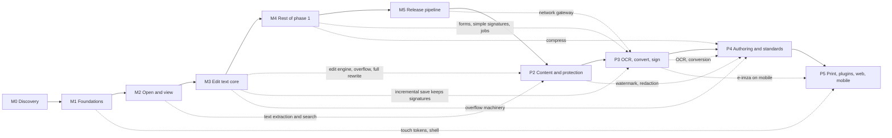

# Ferman roadmap

Status: Milestone 0 is complete and waits for the owner's approval. No application code exists yet.

This document details the roadmap in [brief](BRIEF.md) §7 and covers brief §8 item 4. For every
milestone it gives the goal, the scope from the brief, the deliverables, the artboards it covers,
the engine capabilities and crates, new dependencies, acceptance criteria, the design gaps to settle
and the exit checks.

- The brief's roadmap is fixed. This document only details it. If the two disagree, the brief wins
  and this document has a bug.
- Anything marked **Proposed** is a new decision. It waits for the owner, through an ADR or an entry
  in [QUESTIONS.md](QUESTIONS.md). Until then the brief's wording stands.
- One milestone at a time (brief §9). A milestone starts only after the previous one is accepted.

Related: [architecture](ARCHITECTURE.md) · [design inventory](DESIGN_INVENTORY.md) ·
[design gaps](DESIGN_GAPS.md) · [dependencies](DEPENDENCIES.md) · [questions](QUESTIONS.md) ·
[backlog](BACKLOG.md) · [progress](PROGRESS.md) · [ADRs](adr/README.md)

## Contents

1. [How to read this roadmap](#1-how-to-read-this-roadmap)
2. [Overview](#2-overview)
3. [Rules for every milestone](#3-rules-for-every-milestone)
4. [M0: discovery and plan](#4-m0-discovery-and-plan)
5. [M1: foundations](#5-m1-foundations)
6. [M2: open and view](#6-m2-open-and-view)
7. [M3: edit text core](#7-m3-edit-text-core)
8. [M4: rest of phase 1](#8-m4-rest-of-phase-1)
9. [M5: release pipeline](#9-m5-release-pipeline)
10. [Phase 2: editing content and protecting documents](#10-phase-2-editing-content-and-protecting-documents)
11. [Phase 3: OCR, conversion, certificate signatures and compare](#11-phase-3-ocr-conversion-certificate-signatures-and-compare)
12. [Phase 4: authoring, standards, accessibility, batch and AI](#12-phase-4-authoring-standards-accessibility-batch-and-ai)
13. [Phase 5: print production, plugins, web and mobile](#13-phase-5-print-production-plugins-web-and-mobile)
14. [Not scheduled yet](#14-not-scheduled-yet)
15. [Risk register](#15-risk-register)

## 1. How to read this roadmap

**Codes.** M0 to M5 make up phase 1 (the brief calls M4 "rest of phase 1"). P2 to P5 are the
brief's phases 2 to 5. Step numbers inside a milestone give the order of work.

**Status values.** Not started · In progress · Complete, pending owner approval · Complete.

**Artboards.** Ids are the ones in [DESIGN_INVENTORY.md](DESIGN_INVENTORY.md#5-artboards). Each of
the 223 boards (214 artboards plus 9 fix boards) is listed under exactly one milestone: its primary
milestone. A board can show parts that land later. The inventory row says which, and those parts stay
visible but disabled until they ship.

**Acceptance criteria** are checklists. Each item must be provable by a test, a CI job or a recorded
measurement. A box is ticked only with a link to that evidence (exit check E1). The standard gates
S1 to S9 and exit checks E1 to E8 in [section 3](#3-rules-for-every-milestone) apply to every
milestone from M1 on, in addition to the milestone's own list.

**Reference hardware and budgets** come from [ARCHITECTURE.md §14](ARCHITECTURE.md#14-performance-budgets).
R1 is a MacBook Air with an Apple M1 and 8 GB. R2 is a 2020-class Windows 11 laptop (Core i5-1135G7
class, 8 GB, NVMe SSD). Both are **Proposed**. Flutter numbers come from profile builds, Rust numbers
from release builds.

**Corpus files** used in the criteria have working names. The final names, licences and SHA-256 sums
live in `tests/corpus/README.md` (created in M2). Generated files come from `tools/corpus` and mirror
the design's sample documents ([DESIGN_INVENTORY.md §9](DESIGN_INVENTORY.md#9-fixes-flows-and-sample-documents)).

| Working name | What it is | Source in the design |
|---|---|---|
| `kira-tr` | 3-page Turkish rental contract, subset-embedded fonts, one subset without "ğ" (Madde 6), a tight frame above the IBAN line (Madde 4), three attachments, signature fields on page 3 | `DocKira` |
| `kira-tr-signed`, `kira-tr-signed-changed` | the contract signed (PAdES with a timestamp), and the same file with an incremental update after signing | "Kira sözleşmesi — imzalı.pdf", "… imzalı (2).pdf" |
| `kira-tr-damaged` | broken cross-reference table; page 3 uses a non-embedded TimesNewRomanPSMT | "Kira sözleşmesi (eski).pdf" |
| `ekstre-tr` | 2-page bank statement with a transaction table, checksum-valid fictitious T.C. Kimlik No and IBAN, metadata and earlier revisions | `DocEkstre` |
| `form-aks1-tr`, `form-aks1-flat` | 1-page e-Devlet AcroForm with 20 fields (15 required), and a flat twin with no form fields | `DocForm` ([G59](DESIGN_GAPS.md#g59)) |
| `fatura-tr` | 1-page e-Arşiv invoice with a real column layout and dependent totals | `a3-9` |
| `tez-tr` | 64-page tagged thesis: nested outline, page labels, Turkish with an English block quote | thesis in `a2-1d`, `a2-3a`, `a3-14` |
| `cv-tr` | untagged 1-page CV with a photo, a low-contrast line and visual-only lists | `DocCv` |
| `plan-tr` | vector floor plan at a known 1:75 scale | `DocPlan` |
| `nda-en` | 4-page English contract with a digital signature | "Mutual NDA — Northwind.pdf" |
| `mietvertrag-de` | 6-page German contract with umlauts and ß | "Mietvertrag Berlin.pdf" |
| `report-ar` | 12-page Arabic report with an embedded Arabic font and mixed left-to-right numbers | "التقرير السنوي 2025.pdf" |
| `letter-ja-vertical` | Japanese letter with vertical text (縦書き), tate-chu-yoko and kinsoku | `a3-15` |
| `quote-ja-scan`, `scan-tr` | image-only scans: a 2-page Japanese quotation and a 3-page Turkish letter | "見積書_2026-10.pdf", "Kira artış bildirimi (tarama).pdf" |
| `payslip-aes256` | AES-256 encrypted payslip whose password contains ı, ş and ü | "Maaş bordrosu Eylül 2026.pdf" |
| `imar-2400` | generated 2,400-page report | "İmar planı açıklama raporu.pdf" (`a1-7`) |
| `long-500` | generated 500-page text document for the performance budgets | [ARCHITECTURE.md §14](ARCHITECTURE.md#14-performance-budgets) |
| `truncated` | file cut off at 18 KB, not repairable | "Tarama_0042.pdf" (`a1-9b`) |
| `xfa-visa` | dynamic XFA-only form | "Vize başvuru formu.pdf" (`a11-7c`) |
| `preflight-x4` | generated print file with seeded PDF/X-4 issues (an RGB image, a font that is not embedded, a missing bleed box, ink coverage over the limit) and roman page labels | thesis in `a9-4b` |
| `separations-cmyk` | generated CMYK page with one spot colour (PANTONE 2945 C), overprinting black text and known ink coverage per area | `a9-6d` |
| `office-sources` | freely licensed Word, Excel and PowerPoint source files (`.docx`, `.odt`, `.xlsx`, `.ods`, `.pptx`, `.odp`), each with the PDF its own application exports | `a7-1` "To PDF" |
| script samples | generated paragraphs: `fa-zwnj` (Persian with ZWNJ), `he-para` (Hebrew), `zh-hans`, `zh-hant`, `ko-para` | brief §1 languages |
| real-world set | freely licensed files from Word, Google Docs, LibreOffice, LaTeX, scanners, forms, signed, encrypted and damaged files | brief §5 |

## 2. Overview

| Code | Name | Goal in one line | Status | Boards | Needs first |
|---|---|---|---|---|---|
| M0 | Discovery and plan | Inventory the design, fix the architecture, plan the work (docs only) | Complete, pending owner approval | 0 | — |
| M1 | Foundations | An empty Ferman shell that matches the design, talks to the engine, and is built by green CI on three systems | Not started | 13 | M0 approval; [Q01](QUESTIONS.md#q01) and [Q03](QUESTIONS.md#q03) wanted (a marked placeholder and the proposal are allowed) |
| M2 | Open and view | Open any PDF safely and view, navigate and search it fast | Not started | 28 | M1; approval of [ADR 0009](adr/0009-threading-and-jobs.md) (otherwise M2 stops for a decision before step 1); [Q07](QUESTIONS.md#q07); [Q17](QUESTIONS.md#q17) (desktop_drop and `fuzz/`) |
| M3 | Edit text core | Click any text and edit it; save without ever corrupting the file | Not started | 31 | M2; [Q04](QUESTIONS.md#q04), [Q07](QUESTIONS.md#q07), [Q09](QUESTIONS.md#q09) |
| M4 | Rest of phase 1 | Organize, comment, fill, sign simply, compress and the full app frame | Not started | 36 | M3 |
| M5 | Release pipeline | Signed, notarized, updatable releases on GitHub, Homebrew and winget | Not started | 4 | M4; [Q02](QUESTIONS.md#q02), [Q15](QUESTIONS.md#q15) |
| P2 | Phase 2 | Add text and images, find and replace, page marks, redaction, hidden information | Not started | 18 | M5 |
| P3 | Phase 3 | OCR, conversion, certificate signatures, e-imza, validation, compare | Not started | 23 | P2; [Q06](QUESTIONS.md#q06), [Q16](QUESTIONS.md#q16) |
| P4 | Phase 4 | Form authoring, PDF/A and preflight, PDF/UA tools, batch, translation, local AI | Not started | 17 | P3 |
| P5 | Phase 5 | Print production, plugins, then web, then tablet and mobile | Not started | 53 | P4 |
| | | | | **223** | |

The milestones run in this order. The dotted edges show which capability each later milestone takes
from an earlier one, so a slip in one place shows where it lands.

| Milestone | Takes from earlier milestones |
|---|---|
| M2 | M1: CI, bridge, tokens, components, shell, l10n |
| M3 | M2: open path, interpreter read path, ToUnicode and encodings, words and lines, render keys, tiles, signature detection |
| M4 | M3: transactions and undo, incremental save, recovery journal, review list; M2: thumbnails and jobs |
| M5 | M1: CI matrix; M4: the notices screen and full settings |
| P2 | M2: search; M3: edit engine, missing-glyph steps, full rewrite (redaction always rewrites) |
| P3 | M3: incremental save; M4: signature fields, simple signatures, background tasks; M5: network gateway (timestamps, language packs) |
| P4 | M3: overflow (translation); M4: compress; P2: watermark and redaction; P3: OCR and conversion (batch steps) |
| P5 | Everything above. Mobile e-imza over NFC needs P3. |

## 3. Rules for every milestone

### 3.1 Working rhythm

From brief §9: plan the milestone in [PROGRESS.md](PROGRESS.md), implement, test, update the docs,
commit in small Conventional Commits, push, then stop with a summary for the owner. Ask the owner
before changing an architectural decision, adding a dependency with an unusual licence, touching
`design/`, or deleting work someone else created. Put open questions in [QUESTIONS.md](QUESTIONS.md)
and continue with the safest option.

### 3.2 Standard gates (part of every milestone's acceptance from M1 on)

- [ ] **S1 CI green** on macOS, Windows and Linux: `cargo fmt --all --check`,
  `cargo clippy --workspace --all-targets -- -D warnings`, `cargo test --workspace`,
  `cargo deny check`, `flutter analyze` with zero issues, `flutter test`, and the desktop build for
  each system.
- [ ] **S2 Rust quality**: no `unwrap`, `expect`, `panic`, `todo` or `unimplemented` in library code
  (Clippy lints denied outside tests); `thiserror` errors; every public item documented; unit and
  integration tests for new code ([ADR 0010](adr/0010-error-handling-no-panics.md)).
- [ ] **S3 Fuzzing** (from M2): every new parser has a cargo-fuzz target; the pull-request smoke run
  of every target is clean.
- [ ] **S4 Goldens**: every screen implemented or changed in the milestone has alchemist goldens in
  light and dark × en, tr and ar, with the real bundled fonts, compared with `build/design-refs/`.
- [ ] **S5 Strings**: every UI string is in `app_en.arb` and `app_tr.arb` (Turkish complete, CI
  key-parity check); Arabic exists for every string in the goldens and is reviewed by a native
  speaker; nothing is machine-translated silently.
- [ ] **S6 Flutter rules** (CI checks): no colour, size, radius or duration literals in widgets
  outside `app/lib/design/`; no Material or Cupertino dialog implementations, no `TabBarView`, no
  GetX; `EdgeInsetsDirectional` and `AlignmentDirectional` only; form validators return `bool` and
  check null and empty values explicitly.
- [ ] **S7 Dependencies**: every new dependency is in [DEPENDENCIES.md](DEPENDENCIES.md) with version
  and licence; `cargo deny check` and the Dart licence check (`very_good packages check licenses`)
  pass; nothing AGPL, non-commercial, MuPDF or Ghostscript ([ADR 0016](adr/0016-dependency-licence-policy.md)).
- [ ] **S8 Budgets**: every performance budget that applies to the milestone is measured on R1 and
  R2, recorded in [PROGRESS.md](PROGRESS.md), and guarded by a CI benchmark where
  [ARCHITECTURE.md §14](ARCHITECTURE.md#14-performance-budgets) defines one.
- [ ] **S9 Honest UI**: every entry point that does not work yet is visible exactly as designed,
  disabled, with the tooltip "Available in a future version", and has an entry in
  [BACKLOG.md](BACKLOG.md). **Proposed:** one feature registry in Dart drives these disabled states,
  and a CI script checks that every disabled feature in it has a BACKLOG entry.

### 3.3 Standard exit checks

- [ ] **E1** This roadmap: the milestone's status is updated and every ticked box links to its
  evidence (CI run, test name or measurement).
- [ ] **E2** [PROGRESS.md](PROGRESS.md): milestone ticked, session log written, next step named.
- [ ] **E3** [ARCHITECTURE.md](ARCHITECTURE.md) and the ADRs describe what was built. New decisions
  are recorded as Proposed ADRs, and architecture changes wait for the owner.
- [ ] **E4** [DESIGN_GAPS.md](DESIGN_GAPS.md): every conflict or gap met during the milestone is
  recorded with the option chosen; the entries listed for the milestone are resolved or decided.
- [ ] **E5** [BACKLOG.md](BACKLOG.md): every disabled entry point, deferred state and skipped item is
  listed. Nothing is silently skipped.
- [ ] **E6** [QUESTIONS.md](QUESTIONS.md), [DEPENDENCIES.md](DEPENDENCIES.md) and the commands in
  [CLAUDE.md](../CLAUDE.md) are current.
- [ ] **E7** Work is committed in small Conventional Commits and pushed; CI is green on the pushed
  branch.
- [ ] **E8** A short summary goes to the owner. The next milestone waits for the owner's go-ahead.

## 4. M0: discovery and plan

**Status:** Complete, pending owner approval. **Boards:** none; this milestone produced the
inventory.

### Goal

Understand the design completely, fix the architecture in writing, and plan every later milestone,
without writing application code (brief §8).

### Scope (brief §7)

> M0 Discovery and plan (docs only).

### Deliverables

| File | Content |
|---|---|
| [docs/BRIEF.md](BRIEF.md) | the owner's brief, verbatim |
| [docs/DESIGN_INVENTORY.md](DESIGN_INVENTORY.md) | all 223 boards mapped to feature, milestone and engine capability; tokens, components, icons, fonts, flows, fixes, sample documents; missing screens and states |
| [docs/ARCHITECTURE.md](ARCHITECTURE.md) | crates, API boundary, threading, data flow, text editing pipeline, file safety, errors, security, privacy, localization, platform integration, testing strategy, performance budgets, risks |
| [docs/adr/](adr/README.md) | index, template and ADRs 0001 to 0018; decisions from the brief are "Accepted (brief)", new ones are "Proposed" (0007, 0009, 0018, and 0013 in part) |
| docs/ROADMAP.md | this document |
| [docs/PROGRESS.md](PROGRESS.md) | milestone checklist and session log |
| [docs/DEPENDENCIES.md](DEPENDENCIES.md) | licence policy, planned dependencies per milestone with versions and licences, bundled assets, proposed `deny.toml` |
| [docs/DESIGN_GAPS.md](DESIGN_GAPS.md) | 61 verified gaps and conflicts, G01 to G61 (G61 from the review of the documents), each with the option chosen |
| [docs/QUESTIONS.md](QUESTIONS.md) | 17 questions for the owner, Q01 to Q17 |
| [docs/BACKLOG.md](BACKLOG.md) | entry format only; empty until M1 disables its first feature |
| [CLAUDE.md](../CLAUDE.md), [.claude/rules/rust.md](../.claude/rules/rust.md), [.claude/rules/flutter.md](../.claude/rules/flutter.md) | session rules, repo map, definition of done; path-scoped Rust and Flutter rules |
| [README.md](../README.md), [LICENSE](../LICENSE), [CONTRIBUTING.md](../CONTRIBUTING.md), [CODE_OF_CONDUCT.md](../CODE_OF_CONDUCT.md), [SECURITY.md](../SECURITY.md), [THIRD_PARTY_NOTICES.md](../THIRD_PARTY_NOTICES.md), `.gitignore` | community files; Apache-2.0 licence text; licence texts for the third-party material inside `design/` |

The brief asks for empty DESIGN_GAPS.md and QUESTIONS.md files. During planning the owner chose to
fill them with the verified M0 findings instead. BACKLOG.md stays an empty template.

### Acceptance criteria

- [x] BRIEF.md holds the brief verbatim, sections 1 to 9.
- [x] Every one of the 223 boards appears in DESIGN_INVENTORY.md with a primary milestone; missing
  screens and states are flagged and linked to DESIGN_GAPS.md.
- [x] ARCHITECTURE.md covers crates, API boundary, threading, data flow, file safety, error handling,
  testing strategy and performance budgets (brief §8 item 3), with ADRs for the main decisions.
- [x] This roadmap gives every milestone acceptance criteria (brief §7).
- [x] CLAUDE.md is under 200 lines; the rules files carry `paths:` frontmatter for `crates/**` and
  `app/**`.
- [x] Nothing under `design/` was changed, moved or deleted.
- [x] No application code: no `Cargo.toml`, `pubspec.yaml`, `.rs`, `.dart` or CI workflow files.

### Exit checks

- [ ] Committed and pushed; summary and questions sent to the owner (brief §8 item 7).
- [ ] The owner approves M0. No application code is written before that.
- [ ] The owner answers at least [Q01](QUESTIONS.md#q01) bundle identifier, [Q02](QUESTIONS.md#q02)
  code-signing publisher name and [Q03](QUESTIONS.md#q03) minimum OS versions. Q01 and Q03 are
  wanted before M1 step 2; until then a marked placeholder (Q01) and the proposal (Q03) are used.
  Both are final before M5; Q02 is needed before M5.
- [ ] Proposed ADRs (0007, 0009, 0013 in part, 0018), the Proposed details in 0003, 0004, 0006 and
  0008, and the licence exceptions in [Q17](QUESTIONS.md#q17) are approved, changed or rejected, or
  carried into M1 as open questions with the safest option in force.
- [ ] The owner enables GitHub private vulnerability reporting, which [SECURITY.md](../SECURITY.md)
  and [CODE_OF_CONDUCT.md](../CODE_OF_CONDUCT.md) rely on (see
  [PROGRESS.md](PROGRESS.md#owner-actions)).

## 5. M1: foundations

**Status:** Not started. **Needs first:** owner approval of M0; [Q01](QUESTIONS.md#q01) bundle
identifier and [Q03](QUESTIONS.md#q03) minimum OS versions are wanted before step 2 (until then a
marked placeholder and the proposal are used; both are final before M5); [Q08](QUESTIONS.md#q08)
before Hebrew and Devanagari fonts ship in step 5; [Q12](QUESTIONS.md#q12) before the Linux title
bar in step 8; [Q17](QUESTIONS.md#q17) for the Swatinem/rust-cache CI action (until then
actions/cache or no cache); [Q14](QUESTIONS.md#q14) for the copyright line.

### Goal

A Ferman window that starts on macOS, Windows and Linux, matches the design's shell, start screen
and settings skeleton in light and dark, in English, Turkish and Arabic, calls the Rust engine through
the bridge, and is built and tested by green CI on all three systems. It opens no PDFs yet.

### Scope (brief §7)

> M1 Foundations: workspace, Flutter app, bridge, token pipeline, component library, light/dark
> themes, l10n (en, tr, ar), app shell (title bar, document tabs, mode tabs, tool row, sidebars,
> canvas, right panel, status bar), start screen, settings skeleton, CI green.

### Deliverables

- Cargo workspace with the seven crates of brief §3, `rust-toolchain.toml` (Rust 1.99.0),
  `deny.toml`, `.github/workflows/` CI on macOS, Windows and Linux.
- Flutter app in `app/` for macOS, Windows, Linux and web, wired to `ferman-api` through
  flutter_rust_bridge 2.13.0.
- `tools/tokens` and the generated `app/lib/design/tokens.g.dart` with `ThemeExtension`s;
  `tools/icons` with 229 SVG icons; IBM Plex fonts with licence files; `tools/design-refs`;
  `tools/pdfium` with the pinned PDFium binaries.
- The Ferman component library in `app/lib/design/components/`, 1:1 with the design system (same
  names, variants and states, [ADR 0011](adr/0011-flutter-state-navigation-components.md)).
- The app shell, first-run screens, the empty start screen and the settings skeleton.
- gen-l10n with English (source), Turkish (complete) and Arabic; right-to-left; locale-aware casing.
- The golden matrix for every M1 screen.

### Artboards covered

- **00 Fixes** (2): `f6`, `f6a`
- **01 First run and files** (4): `a1-1`, `a1-2b`, `a1-2c`, `a1-5`
- **11a Settings** (3): `a11-1`, `a11-1w`, `a11-1b`
- **12 Localization** (4): `a12-2a`, `a12-2b`, `a12-2c`, `a12-2d`

13 boards.

Notes on these boards:

- `a12-2b` and `a12-2d` are German. German is not translated in M1; brief §6 says other languages
  fall back to English until volunteers translate them. These boards serve as text-expansion
  references (step 10).
- `a1-2a` (welcome, step 1 of 3) is an M3 board because its specimen shows live editing. M1 builds
  the onboarding frame with steps 2 and 3; the first-run flow goes from the language picker to step 2
  until M3 adds step 1.
- Copy that changes in the app: `a1-2c` and `a11-5` say GPL-3.0; the app says Apache-2.0
  ([G13](DESIGN_GAPS.md#g13)). `a1-2c` marks every feature as included; features that have not
  shipped are shown as coming in a future version, not "Included" ([G12](DESIGN_GAPS.md#g12)).
  `a1-2b` names only the update check; the app lists all four network uses the brief allows
  ([G24](DESIGN_GAPS.md#g24)).
- The macOS editor shell has no M1 board of its own. Its chrome is checked against `FmWindow` as drawn
  in `a2-1b` (light) and `a3-1d` (dark), with the canvas masked.

### Engine capabilities and crates

- All seven crates exist with the module layout of [ARCHITECTURE.md §2.3](ARCHITECTURE.md#23-crates-in-detail),
  the workspace lint set, crate docs and at least one test each.
- `ferman-api`: the pure-Rust facade plus the `frb` feature. Two calls: `api_version()` (the only
  synchronous call) and an async `engine_info()` that returns versions and build profile.
- `ApiError { kind, message_key, details }` skeleton and `catch_unwind` at the boundary
  ([ADR 0010](adr/0010-error-handling-no-panics.md)).
- `ferman-cli`: `ferman --version` and `ferman info --json`, both through the facade.
- `ferman-render`: a skeleton render thread that loads PDFium and reports its version
  ([ADR 0009](adr/0009-threading-and-jobs.md)). No PDF parsing or rendering yet.

### New dependencies

Versions and licences were verified on 2026-10-13; [DEPENDENCIES.md](DEPENDENCIES.md) is the record.

| Kind | Dependency | Licence | Notes |
|---|---|---|---|
| Rust | flutter_rust_bridge `=2.13.0` | MIT | crate, Dart package and codegen must be the same version; allo-isolate needs a cargo-deny clarify entry |
| Rust | thiserror 2.0, tracing 0.1 and tracing-subscriber | MIT OR Apache-2.0; MIT | errors and local logs |
| Rust (dev) | proptest 1.12, insta 1.49 | MIT OR Apache-2.0; Apache-2.0 | property and snapshot tests |
| Rust | argument parser for ferman-cli | to check | chosen and licence-checked in step 1 |
| Rust | pdfium-render 0.9.4 | MIT OR Apache-2.0 | default features off; `pdfium_7881` and `thread_safe` on |
| Binary | PDFium from bblanchon/pdfium-binaries, tag `chromium/7881`, non-V8, non-XFA | BSD-3-Clause AND Apache-2.0, plus bundled third-party notices | SHA-256 pinned per archive; the archive's `licenses/` folder (PDFium's own licence in `licenses/pdfium.txt`) and the packager's MIT `LICENSE` ship with the app |
| Dart | flutter_riverpod 3.4, riverpod_annotation 4, riverpod_generator 4, build_runner 2.16 | MIT; BSD-3-Clause | state with code generation ([ADR 0011](adr/0011-flutter-state-navigation-components.md)) |
| Dart | riverpod_lint 3.1.9 | MIT | analyzer plugin; custom_lint is not used |
| Dart | go_router 18, very_good_analysis 11 | BSD-3-Clause; MIT | navigation; lints |
| Dart | intl 0.20, flutter_localizations (SDK) | BSD-3-Clause | gen-l10n, dates and numbers |
| Dart | window_manager 0.5, flutter_svg 2.3, path_provider 2.1 | MIT; MIT; BSD-3-Clause | custom title bars; icons; app directories |
| Dart (dev) | alchemist 0.14, mocktail 1.0 | MIT | goldens (golden_toolkit is discontinued); mocks |
| Dart | flutter_rust_bridge 2.13.0 | MIT | Dart side of the bridge |
| Dart | shared_preferences 2.5 | BSD-3-Clause | only if step 9 chooses it for settings |
| Tools | Rust 1.99.0, Flutter 3.47.7 / Dart 3.13.5, Node 24 LTS, Playwright 1.64, cargo-deny 0.20, very_good_cli 1.5, flutter_rust_bridge_codegen 2.13.0 | various permissive | never shipped |
| CI | actions/checkout, dtolnay/rust-toolchain, subosito/flutter-action, EmbarkStudios/cargo-deny-action, and a Cargo cache: Swatinem/rust-cache only if [Q17](QUESTIONS.md#q17) approves its LGPL-3.0 licence, otherwise actions/cache (MIT) or none | MIT or MIT OR Apache-2.0; rust-cache is LGPL-3.0 | pinned by commit SHA; rust-cache runs only in CI and is never distributed |
| Assets | IBM Plex TTFs | OFL-1.1 | unmodified files, Reserved Font Name "Plex" ([ADR 0013](adr/0013-fonts-and-icons.md)) |
| Assets | the design's icon path data | Lucide ISC, Feather MIT | provenance table for non-Lucide glyphs |
| Tool only | React 18.3.1, ReactDOM 18.3.1, Babel standalone 7.29.0, the font families the export loads from Google Fonts | MIT; fonts OFL-1.1, Homemade Apple Apache-2.0 | vendored for `tools/design-refs`; licences checked before vendoring; never in the app |

### Steps

Each step ends with CI green. Strings go through ARB files from step 2 on, so steps 7 to 9 never add
hardcoded text; step 10 completes the translations.

#### Step 1. Cargo workspace, crate skeletons, toolchain, cargo-deny, CI matrix

Deliverables: workspace `Cargo.toml` with `ferman-core`, `ferman-render`, `ferman-text`,
`ferman-fonts`, `ferman-ops`, `ferman-api`, `ferman-cli`; `rust-toolchain.toml` pinning 1.99.0 with
rustfmt and clippy; workspace lints (`unwrap_used`, `expect_used`, `panic`, `todo`, `unimplemented`
denied outside tests; `missing_docs` as a warning, which `-D warnings` turns into an error);
`deny.toml` from [DEPENDENCIES.md](DEPENDENCIES.md); CI workflow with the three-system matrix; a
`tests/corpus/README.md` skeleton with the provenance format.

Unsafe code: `forbid(unsafe_code)` at the root of every crate except ferman-api. ferman-api uses
`#![deny(unsafe_code)]`, with `#[allow(unsafe_code)]` only on the FRB-generated module behind its
`frb` feature. The generated glue needs `extern "C"` exports and `unsafe` blocks, and an inner
`allow` cannot override `forbid`. This is the documented exception that
[ADR 0002](adr/0002-rust-engine-flutter-ui-frb.md) allows.

- [ ] `cargo build`, `cargo test`, `cargo fmt --all --check` and
  `cargo clippy --workspace --all-targets -- -D warnings` pass on macOS, Windows and Linux in CI.
- [ ] `cargo deny check` passes for licences, bans, advisories and sources. The bans list holds
  `pdfium` (GPL-3.0), `mupdf`, `mupdf-sys`, `jbig2dec`, the poppler bindings, `magick_rust`,
  `libheif-sys` and `ffmpeg-sys-next`. `rustybuzz` is banned outside krilla's wrapper only if the
  owner approves ADR 0007; until then the brief's rustybuzz stays allowed.
- [ ] The workspace declares `rust-version` and the toolchain file pins 1.99.0; CI reads the
  toolchain from the file.
- [ ] Every crate root except ferman-api forbids unsafe code, and ferman-api denies it (CI check of
  the crate roots).
- [ ] **Proposed:** a script reads `cargo metadata` and fails on any crate edge not allowed by
  [ARCHITECTURE.md §2.2](ARCHITECTURE.md#22-dependency-graph).
- [ ] `ferman --version` prints the app version and API version on all three systems.
- [ ] Every GitHub Action is pinned by commit SHA.

#### Step 2. Flutter app skeleton

Deliverables: `app/` with macOS, Windows, Linux and web targets; `analysis_options.yaml` with
very_good_analysis 11 and the riverpod_lint plugin; Riverpod code generation; go_router routes for
start, document and settings; gen-l10n with `app_en.arb`; bundle identifier from Q01 and minimum OS
versions from Q03 in the platform projects (a marked placeholder plus a BACKLOG entry while either
question is open).

- [ ] `flutter analyze` reports zero issues and `flutter test` passes on all three systems.
- [ ] `flutter build macos`, `flutter build windows` and `flutter build linux` succeed in CI, and a
  smoke integration test starts each build and finds the root widget.
- [ ] CI pins Flutter 3.47.7; `pubspec.yaml` requires Dart 3.13.5 or later.
- [ ] CI runs build_runner and fails if any generated file differs from the committed one.
- [ ] `very_good packages check licenses` passes with the allow-list in DEPENDENCIES.md.
- [ ] **Proposed:** CI fails if `pubspec.lock` contains a package from the network deny list: HTTP
  clients, font downloaders such as google_fonts, analytics and crash-reporting SDKs
  ([ADR 0015](adr/0015-privacy-and-network.md)).
- [ ] **Proposed:** CI compiles the web target with the engine stubbed, so the web path stays
  buildable until phase 5.

#### Step 3. flutter_rust_bridge wiring

Deliverables: FRB 2.13.0 codegen configured to scan only the `frb` module of `ferman-api`;
`app/lib/bridge/` (generated, never edited) and `app/lib/engine/` (the only Dart code that imports
the bridge); an API version check at start-up; `tools/pdfium` and the skeleton render thread.

- [ ] The Rust crate, the Dart package and the codegen are all 2.13.0; a CI check compares the three.
- [ ] CI regenerates the bindings and fails if they differ from the committed ones.
- [ ] ferman-api builds with the `frb` feature on and off, and a CI check fails on any
  `allow(unsafe_code)` outside the FRB-generated module (step 1).
- [ ] An integration test on each system calls `engine_info()` from Dart and gets the expected
  values.
- [ ] A panic in a test-only Rust call reaches Dart as an error and the app keeps running.
- [ ] Zero-copy check: a 1 MB byte vector crosses from Rust to Dart in under 0.2 ms on R1 and R2
  ([ARCHITECTURE.md §3.4](ARCHITECTURE.md#34-tiles)). If it does not, the texture-registry fallback
  is designed and recorded in [ADR 0009](adr/0009-threading-and-jobs.md) before M2 starts.
- [ ] A CI import check fails if any file outside `app/lib/engine/` imports `app/lib/bridge/`.
- [ ] `tools/pdfium` downloads `chromium/7881` for macOS (arm64 and x64, combined universal), Windows
  (x64, arm64) and Linux (x64, arm64), checks a pinned SHA-256 per archive, and fails on a mismatch.
- [ ] The skeleton render thread loads the bundled PDFium on all three systems in CI, and
  `engine_info()` reports its version.

#### Step 4. Token generator

Deliverables: `tools/tokens` ([ADR 0012](adr/0012-design-token-pipeline.md)) reading
`tokens/*.css` and `ds-additions/fm-additions.css`, which is not merged into the DS files
([G05](DESIGN_GAPS.md#g05)); generated `app/lib/design/tokens.g.dart`; `app/lib/design/theme.dart`
with `ThemeExtension`s for light, dark, page dim, touch density, reduced motion and the CJK type
overrides.

- [ ] All 269 unique token names are generated: colours (132 in `:root`, 48 dark, 1 dim),
  typography (41), spacing (34, plus 12 touch), effects (31, plus 5 dark and 4 reduced-motion), and
  `fm-additions.css` (31 new tokens, 3 overrides, 5 CJK leading overrides, 1 dark). A test counts
  them against the CSS sources.
- [ ] Every mapping issue in [DESIGN_INVENTORY.md §6](DESIGN_INVENTORY.md#6-design-system) has a
  documented rule and a test: rgba overlays, multi-layer shadows with rings, the two-layer focus
  ring, cubic-bezier easings, the CSS `font` shorthand, `var()` chains, `--page-filter` as a colour
  matrix, hatch patterns, and kebab-case name collisions (`--text-*`, `--icon-*`).
- [ ] Two runs give byte-identical output; CI fails if `tokens.g.dart` is stale.
- [ ] Light, dark and "match system" switch at run time without a restart; when the OS asks for
  reduced motion, durations come from the reduced-motion tokens (widget test).
- [ ] The S6 literal check is active: a colour, size, radius or duration literal in widget code
  outside `app/lib/design/` fails CI.

#### Step 5. Fonts and icons

Deliverables ([ADR 0013](adr/0013-fonts-and-icons.md)): `app/assets/fonts/` with IBM's unmodified
static TTFs (Plex Sans 400/500/600, Plex Serif, Plex Mono and Plex Sans Arabic, plus Plex Sans
Hebrew and Plex Sans Devanagari if Q08 approves them) and an OFL text per family;
`app/assets/icons/` with 229 SVGs written by `tools/icons` from `ICON_PATHS` and `fm-icons.js`, a
provenance table, and the Lucide ISC and Feather MIT notices; LicenseRegistry entries for every
bundled asset. The design's woff2 subsets are not used ([G06](DESIGN_GAPS.md#g06)).

- [ ] Each font file's SHA-256 equals the IBM upstream release file it came from (recorded in
  DEPENDENCIES.md). No bundled font is subset, renamed or modified.
- [ ] A coverage test reads each font's cmap: Plex Sans covers Latin including Turkish and
  Vietnamese, Cyrillic and Greek; Plex Sans Arabic covers Arabic and Persian. A golden of
  "İMZALA ğ ş ı · Tiếng Việt · Русский · Ελληνικά · العربية · فارسی" shows no fallback glyphs.
- [ ] Japanese, Korean, Simplified and Traditional Chinese samples render with the system fonts of
  ADR 0013 and the right locale per text style, checked by hand on R1, R2 and a Linux machine and
  recorded in PROGRESS.md (Traditional Chinese must not show Simplified forms, [G07](DESIGN_GAPS.md#g07)).
- [ ] Exactly 229 icons are generated; a test fails if the count or any path differs from the design
  source. The provenance table names the matching Lucide release (0.460.0, 1.56.0, 0.500.0 or
  0.300.0) for each of the 84 added glyphs, and "Ferman design" for ellipse alone
  ([G04](DESIGN_GAPS.md#g04), [G60](DESIGN_GAPS.md#g60)).
- [ ] Icons draw with a 1.5 px stroke as the DS specifies, and mirror in right-to-left exactly for
  the icons the design flips.
- [ ] **Proposed** (the step 2 network deny list): the app never fetches fonts; CI fails if
  `pubspec.lock` contains google_fonts or another font downloader.
- [ ] Every bundled licence text appears through Flutter's LicenseRegistry (widget test)
  ([G08](DESIGN_GAPS.md#g08)).

#### Step 6. Design references

Deliverables: `tools/design-refs` on Node 24 and Playwright 1.64 with a lockfile; vendored React
18.3.1, ReactDOM 18.3.1, Babel standalone 7.29.0 and the fonts the export loads at run time, each with
its licence; one PNG per board in `build/design-refs/` (gitignored).

- [ ] All 223 boards render, one PNG per board id, captured from the element that carries
  `data-fm-artboard`; the DS additions sheet renders too. A count check fails if an id is missing.
- [ ] The run is offline: requests for unpkg.com and fonts.googleapis.com are answered from the
  vendored copies, and any other non-local request fails the run ([G07](DESIGN_GAPS.md#g07)).
- [ ] Two runs on the same machine give pixel-identical PNGs.
- [ ] Nothing under `design/` changes (CI checks `git diff --stat -- design/` is empty).
- [ ] None of the vendored files ends up in an app build (CI scans the build output).

#### Step 7. Component library

Deliverables: `app/lib/design/components/` with one widget per visual DS component (the 42 visual entries of the 45 in the
manifest, plus the internal Field, Popover and Scrim; the data constants `ICON_PATHS`, `FERMAN_MODES` and
`ANNOTATION_TOOLS` become the generated `IconName`, `FermanMode` and `AnnotationTool` enums) and the DS additions as widgets (FmNumber, document tabs,
window chrome, thumbnail badges and legend, date-picker popover, mention list, status-bar save
indicator); a component spec of props, variants and states taken from `_ds_bundle.js` and
`_adherence.oxlintrc.json` ([G02](DESIGN_GAPS.md#g02)); a debug-only gallery route for review.

- [ ] Every component exists under its design-system name (Button, IconButton, ToolButton and so on;
  the `Fm*` shell building blocks and `FmNumber` keep their `Fm` names), with every variant and
  state in the spec ([ADR 0011](adr/0011-flutter-state-navigation-components.md)). A test walks the
  spec and fails on anything missing.
- [ ] Widget tests cover every state, including focus-visible ([G22](DESIGN_GAPS.md#g22)) and a
  disabled state with the tooltip "Available in a future version" for Button, IconButton,
  ToolButton, menu items and SegmentedControl options ([G10](DESIGN_GAPS.md#g10)).
- [ ] Goldens for every component in light and dark, and in right-to-left for directional ones.
- [ ] Keyboard and screen readers: every interactive component is reachable with Tab, works with the
  keys its role implies (Enter, Space, arrows, Esc), and has a Semantics label (widget tests)
  ([G23](DESIGN_GAPS.md#g23)).
- [ ] Dialogs, menus, popovers, tooltips and toasts are components from this library; the S6 check is
  active for `showDialog`, `AlertDialog`, `SimpleDialog`, `CupertinoAlertDialog`, `TabBarView` and
  GetX.
- [ ] Components that need the engine later (SignaturePad, Stamp, PdfFormField, CommandPalette and
  others) are complete visually, with every state, and take their data through parameters.

#### Step 8. App shell

Deliverables: `app/lib/features/shell/` with the title bar, document tab strip, mode bar, one tool
row per mode, sidebar, canvas placeholder, right panel and status bar, built from `FmWindow`
([G01](DESIGN_GAPS.md#g01)); one shortcut table bound through `Shortcuts` and `Actions`.

- [ ] Sizes match `FmWindow` at 1440 × 900: title bar 38 px, mode bar 40 px, tool row 44 px, sidebar
  216 px, right panel 264 px, status bar 26 px. Goldens line up with the references for `f6` and
  `f6a` (Windows) and with the chrome of `a2-1b` and `a3-1d` (macOS); every difference is fixed or
  recorded in DESIGN_GAPS.md.
- [ ] Eight mode tabs in the designed order: View, Edit, Comment, Fill & Sign, Organize, Convert,
  Protect, Tools ([G09](DESIGN_GAPS.md#g09), [Q05](QUESTIONS.md#q05)). Mode tabs and sidebar tabs are
  custom segmented controls over an `IndexedStack`; a widget test shows each mode keeps its state
  when the user switches away and back.
- [ ] Every tool in every tool row is visible as drawn. Tools that do not work yet are disabled with
  the future-version tooltip and listed in BACKLOG.md (S9).
- [ ] Document tabs show the active, idle, unsaved, loading and "+N" overflow states with placeholder
  data, and "+" opens nothing yet (disabled with the tooltip until M2).
- [ ] Windows: caption buttons 46 px wide, close turns red on hover, window corners 8 px, the area
  between the tabs and Search drags the window, and snap layouts appear on hover over maximize on
  Windows 11 (checked by hand on R2 and recorded).
- [ ] macOS: traffic lights sit where the design puts them; full screen works.
- [ ] Linux: the title bar follows the answer to Q12. Until then, native decorations plus a BACKLOG
  entry; the proposal is client-side decorations with caption buttons at the end, Ctrl shortcuts and
  Cancel-left dialog order ([G15](DESIGN_GAPS.md#g15)).
- [ ] Every action in the shortcut table appears in its tooltip and menu as ⌘, ⌥, ⇧ on macOS and
  Ctrl, Alt, Shift on Windows and Linux. A test fails on any duplicate binding per platform; the ⌥⌘S
  collision is resolved before this step ([G44](DESIGN_GAPS.md#g44)).
- [ ] Focus moves in visual order: title bar, mode bar, tool row, sidebar, canvas, right panel,
  status bar (widget test). Every control has a Semantics label.
- [ ] **Proposed:** at a minimum window width of 1024 px nothing overlaps; the tool row collapses to
  icons with an overflow menu and the panels collapse ([G21](DESIGN_GAPS.md#g21)).

#### Step 9. Start screen and settings skeleton

Deliverables: `features/onboarding` (`a1-1`, `a1-2b`, `a1-2c`), `features/start` (the empty state of
`a1-5`), `features/settings` (the settings window with its navigation, the General and Language and
region panes, a Privacy skeleton, the other panes present and disabled); settings storage, chosen
in this step and recorded in ARCHITECTURE.md as [ADR 0011](adr/0011-flutter-state-navigation-components.md)
asks (shared_preferences with its async API, or a settings file owned by the Rust core so the CLI and
later platforms share it).

- [ ] The start screen matches `a1-5` and `a12-2a` in goldens. Open file…, Create PDF, Combine files,
  Scan to PDF, the quick tools and the drop strip are visible and disabled with the tooltip until
  their milestones ([G11](DESIGN_GAPS.md#g11)).
- [ ] The language picker (`a1-1`) lists all 21 languages. English, Turkish and Arabic are complete;
  the others carry the "Not translated yet" state chosen in [G20](DESIGN_GAPS.md#g20). Choosing
  Arabic switches the whole UI to right-to-left at once.
- [ ] `a1-2b` lists the four network uses with "off until you use it" for all but the update check,
  and links to Settings → Privacy ([G24](DESIGN_GAPS.md#g24)). `a1-2c` says Apache-2.0
  ([G13](DESIGN_GAPS.md#g13)) and marks unshipped features as coming in a future version
  ([G12](DESIGN_GAPS.md#g12)).
- [ ] Settings shows the 11 panes of `a11-1`. General: Theme (Match system, Light, Dark) works live
  and persists across restarts. Language and region (`a11-1b`): app language en, tr or ar; region
  formats with live examples ("13.10.2026", "10,5 pt" for Türkiye). The Windows variant matches
  `a11-1w`, right-to-left matches `a12-2c`. Options that need later milestones are disabled with the
  tooltip.
- [ ] Settings → Privacy shows the four network uses of brief §3, each disabled with the tooltip
  until its milestone ([ADR 0015](adr/0015-privacy-and-network.md)). The drawn "Signature checks"
  row stays visible but disabled until the owner decides [Q06](QUESTIONS.md#q06)
  ([G51](DESIGN_GAPS.md#g51)).
- [ ] Settings are stored only in the app data directory; nothing leaves the device.
- [ ] Settings opens as its own window if desktop multi-window is stable in Flutter 3.47.7, otherwise
  as a window-styled surface ([ARCHITECTURE.md §12](ARCHITECTURE.md#12-platform-integration)); the
  choice is recorded.
- [ ] **Proposed budget:** the start screen is interactive within 1.5 s of process start on R1 and R2
  (tracked, not gated).

#### Step 10. Localization en, tr and ar, right to left, locale-aware casing

Deliverables ([ADR 0014](adr/0014-localization-and-rtl.md)): `app_en.arb` (source), `app_tr.arb`
(complete), `app_ar.arb`; the casing utility in `app/lib/l10n/`
([ARCHITECTURE.md §11.2](ARCHITECTURE.md#112-locale-aware-casing)); region-based formatting;
**Proposed:** a pseudo-locale for text expansion.

- [ ] `app_tr.arb` has every key of `app_en.arb` (CI key-parity check), reviewed by a native Turkish
  speaker.
- [ ] Arabic exists for every M1 string, taken from the design's Arabic boards where they have it
  (`a12-2a`, `a12-2c`) and reviewed by a native speaker. Missing translations fall back to English
  and are listed in BACKLOG.md. Other languages fall back to English.
- [ ] Casing tests: Turkish `upper("imzala")` gives "İMZALA", `upper("ılık")` gives "ILIK",
  `lower("İSTANBUL")` gives "istanbul" and `lower("I")` gives "ı"; English keeps "i" ↔ "I". The cases
  are checked against a table derived from Unicode SpecialCasing.
- [ ] Numbers, dates, paper sizes and units follow the region setting, never the UI language: with an
  English UI and the Türkiye region a test sees "13.10.2026 · 14:32" and "10,5 pt"
  ([G34](DESIGN_GAPS.md#g34)).
- [ ] Right to left: the S6 directional check is active; directional icons mirror and the others do
  not; the canvas placeholder is never mirrored (widget test).
- [ ] **Proposed:** every M1 screen renders in a pseudo-locale with strings 40% longer without
  clipping or overflow errors. This stands in for the German boards `a12-2b` and `a12-2d`.
- [ ] UI translations are bundled with the app and never downloaded ([G52](DESIGN_GAPS.md#g52)).
- [ ] The ARB files are ready for community translation through Weblate: every key has a
  description for translators. Setting up the Weblate project is a BACKLOG entry until the owner
  creates it.

#### Step 11. Golden matrix

- [ ] Goldens exist for the language picker, welcome steps 2 and 3, the empty start screen, the shell
  in each of the eight modes with macOS and with Windows chrome, and Settings General and Language and
  region, each in light and dark × en, tr and ar, with the real bundled fonts.
- [ ] Goldens are generated and compared on the Linux CI runner only; other runners run the widget
  tests without goldens ([ARCHITECTURE.md §13.5](ARCHITECTURE.md#135-flutter-tests)).
- [ ] A comparison report lines up each golden with its reference (`f6`, `f6a`, `a1-1`, `a1-2b`,
  `a1-2c`, `a1-5`, `a11-1`, `a11-1w`, `a11-1b`, `a12-2a`, `a12-2b`, `a12-2c`, `a12-2d`) and posts a
  perceptual difference score in the pull request. A person reviews it; in M1 it is not a gate.
- [ ] Screens with no drawn dark, Windows, Turkish or right-to-left variant are built from tokens, and
  each such screen is noted in DESIGN_GAPS.md ([G16](DESIGN_GAPS.md#g16), [G17](DESIGN_GAPS.md#g17),
  [G18](DESIGN_GAPS.md#g18), [G19](DESIGN_GAPS.md#g19)).

### Acceptance criteria

- [ ] Steps 1 to 11 accepted.
- [ ] Standard gates S1 to S9 (S3 starts in M2).
- [ ] A fresh clone builds, tests and runs on macOS, Windows and Linux using only the commands in
  CLAUDE.md.

### Design gaps to settle in M1

- Export gaps: [G01](DESIGN_GAPS.md#g01) desktop UI kit missing, [G02](DESIGN_GAPS.md#g02) component
  sources missing, [G03](DESIGN_GAPS.md#g03) guidelines missing, [G04](DESIGN_GAPS.md#g04) icon SVGs
  missing, [G05](DESIGN_GAPS.md#g05) additions not merged, [G06](DESIGN_GAPS.md#g06) fonts not usable
  in Flutter, [G07](DESIGN_GAPS.md#g07) fonts loaded from the network, [G08](DESIGN_GAPS.md#g08)
  licence texts missing, [G60](DESIGN_GAPS.md#g60) icon provenance.
- Shell and components: [G09](DESIGN_GAPS.md#g09) eighth mode, [G10](DESIGN_GAPS.md#g10)
  future-version state, [G21](DESIGN_GAPS.md#g21) narrow windows, [G22](DESIGN_GAPS.md#g22) tooltips
  and focus, [G23](DESIGN_GAPS.md#g23) app accessibility, [G44](DESIGN_GAPS.md#g44) ⌥⌘S collision
  (decided here because the shell tooltips show it).
- Variants: [G15](DESIGN_GAPS.md#g15) Linux, [G16](DESIGN_GAPS.md#g16) Windows,
  [G17](DESIGN_GAPS.md#g17) dark, [G18](DESIGN_GAPS.md#g18) right to left,
  [G19](DESIGN_GAPS.md#g19) Turkish.
- Copy and first run: [G11](DESIGN_GAPS.md#g11) start screen promises, [G12](DESIGN_GAPS.md#g12)
  "Included", [G13](DESIGN_GAPS.md#g13) licence, [G20](DESIGN_GAPS.md#g20) language picker states,
  [G24](DESIGN_GAPS.md#g24) network claims, [G34](DESIGN_GAPS.md#g34) locale formats,
  [G52](DESIGN_GAPS.md#g52) bundled translations.

### Exit checks

E1 to E8, plus:

- [ ] CLAUDE.md lists the real build, test, codegen, token and design-reference commands.
- [ ] The measured bridge numbers from step 3 are in ARCHITECTURE.md §3.4 and PROGRESS.md.
- [ ] The PDFium tag and archive hashes are in DEPENDENCIES.md.
- [ ] Every M1 tool, menu item and quick tool that is disabled has a BACKLOG.md entry naming its
  milestone.

## 6. M2: open and view

**Status:** Not started. **Needs first:**

- M1 accepted.
- Approval of [ADR 0009](adr/0009-threading-and-jobs.md), threading and jobs. The render thread, the
  tile queue and the document actors are built on it. ADR 0009 is Proposed and has no question of its
  own; it is reviewed with M0. If it is not approved when M1 ends, only the brief's rule applies
  (nothing heavy on the UI thread), and M2 stops for the owner's decision before step 1.
- [Q07](QUESTIONS.md#q07), native pickers. ADR 0018 is Proposed. If the owner has not answered when
  M2 starts, "Open file…" and ⌘O or Ctrl+O use the OS-native open picker as the safest option
  ([brief §9](BRIEF.md)), as ADR 0018, Q07 and [G26](DESIGN_GAPS.md#g26) say, and the M2 summary
  flags it for approval. Drag and drop, recent files and "Open with" work alongside it.
- [Q17](QUESTIONS.md#q17), licence exceptions. desktop_drop (which pulls MPL-2.0 `dbus` on every
  platform) and the `fuzz/` workspace (NCSA `libfuzzer-sys`) are added only after the owner approves
  them. If Q17 is still open when M2 starts, drag and drop uses another permissively licensed package
  or a platform channel, and the fuzz criterion waits for the answer with a BACKLOG entry, flagged in
  the M2 summary.
- [Q13](QUESTIONS.md#q13), document JavaScript policy. The non-V8 PDFium build already runs no
  scripts.

### Goal

Open any PDF without risk, from every place a user expects, and view it fast: the first page in under
a second, smooth scrolling and zoom, thumbnails, outline, attachments, layers, search that understands
Turkish, and document properties, in several tabs at once.

### Scope (brief §7)

> M2 Open and view: open (dialog, drag-and-drop, recent files, "open with"), password unlock, repair
> notice, rendering (tiles, zoom modes, continuous/spread/book), thumbnails, outline, attachments,
> search (diacritic-insensitive, İ/ı aware), document properties, multiple tabs.

### Deliverables

- PDFium (fetched by `tools/pdfium` since M1) bundled in every desktop build with its `licenses/`
  folder and the packager's `LICENSE`; `ferman-render` with the full render thread, tile queue and
  caches.
- `ferman-core` open path: lopdf model, passwords, structure scan, repair, the two-parser check,
  resource limits; the first cargo-fuzz targets in `fuzz/`.
- The read path of brief §4: content-stream lexer and interpreter for extraction, encodings,
  ToUnicode, words and lines, search text per page.
- `ferman-api`: open and close, unlock, page info, views with a tile stream, thumbnails, indexing and
  search jobs.
- Viewer, sidebar, find bar, start screen with recent files, open from every source, tabs, document
  properties.
- `tests/corpus/` with `README.md` (provenance) and `tools/corpus` generators.

### Artboards covered

- **00 Fixes** (1): `f5`
- **01 First run and files** (11): `a1-3`, `a1-4`, `a1-4b`, `a1-4c`, `a1-6`, `a1-7`, `a1-8`, `a1-8b`, `a1-9`, `a1-9b`, `a1-10`
- **02 View** (15): `a2-1a`, `a2-1b`, `a2-1c`, `a2-1d`, `a2-2`, `a2-3a`, `a2-3p`, `a2-3o`, `a2-3b`, `a2-3c` (proposed), `a2-3e`, `a2-3x`, `a2-4a`, `a2-4b`, `a2-7`
- **11b App** (1): `a11-7c`

28 boards, 1 of them with a proposed milestone ([Q10](QUESTIONS.md#q10)).

Parts of these boards that land later stay visible and disabled: bookmark rename and add (`a2-3a`,
`a2-3x`) and metadata editing (`a2-7`) need saving and come in M3 if time allows, otherwise M4;
"Attach a file" (`a2-3b`) is proposed for M4; replace in the find bar (`a2-4a`) is P2; thumbnail
badges arrive with their features (`f5`: edited and warning in M3, comments, fields and signatures in
M4); "Save repaired copy…" (`a1-9`) needs the writer from M3. The Signatures tab lists signatures in
the neutral pre-P3 form ([G31](DESIGN_GAPS.md#g31)); its full board `a2-3d` is checked in M3.

### Engine capabilities and crates

- **ferman-core:** read the file into an owned buffer with SHA-256 (the user's file is never kept
  open or memory-mapped, [ARCHITECTURE.md §5.1](ARCHITECTURE.md#51-open)); lopdf `=0.45` object
  model; standard security handler (RC4 40 and 128, AES-128, AES-256) with `unlock`; structure scan
  (page tree and inheritance, page labels, outlines, attachments, optional content, AcroForm and XFA
  detection, signatures and DocMDP permissions); repair by object scan; the `Limits` struct
  ([ARCHITECTURE.md §9.1](ARCHITECTURE.md#91-resource-limits)); content-stream lexer and interpreter
  with operator spans, used here for extraction.
- **ferman-fonts:** encoding tables, glyph names to Unicode, CMap and ToUnicode parsing with
  `usecmap`, a minimal Type1 parser for built-in encodings, font program reading through skrifa and
  read-fonts for the reverse cmap lookup.
- **ferman-text:** PDF font resolution, glyph runs, glyphs to Unicode in the order of
  [ARCHITECTURE.md §6.3](ARCHITECTURE.md#63-from-glyphs-to-unicode), words and lines in logical order
  (bidi for Arabic, Persian and Hebrew), search text and match quads per page.
- **ferman-render:** load PDFium from the bundled path; one render thread that owns PDFium
  (`thread_safe` on as a second guard); tiles on a 512 × 512 grid in quarter-octave zoom buckets;
  prioritised, cancellable queue with wanted-set semantics; thumbnails; render keys; tile and
  loaded-page caches ([ARCHITECTURE.md §4](ARCHITECTURE.md#4-threading-and-concurrency)).
- **ferman-api:** document actors, views and the tile stream, jobs with progress and cancel, the
  `ApiError` kinds for open (NotFound, PermissionDenied, PasswordRequired, WrongPassword, Restricted,
  Damaged, Unsupported, ResourceLimit).
- **Platform:** file associations and "Open with" on macOS; a file path on the command line on Windows
  and Linux (the Windows ProgID is registered by the installer in M5); forwarding a second launch to
  the running instance; native open picker ([ADR 0018](adr/0018-native-file-pickers.md); the safest
  option while [Q07](QUESTIONS.md#q07) is open); drag and drop; default-app prompt.

### New dependencies

| Kind | Dependency | Licence | Notes |
|---|---|---|---|
| Rust | lopdf `=0.45` | MIT | breaking releases almost monthly, so pinned exactly |
| Rust | skrifa 0.48, read-fonts 0.45 | MIT OR Apache-2.0 | pinned exactly; upgraded together (fontations is pre-1.0) |
| Rust | sha2 0.11 | MIT OR Apache-2.0 | file fingerprints, cache keys |
| Rust | rayon 1.12, crossbeam-channel 0.5, lru 0.18 | MIT OR Apache-2.0; MIT | job pool, actor and render queues, caches |
| Rust | unicode-normalization 0.1, unicode-segmentation 1.13, unicode-bidi 0.3 | MIT OR Apache-2.0 | search folding, word boundaries, logical order for right-to-left text |
| Rust | icu_casemap 2.3, icu_collator 2.3 | Unicode-3.0 | Turkish-aware search folding; locale sorting of recent files; binary size checked |
| Rust (dev) | criterion 0.8, tempfile 3.27 | Apache-2.0 OR MIT; MIT OR Apache-2.0 | benchmarks; test files |
| Fuzz | cargo-fuzz 0.13, libfuzzer-sys 0.4 | MIT OR Apache-2.0; libfuzzer-sys adds NCSA | separate `fuzz/` workspace, never shipped; NCSA for that crate only, pending [Q17](QUESTIONS.md#q17) |
| Dart | desktop_drop 0.8, file_selector 1.1 | Apache-2.0; BSD-3-Clause | desktop_drop pulls dbus (MPL-2.0) on every platform (used only on Linux at run time); added only if [Q17](QUESTIONS.md#q17) approves it, and its notice then ships in every build |

### Steps

#### Step 1. PDFium and the render thread

- [ ] PDFium is bundled in the macOS, Windows and Linux builds next to the app as
  [ARCHITECTURE.md §12](ARCHITECTURE.md#12-platform-integration) describes.
- [ ] The library loads from the bundled location on all three systems; if it is missing, the app
  shows an error screen instead of crashing (integration test).
- [ ] Rendering is deterministic: the same page with the same settings gives byte-identical pixels in
  ten runs on each system. The pixel-diff acceptance in M3 depends on this.
- [ ] All PDFium calls happen on the render thread; a stress test with three views requesting tiles
  concurrently for 10 minutes finishes with no crash and no deadlock.

#### Step 2. Open path and structure

- [ ] Every corpus file opens or fails with the designed state: healthy files fully;
  `kira-tr-damaged` as Repaired with the list of fixes (`a1-9`); `truncated` with the can't-open
  state, likely cause and technical details (`a1-9b`); `xfa-visa` read-only with the XFA notice
  (`a11-7c`).
- [ ] `payslip-aes256` asks for its password (`a1-8`); the wrong password "eylul2026" shows the
  Turkish keyboard hint with no lockout (`a1-8b`); the right password opens it. RC4 40, RC4 128 and
  AES-128 corpus files open too. Passwords are wiped from memory after key derivation and never
  logged (test).
- [ ] When lopdf and PDFium disagree on page count or page sizes, the document opens read-only with a
  notice (**Proposed**, test with a crafted file).
- [ ] An owner-password restricted file opens with a banner, Edit, Comment and Fill disabled with the
  reason, and an optional owner-password unlock ([G27](DESIGN_GAPS.md#g27)); a read-only file on disk
  opens with a read-only banner and Save as only ([G28](DESIGN_GAPS.md#g28)).
- [ ] Every limit in ARCHITECTURE.md §9.1 has a test that crosses it and gets `ResourceLimit`, not a
  hang or a crash.

#### Step 3. API, tiles and the viewer

- [ ] `open`, `close`, `unlock`, `page_info`, `open_view`, `request_tiles`, `request_thumbnails`,
  `close_view` and the job calls exist with documented DTOs; the UI imports nothing below
  `app/lib/engine/`.
- [ ] Layouts: single page, continuous, two-page spread and book with a cover (`a2-1a` to `a2-1d`).
  Spread and book order follow the document's `/ViewerPreferences/Direction`, never the UI language
  ([G32](DESIGN_GAPS.md#g32)).
- [ ] Zoom: fit page, fit width, actual size, 50 to 400% steps, marquee zoom, ⌘ or Ctrl with the
  scroll wheel and pinch (`a2-2`). While a sharp tile is missing, the best lower bucket or the
  thumbnail is shown scaled; a page that fails to render shows an error tile ([G30](DESIGN_GAPS.md#g30)).
- [ ] Status bar: page entry ("Page 3 of 64" accepts a typed number or page label), zoom field, inline
  task progress.
- [ ] Settings → General gains the default layout and zoom, "Reopen documents", the default-app prompt
  and the "Paper white" and "Dimmed" page options (`a11-1`); "Dark reading mode" stays disabled until
  P2.

#### Step 4. Sidebar

- [ ] Pages: thumbnails with page labels and the badge legend (`a2-3p`, `f5`); arrow keys move focus;
  badges for later features are not shown until those features exist.
- [ ] Outline: nested bookmarks, expand and collapse, the current section tinted, click to navigate
  (`a2-3o`, `a2-3a`, `a2-3x`).
- [ ] Attachments: list with name, size and date; "Save attachment as…" writes the embedded file to a
  location the user picks through the native save picker (`a2-3b`,
  [ADR 0018](adr/0018-native-file-pickers.md)); if Q07 is still open, this follows the same brief §9
  interim as the open picker and the M2 summary flags it. Embedded files are never opened
  automatically.
- [ ] Layers (Proposed for M2): optional content groups listed with show and hide; hiding a layer
  re-renders without it (`a2-3c`).
- [ ] Signatures: each signature listed with signer and page, without a validity colour
  ([G31](DESIGN_GAPS.md#g31)).
- [ ] Empty states for every tab ([G29](DESIGN_GAPS.md#g29)).

#### Step 5. Text extraction and search

- [ ] For every generated corpus file, extracted text equals the generator's source text after NFC
  normalisation (100%), including `report-ar` in logical order and `letter-ja-vertical`.
- [ ] Turkish folding: "kira" finds "KİRA" and "Kira" in `kira-tr`; "ılık" finds "ILIK"; "istanbul"
  finds "İSTANBUL" (`a2-4a`).
- [ ] "Ignore accents and dotted/dotless i" (`a2-4a`) is on by default for every document, whatever
  its language, and the last sentence of its description reads "On by default."
  ([G61](DESIGN_GAPS.md#g61)). With it on, "i" finds "İ", "ı" and "î"; "c" finds "ç"; "kira" finds
  "KİRA"; "sozlesme" finds "sözleşme".
- [ ] With default settings, "muller" finds "Müller" in `mietvertrag-de` and "istanbul" finds
  "İSTANBUL" in `kira-tr` ([G61](DESIGN_GAPS.md#g61)).
- [ ] Arabic words in `report-ar` and German words with ß in `mietvertrag-de` are found.
- [ ] The counter is a live region ("1 of 7"); Enter and Shift+Enter step through matches; "Show all"
  moves results to the sidebar grouped by page with snippets (`a2-4b`, `a2-3e`); no-results,
  still-searching and no-text-layer states exist ([G29](DESIGN_GAPS.md#g29)).
- [ ] "Look in" (`a2-4a`) offers Page text and Comments (both on by default), Form fields and
  Bookmarks; each scope searches only its own content: the page text, the contents of annotations
  already in the file, form field values, and bookmark titles.
- [ ] **Proposed budget:** first match on `long-500` in under 200 ms and all matches counted in under
  1 s once indexed; indexing at least 100 pages per second.

#### Step 6. Files, tabs and properties

- [ ] "Open file…" and ⌘O or Ctrl+O show the OS-native open picker, filtered to PDF
  ([G26](DESIGN_GAPS.md#g26), [ADR 0018](adr/0018-native-file-pickers.md)). If
  [Q07](QUESTIONS.md#q07) is still open, this is the safest option (brief §9), and the M2 summary
  flags it for approval.
- [ ] Drag and drop onto the start screen and the tab strip opens each PDF in a tab (`a1-6`); a
  non-PDF file shows "Can't open yet" with the future-version tooltip ([G11](DESIGN_GAPS.md#g11),
  [G28](DESIGN_GAPS.md#g28)).
- [ ] "Open with" and double-click: macOS open-document events and a command-line path on Windows and
  Linux open a tab in the running instance; a second launch forwards its paths; a file already open
  focuses its tab ([G25](DESIGN_GAPS.md#g25)).
- [ ] Recent files: grid and list (`a1-4`, `a1-4b`, `a1-4c`), pinned files, search, sort with Turkish
  collation, "Clear list", stored only on this device; a moved or deleted file shows "Remove from
  list" and "Locate…" ([G28](DESIGN_GAPS.md#g28)); no preview is stored for encrypted documents
  (**Proposed**).
- [ ] Default-app prompt (`a1-3`): macOS asks the system, which asks the user; Windows opens Settings →
  Default apps.
- [ ] Large files: `imar-2400` shows page 1 at once, then the indexing card and banner ("Page 840 of
  2,400 · about 20 seconds left"); search and thumbnails turn on when indexing ends (editing joins
  them in M3); Cancel closes the tab (`a1-7`).
- [ ] Tabs: 20 documents open at once; the overflow menu works (`a1-10`); each tab keeps its scroll,
  zoom, sidebar tab and search after switching (IndexedStack test).
- [ ] Document properties (`a2-7`): Summary, Fonts (embedded, subset, not embedded with the font shown
  instead) and Security (encryption and permissions, [G27](DESIGN_GAPS.md#g27)); dates in the region
  format ([G34](DESIGN_GAPS.md#g34)).

### Acceptance criteria

- [ ] Steps 1 to 6 accepted.
- [ ] **First page visible in under 1 s** for `long-500` on R1 and R2, cold engine caches (brief §5);
  the engine part is guarded by a criterion benchmark on every pull request.
- [ ] **60 fps**: frame build plus raster under 16.6 ms at the 99th percentile while scrolling through
  `long-500` and pinching from 25% to 800%, on R1 and R2 in profile mode (brief §5).
- [ ] **Proposed budgets** measured and recorded: first 12 thumbnails within 300 ms after the first
  page; `imar-2400` first page under 1.5 s and indexing under 25 s; engine memory for idle `long-500`
  under 400 MB, tile cache excluded.
- [ ] Fuzz targets exist and run clean: object lexer and parser; cross-reference and trailer,
  including repair; each stream filter (Flate, LZW, ASCII85, ASCIIHex, RunLength); encryption and
  password handling; content-stream lexer; interpreter (extraction path); CMap and ToUnicode; Type1
  parser; "open arbitrary bytes" through the facade. Each runs 60 s on every pull request and 1 hour
  nightly (**Proposed** durations); every crash becomes a corpus regression file.
- [ ] `tests/corpus/README.md` records source, licence, SHA-256 and purpose for every file; the
  real-world set covers Word, Google Docs, LibreOffice, LaTeX, scanned, forms, signed, encrypted and
  damaged files.
- [ ] Goldens for every M2 screen in light and dark × en, tr and ar (S4), including a dark View-mode
  window ([G17](DESIGN_GAPS.md#g17)).
- [ ] No network connection is made by any M2 build (test with outbound traffic blocked and logged).
- [ ] Standard gates S1 to S9.

### Design gaps to settle in M2

[G11](DESIGN_GAPS.md#g11) drop copy, [G25](DESIGN_GAPS.md#g25) open from the OS,
[G26](DESIGN_GAPS.md#g26) native pickers, [G27](DESIGN_GAPS.md#g27) restricted documents,
[G28](DESIGN_GAPS.md#g28) open errors, [G29](DESIGN_GAPS.md#g29) empty sidebar and search states,
[G30](DESIGN_GAPS.md#g30) tile loading and zoom states, [G31](DESIGN_GAPS.md#g31) unchecked
signatures, [G32](DESIGN_GAPS.md#g32) right-to-left document order, [G33](DESIGN_GAPS.md#g33) layers
(proposed for M2), [G34](DESIGN_GAPS.md#g34) locale formats, [G59](DESIGN_GAPS.md#g59) form page
count, [G61](DESIGN_GAPS.md#g61) accent-insensitive search by default.

### Exit checks

E1 to E8, plus:

- [ ] The PDFium `licenses/` folder and the packager's `LICENSE` are in the app bundle on all three
  systems and in the notices.
- [ ] Measured budgets are in PROGRESS.md; the CI calibration factor per runner is recorded
  ([ARCHITECTURE.md §14](ARCHITECTURE.md#14-performance-budgets)).
- [ ] If the single render thread misses a budget, the helper-process option is assessed and the
  result recorded in [ADR 0009](adr/0009-threading-and-jobs.md).

## 7. M3: edit text core

**Status:** Not started. **Needs first:** M2 accepted; [Q04](QUESTIONS.md#q04) shaper (until the
owner approves [ADR 0007](adr/0007-harfrust-instead-of-rustybuzz.md), the brief's rustybuzz stands,
behind one internal trait so a switch touches one module); [Q09](QUESTIONS.md#q09) missing-glyph
default; [Q08](QUESTIONS.md#q08) similar fonts shipped beyond IBM Plex; [Q07](QUESTIONS.md#q07)
for the Save as location picker (if it is still open, "Other location…" hands off to the OS-native
save picker as the safest option, as ADR 0018 and G26 say, and the M3 summary flags it; see step 8).

### Goal

Brief §4, without compromise: click any text in any PDF and edit it like a Word document. Only the
edited block's operators change; every other byte of the page content stays identical; the pixels
outside the edited region stay exactly the same. Saving never corrupts a file, edits can be undone and
reviewed, and nothing is substituted silently.

### Scope (brief §7)

> M3 Edit text core (section 4), save/save as, undo/redo, edit review list.

Brief §4 in full is the specification: the content-stream interpreter with full graphics and text
state; Type1, TrueType, Type3 and Type0/CID fonts with their encodings, ToUnicode and widths; the text
model; block-scoped rewriting in the font's own encoding; the three missing-glyph steps; the design's
overflow choices; the signed-document warning; and the pixel-diff acceptance test with Turkish, Arabic
and CJK cases. Design: [ADR 0005](adr/0005-block-scoped-text-editing.md),
[ADR 0006](adr/0006-font-pipeline-and-missing-glyphs.md), [ADR 0008](adr/0008-file-safety-and-saving.md),
[ARCHITECTURE.md §6](ARCHITECTURE.md#6-text-editing-pipeline) and
[§7](ARCHITECTURE.md#7-file-safety).

### Deliverables

- The write path of brief §4 in `ferman-core`, `ferman-fonts` and `ferman-text`.
- Edit transactions, engine-level undo and redo, and the edit journal in `ferman-api`.
- Incremental save, "optimize and clean", atomic replace, external-change detection, the recovery
  journal and crash recovery.
- Edit mode in the app: hover, caret, selection, the text-block panel, missing-glyph and overflow
  flows, edit marks, the review list, undo history, save states, save as, close and recovery dialogs,
  the signed-document warning, Settings → Editing.
- The edit corpus with ground truth, the pixel-diff harness, `ferman verify-edit`, new fuzz targets.

### Artboards covered

- **00 Fixes** (6): `f1`, `f2`, `f3`, `f4`, `f4a`, `f4b`
- **01 First run and files** (4): `a1-2a`, `a1-10b`, `a1-11`, `a1-12`
- **02 View** (1): `a2-3d`
- **03a Edit text** (9): `a3-1a`, `a3-1b`, `a3-1c`, `a3-1d`, `a3-2`, `a3-3a`, `a3-3b`, `a3-4`, `a3-15`
- **03b Edit content** (2): `a3-9`, `a3-10`
- **03c Edit review and translate** (2): `a3-12`, `a3-14`
- **11a Settings** (1): `a11-1c`
- **11b App** (2): `a11-7`, `a11-7b`
- **12 Localization** (4): `a12-1tr`, `a12-1de`, `a12-1ar`, `a12-1ja`

31 boards.

Notes: `a12-1de` and `a12-1ja` check layout and font fallback; their UI strings fall back to English
until volunteers translate them. `a3-15` (vertical Japanese) is in M3 as a candidate to defer
([Q10](QUESTIONS.md#q10)); if it is deferred, vertical blocks are not editable and say why. In
`a3-1c`, highlight, comment and "Add link" arrive with annotations and links in M4 (`a3-6`), and
find and replace is P2; spell-check and hyphenation in `a3-2` and `a3-14` may move to M4. `a2-3d`
shows signatures without a validity colour until P3. `a11-1c`: "Keep versions" is M4 and "Font for
new text" is P2.

### Engine capabilities and crates

- **ferman-core:** full graphics and text state in the interpreter (`q`/`Q`, `cm`, `BT`/`ET`, `Tf`,
  `Tm`, `Td`, `TD`, `T*`, `TL`, `Tc`, `Tw`, `Tz`, `Ts`, `Tr`, `Tj`, `TJ`, `'`, `"`), clipping and
  colour, recursive Form XObjects with cycle detection, marked content (`/MCID`, `/ActualText`,
  `/Lang`, `/Artifact`, `/OC`), inline images; byte-span splicing; revision store with overlays;
  incremental writer matching the original cross-reference form; full rewrite; safe write; external
  change detection; recovery journal ([ARCHITECTURE.md §6.1](ARCHITECTURE.md#61-content-stream-interpreter-ferman-core),
  [§7](ARCHITECTURE.md#7-file-safety)).
- **ferman-fonts:** shaping (rustybuzz per the brief, or harfrust if ADR 0007 is approved),
  subsetting (subsetter), system fonts (fontdb), coverage per shaped glyph, metric comparison for the
  similar-font ranking, the registry of fonts bundled with the app, embedding permissions (OS/2
  `fsType`), ToUnicode and CMap writing, glyph and shaping caches (brief §3).
- **ferman-text:** words, lines, blocks, alignment (left, right, center, justified), columns and
  reading order; table columns for in-cell edits; block ids; hit testing and caret stops;
  editability with reasons ([ARCHITECTURE.md §6.5](ARCHITECTURE.md#65-editability)); line breaking
  (UAX #14 plus kinsoku); reflow inside the frame; bidi; re-encoding in the font's own encoding;
  operator generation with the state invariant; missing-glyph and overflow plans; the edit journal.
- **ferman-api:** `begin_edit`, `apply`, `commit`, `rollback`, `undo`, `redo`, `save`, `save_as`
  ([ARCHITECTURE.md §3.6](ARCHITECTURE.md#36-edit-transactions-and-undo)); the confirmation token for
  signed documents; DiskFull, FileChangedOnDisk, FileLocked, NotEditable and ConfirmationRequired
  errors.
- **ferman-cli:** `edit`, `save` and `verify-edit`.

### New dependencies

| Kind | Dependency | Licence | Notes |
|---|---|---|---|
| Rust | rustybuzz 0.20 per the brief, or harfrust 0.14 if ADR 0007 is approved | MIT | rustybuzz is archived upstream; harfrust shares read-fonts 0.45 with skrifa 0.48 |
| Rust | subsetter 0.2.6 | MIT OR Apache-2.0 | its `variable-fonts` feature pulls a second fontations copy; keep it off unless needed |
| Rust | fontdb 0.24 | MIT | system font discovery; brings ttf-parser transitively (not used directly) |
| Rust | a UAX #14 line breaker | to check | chosen and licence-checked in step 5 |
| Rust | tempfile 3.27 (runtime), atomic-write-file 0.3 (under evaluation) | MIT OR Apache-2.0; BSD-3-Clause | atomic-write-file is used only if it covers `ReplaceFileW` and metadata preservation ([ARCHITECTURE.md §7.2](ARCHITECTURE.md#72-atomic-replace)) |
| Rust | a file-change notification crate | to check | chosen and licence-checked in step 8 (Proposed) |
| Data | Adobe Glyph List, standard-14 AFM metrics, predefined CJK CMaps | to check | added only after their licences are checked and listed |
| CI only | an independent PDF structure checker, for example qpdf (Apache-2.0) | to check | **Proposed**; runs in CI on every saved test file; never shipped |

### Steps

#### Step 1. Text model, hit testing and editability

- [ ] Blocks, lines, alignment and columns match the generator's layout for every generated corpus
  file (100%). For the real-world set, at least 95% of blocks match hand-labelled ground truth
  (**Proposed** threshold); every mismatch is filed as a case.
- [ ] Every block that cannot be edited carries its reason (image only, unknown text, outlined text,
  restricted, read-only or damaged, signature appearance, annotation or form field, too complex), and
  the UI shows it with a not-allowed cursor, a tooltip and a panel callout ([G39](DESIGN_GAPS.md#g39)).
  On scanned pages, "Recognize text" is disabled with the future-version tooltip until P3 (`a3-11`).
- [ ] Hover shows only the frame under the pointer, with an I-beam and the tooltip (`a3-1a`). Hit
  testing of block boxes runs in the UI; caret positions come from the engine.

#### Step 2. Transactions, undo and redo

- [ ] `begin_edit`, `apply`, `commit` and `rollback` work as [ARCHITECTURE.md §3.6](ARCHITECTURE.md#36-edit-transactions-and-undo)
  describes; typing in one block coalesces into one transaction (**Proposed**: commit on blur, Esc,
  mode switch, save or 1.5 s idle).
- [ ] Property test: 50 random edits, then 50 undos, return content streams byte-identical to the
  original; redo returns each revision byte-identical.
- [ ] Undo history (`a3-10`) lists named steps with time, the current step and redoable steps.

#### Step 3. Re-encoding and rewriting for simple fonts

- [ ] Text is re-encoded in the font's own encoding for Standard, WinAnsi, MacRoman and `/Differences`
  encodings, for Type1 (including the standard 14), TrueType (symbolic and non-symbolic) and Type3
  fonts whose glyph procedures cover the text.
- [ ] Replacement operators restore the state invariant: text matrix, line matrix, text state, colour
  and `q` depth after the block equal the original ([ARCHITECTURE.md §6.6](ARCHITECTURE.md#66-transaction-re-encoding-and-operator-rewriting)).
- [ ] The pixel-diff harness and `ferman verify-edit` run every case in the table below
  ([ARCHITECTURE.md §13.4](ARCHITECTURE.md#134-pixel-diff-acceptance-for-every-edit)).

#### Step 4. Composite fonts

- [ ] Type0 fonts with CIDFontType0 and CIDFontType2, Identity-H, Identity-V, embedded CMaps with
  `usecmap` and predefined CMaps, `/CIDToGIDMap`, and widths from `/W`, `/DW`, `/W2` and `/DW2`.
- [ ] A font dictionary used by unedited text is never changed by any edit case; new codes go into a
  new font dictionary used only by the edited block.

#### Step 5. Layout, reflow and overflow

- [ ] Typing reflows inside the original frame with the original font and justification (`a3-1b`);
  justification reproduces the original method (`Tw` or `TJ`).
- [ ] Overflow (`a3-4`) offers the design's three choices with their amounts: "Extend block by N
  line(s)", "Tighten spacing slightly (−x%)" and "Keep and warn" ([G54](DESIGN_GAPS.md#g54)), with
  the copy as drawn in `a3-4` ("Extend block by 1 line", "Tighten spacing slightly (−0.6%)"). The
  brief's short names ("Extend block", "Tighten spacing slightly", "Keep and warn") refer to these
  labels and do not replace them. Extend is disabled with the reason when it would overlap the IBAN
  line under Madde 4; Tighten is capped (**Proposed**: 2%) and disabled with the reason when that is
  not enough; Keep and warn loses no text (extraction from the saved file still finds it) and leaves
  a warning in the review list and on the thumbnail ([G38](DESIGN_GAPS.md#g38)).

#### Step 6. Missing glyphs

- [ ] Step 1 of the policy: a glyph in the embedded program but not in the encoding gets a new code
  through `/Differences` in a new font dictionary used only by the block.
- [ ] Step 2: when the same font is installed (matched by PostScript name, then family and style,
  checked by units per em and widths within 1/1000 of `/Widths`), the glyph is taken from it,
  re-subset, embedded as a new Type0 font with a ToUnicode CMap, and the user is told once
  ([G37](DESIGN_GAPS.md#g37)). Fonts whose `fsType` forbids embedding go to step 3 with the reason.
- [ ] Step 3: the design's flow ([G36](DESIGN_GAPS.md#g36)). The character is drawn in the closest
  similar font and marked once: amber wavy underline, amber frame tab, warning on the font field, one
  callout with "Choose a font…" and "Keep as is" (`a3-3a`, `f2`). The picker (`a3-3b`) ranks embedded,
  installed and bundled fonts by coverage and metrics with a Turkish preview string. "Ask each time"
  in Settings asks first.
- [ ] Never silent: every substitution appears in the review list (`a3-12`) and in the "Font
  substituted" toast; the warning is never shown twice. Bold and italic are never faked.

#### Step 7. Complex scripts, CJK and input

- [ ] Arabic: bidi per paragraph, shaping with joining forms, lam-alef and marks; numbers, dates and
  the IBAN stay isolated left to right; coverage is checked per shaped glyph, so a missing contextual
  form goes through the missing-glyph steps.
- [ ] Persian with ZWNJ and Hebrew paragraphs edit correctly.
- [ ] CJK: horizontal Japanese, Simplified and Traditional Chinese and Korean in Identity-H fonts;
  vertical Japanese in Identity-V with the `vert` feature, tate-chu-yoko and kinsoku (`a3-15`), unless
  deferred ([Q10](QUESTIONS.md#q10)).
- [ ] Input goes through `DeltaTextInputClient`: Japanese and Korean IME composition and Turkish dead
  keys work in integration tests; composing text is rendered provisionally without an undo step.

#### Step 8. Saving

- [ ] Incremental update by default: the original bytes are an exact prefix of the saved file, the
  cross-reference form matches the original, and encrypted documents stay encrypted.
- [ ] Atomic replace on each system ([ARCHITECTURE.md §7.2](ARCHITECTURE.md#72-atomic-replace)):
  temp file in the same directory, flush, verify, replace (`rename` on macOS and Linux, `ReplaceFileW`
  on Windows), flush the directory.
- [ ] Crash injection on Linux and macOS: killing the process at 1,000 random points during save
  always leaves either the old or the new file, and both open correctly.
- [ ] Failures ([ARCHITECTURE.md §7.8](ARCHITECTURE.md#78-when-writing-fails)): disk full (`a11-7`),
  read-only or permission denied, file locked by another app, rename failed, volume gone. Each leaves
  the original untouched, deletes the temp file, keeps the edits, and offers Save as
  ([G40](DESIGN_GAPS.md#g40)).
- [ ] A file changed on disk since it was opened stops the save and shows the `a11-7b` choices
  "Compare", "Keep mine" and "Reload".
- [ ] Save states follow `f4`, `f4a` and `f4b`: Unsaved, Saving…, Saved ("Saved on this device ·
  14:32"), Couldn't save with Save still enabled for a retry ([G41](DESIGN_GAPS.md#g41)).
- [ ] Save as (`a1-11`) collects the file name, location and options in a Ferman sheet; choosing a
  drawn location in "Where" saves without a picker. "Other location…" hands off to the OS-native
  save picker, and the sheet then shows the chosen folder ([G26](DESIGN_GAPS.md#g26),
  [ADR 0018](adr/0018-native-file-pickers.md)); if [Q07](QUESTIONS.md#q07) is still open, this is
  the safest option (brief §9) and the M3 summary flags it. The "PDF/A-2b, for archiving" and
  "Optimized for web" formats stay disabled with the future-version tooltip.
- [ ] "Optimize and clean" writes a full rewrite without earlier revisions or unreferenced objects and
  warns first on signed documents. Saving a repaired document (`a1-9`) always writes a full rewrite to
  a new file.
- [ ] Settings → Editing (`a11-1c`) has the saving group proposed in [G43](DESIGN_GAPS.md#g43).

#### Step 9. Recovery and closing

- [ ] Every commit appends to the recovery journal in the app data directory; a snapshot is written
  every minute while changes are unsaved; the switch in `a11-1c` turns both off.
- [ ] After `kill -9` during editing, the next launch shows `a1-12`; restored documents match the last
  committed revision byte for byte, and files on disk are unchanged.
- [ ] Recovery data of encrypted documents is encrypted with the document's key: a test scans the
  recovery directory for known plaintext and finds none.
- [ ] Closing a tab with unsaved changes shows `a1-10b` with the platform's button order; quitting with
  several unsaved documents shows the review dialog ([G40](DESIGN_GAPS.md#g40)).

#### Step 10. Signed documents

- [ ] Signatures are detected at open (`/SigFlags`, signature fields with values, DocMDP).
- [ ] Before the first change to a signed document the custom warning appears ([G35](DESIGN_GAPS.md#g35)):
  "Edit a copy" (default), "Edit anyway", "Cancel", then a persistent banner; the review list gets a
  signature row ([G42](DESIGN_GAPS.md#g42)).
- [ ] Without the confirmation token the engine refuses to commit (test).
- [ ] After an incremental save of `kira-tr-signed`, the original signature's byte range still hashes
  to the signed digest (test); "Optimize and clean" warns that it breaks the signature.

#### Step 11. Edit mode in the app

- [ ] Caret, selection, the floating format bar and the dark editor (`a3-1b`, `a3-1c`, `a3-1d`).
- [ ] The text-block panel (`a3-2`): font, size, colour with document colours first, bold, italic,
  underline, alignment, spacing, position and size in the region's units, language.
- [ ] Frame label placement follows `f1`: above, then below, then in the margin; it never covers
  content and is recalculated while the frame moves.
- [ ] Edit marks follow `f3`: dotted underline and margin bar on changed lines only, never saved or
  printed, controlled by "Mark edited text".
- [ ] Review list (`a3-12`): every change with where, when, before and after, "Go to" and "Revert" per
  row, filter, "Revert all…" with a confirmation, "Export list", and an empty state; reverting an edit
  that a later edit depends on is refused with the reason ([G42](DESIGN_GAPS.md#g42)).
- [ ] Table cells (`a3-9`): a number edited in a detected column keeps its right alignment, and
  dependent totals are flagged, not changed. Per-block language (`a3-14`) is shown and can be set.
- [ ] Welcome step 1 (`a1-2a`) joins the onboarding with its live specimen.
- [ ] Localization boards: `a12-1tr` and `a12-1ar` match in goldens; `a12-1de` and `a12-1ja` show no
  clipping with fallback strings and correct document fonts.

### Edit corpus

Every case runs through the pixel-diff harness on macOS, Windows and Linux. "Diff" means: render the
page before and after with PDFium at 72, 150 and 300 dpi with the fixed render flags; reopen the saved
file from disk; assert zero differing pixels outside the edited region (the union of the block's box
before and after, **Proposed**: grown by 2 device pixels for anti-aliasing); assert that content-stream
bytes outside the block's spans, every other object and every other page are identical, and that the
original file is an exact prefix of the saved file.

| Case | File | Edit | Also checks |
|---|---|---|---|
| E01 | `kira-tr` | Madde 4: "18.500" → "19.500" (same length, subset TrueType, WinAnsi) | Flow A path; review list row |
| E02 | `kira-tr` | Madde 6: type "ğ" in the subset without it, font not installed | missing-glyph step 3, said once, review row, toast |
| E03 | `kira-tr` | as E02 with the full font installed in the test font set | step 2: new Type0 font, ToUnicode, notice |
| E04 | generated | glyph present in the program but not in the WinAnsi encoding (`/gbreve`) | step 1 through `/Differences` in a new font dictionary |
| E05 | generated | as E03 with an `fsType` that forbids embedding | falls to step 3 with the reason |
| E06 | `kira-tr` | Madde 4: add a sentence that needs one more line | each overflow choice; Extend disabled by the IBAN line |
| E07 | `fatura-tr` | change an amount in a right-aligned table cell | alignment kept; dependent totals flagged |
| E08 | `tez-tr` | edit a justified Turkish paragraph and the English quote block | justification method kept; `/Lang` per block |
| E09 | `report-ar` | replace an Arabic word next to a number and an IBAN | shaping, joining, lam-alef, bidi isolation |
| E10 | `fa-zwnj` | insert a Persian word containing ZWNJ | ZWNJ handling |
| E11 | `he-para` | edit a Hebrew sentence | right-to-left reflow |
| E12 | generated Japanese, `zh-hans`, `zh-hant`, `ko-para` | horizontal edits in Identity-H fonts | CID re-encoding, `/W` and `/DW` widths |
| E13 | `letter-ja-vertical` | change the date run "19" in vertical text | Identity-V, `/W2` and `/DW2`, tate-chu-yoko; or "not editable" with the reason if deferred |
| E14 | real-world LaTeX file | edit a paragraph in a Type1 font with `/Differences` | Type1 built-in and custom encodings |
| E15 | generated | edit text in a standard-14 Helvetica font without an embedded program | standard-14 metrics |
| E16 | generated | edit text in a Type3 font whose glyph procedures cover the new text | Type3 path |
| E17 | real-world Word and Google Docs files | edit text drawn with `TJ` kerning | kerning numbers kept outside the block |
| E18 | real-world LibreOffice file with two columns | edit a block whose operators interleave with the other column | interleaved spans keep the state invariant |
| E19 | generated | edit on a page with `/Rotate 90` and on rotated text (`Tm` rotation) | region in device space after rotation |
| E20 | generated | edit text inside a Form XObject placed twice | copy-on-write; the other placement unchanged |
| E21 | generated | edit text inside marked content with `/ActualText` | marked content kept |
| E22 | generated | edit a block split across two streams of a `/Contents` array | spans across stream boundaries |
| E23 | generated | edit text in a content stream shared by two pages | only this page's `/Contents` changes |
| E24 | `payslip-aes256` | edit after unlocking, then save | output stays encrypted; new objects encrypted |
| E25 | `kira-tr-signed` | edit after confirming the warning | signed byte range unchanged; old revision verifies |
| E26 | generated | edit next to an inline image (`BI … ID … EI`) | inline image bytes untouched |

### Acceptance criteria

- [ ] Steps 1 to 11 accepted.
- [ ] **Pixel diff = 0** outside the edited region for every case E01 to E26 at 72, 150 and 300 dpi on
  macOS, Windows and Linux, with the byte checks above (brief §4).
- [ ] Every font type (Type1 with the standard 14, TrueType, Type3, Type0 with both CIDFont types) and
  every encoding (Standard, WinAnsi, MacRoman, `/Differences`, Identity-H, Identity-V, embedded and
  predefined CMaps, ToUnicode) appears in at least one passing case.
- [ ] Every operator listed in brief §4 has unit tests in the interpreter, including Form XObject
  recursion with cycle detection and marked content.
- [ ] **Edit-to-render under 100 ms** for every keystroke, from key press to the frame showing the
  edited block: the slowest of 200 keystrokes on `kira-tr` and on a page of `long-500` stays under
  100 ms on R1 and R2 (brief §5, [ARCHITECTURE.md §14](ARCHITECTURE.md#14-performance-budgets)); the
  engine part stays under 75 ms in its criterion benchmark, guarded in CI.
- [ ] **Proposed budget:** incremental save of a 20 MB, 500-page file with 10 edits under 500 ms
  including the flush.
- [ ] Every file saved in tests reopens in PDFium with the same page count and passes the independent
  structure check (**Proposed**).
- [ ] Flow A (`fa`) runs as an integration test on macOS, Windows and Linux: open `kira-tr`, change
  "18.500" to "19.500", see it in the review list, save, reopen and find "19.500"; its branches
  (missing glyph, overflow, scanned page with recognition disabled, password) pass too.
- [ ] Goldens for every M3 screen in light and dark × en, tr and ar (S4), including the states
  [G37](DESIGN_GAPS.md#g37), [G38](DESIGN_GAPS.md#g38), [G40](DESIGN_GAPS.md#g40) and
  [G42](DESIGN_GAPS.md#g42) ask for.
- [ ] Accessibility: each block is a semantics node in reading order; the active block behaves as a
  multi-line text field.
- [ ] New fuzz targets run clean (60 s per pull request and 1 hour nightly, **Proposed**): incremental
  writer round trip; edit scripts (random operations on random blocks of corpus pages, asserting no
  panic, identical bytes outside the spans, and a saved file that reopens); re-encoding of random
  Unicode text in each encoding; ToUnicode and CMap writing round trip; font program parsing
  (TrueType, CFF, Type1) through ferman-fonts; subsetting through ferman-fonts; shaping of random text;
  line breaking; the recovery journal reader. The M2 targets keep running.
- [ ] Standard gates S1 to S9.

### Design gaps to settle in M3

[G35](DESIGN_GAPS.md#g35) signed-document warning, [G36](DESIGN_GAPS.md#g36) missing glyph as
designed, [G37](DESIGN_GAPS.md#g37) missing-glyph chain states, [G38](DESIGN_GAPS.md#g38) overflow
outcomes, [G39](DESIGN_GAPS.md#g39) text that cannot be edited, [G40](DESIGN_GAPS.md#g40) save
failures, [G41](DESIGN_GAPS.md#g41) Save in the error state, [G42](DESIGN_GAPS.md#g42) review list
states, [G43](DESIGN_GAPS.md#g43) saving settings, [G44](DESIGN_GAPS.md#g44) shortcut collision
(confirmed for Save a copy), [G54](DESIGN_GAPS.md#g54) overflow labels.

### Exit checks

E1 to E8, plus:

- [ ] ADRs 0005, 0006 and 0008 match the implementation; ADR 0007 is approved or the brief's
  rustybuzz is in place.
- [ ] The Turkish, Arabic and CJK cases the brief requires (E01 to E03, E09, E12) pass. Any other
  case that cannot reach zero diff is fixed, or its block becomes "not editable" with a reason and a
  BACKLOG entry. No case is skipped or passed silently.
- [ ] The edit corpus and its ground truth are documented in `tests/corpus/README.md`.

## 8. M4: rest of phase 1

**Status:** Not started. **Needs first:** M3 accepted; [Q08](QUESTIONS.md#q08) handwriting fonts
for typed signatures; [Q06](QUESTIONS.md#q06) for the drawn "Signature checks" row in Settings →
Privacy (visible but disabled until then); [Q10](QUESTIONS.md#q10) basic system print.

### Goal

Everything else phase 1 promises, on top of the M3 engine: organize pages, combine and split,
comments and annotations, form filling, simple signatures, compress, version history, and the full
app frame (command palette, toasts, background tasks, full settings).

### Scope (brief §7)

> M4 Rest of phase 1: organize pages, combine/split, comments and annotations, form filling, simple
> signatures, compress, version history, command palette, toasts, background tasks, full settings.

### Deliverables

- `ferman-ops` modules for pages, combine and split, annotations, forms, simple signatures, compress,
  flatten and version snapshots, each a function from a snapshot and parameters to a change set
  ([ARCHITECTURE.md §2.3](ARCHITECTURE.md#ferman-ops)).
- Organize, Comment and Fill & Sign modes; Compress and Version history in Tools mode.
- Command palette, keyboard cheat sheet, toasts, background task drawer.
- All Settings panes, the licences and third-party notices screen, basic system print (Proposed).

### Artboards covered

- **03b Edit content** (1): `a3-6`
- **04 Comment** (8): `a4-1`, `a4-1d`, `a4-2`, `a4-3`, `a4-3b`, `a4-4`, `a4-5`, `a4-5b`
- **05a Fill** (9): `a5-1`, `a5-1d`, `a5-2`, `a5-2b`, `a5-3`, `a5-3b`, `a5-3c`, `a5-3d`, `a5-4`
- **06 Organize** (6): `a6-1`, `a6-1b`, `a6-2`, `a6-3`, `a6-4`, `a6-5`
- **09a Tools** (1): `a9-1`
- **09b Tools** (2): `a9-6` (proposed), `a9-8`
- **11a Settings** (5): `a11-1d`, `a11-1e`, `a11-1h`, `a11-1j`, `a11-1k`
- **11b App** (4): `a11-2`, `a11-3`, `a11-6`, `a11-6b`

36 boards, 1 of them with a proposed milestone ([Q10](QUESTIONS.md#q10)).

Parts that land later stay disabled with the future-version tooltip: scanner and camera import in
`a6-1` (P3, with Scan to PDF); Word and Excel input in `a6-3` (P3); certificates, PKCS#11, timestamp
servers and revocation in `a11-1e` (P3); compare in `a9-8` (P3); booklet and poster in `a9-6` (P5);
privacy rows for features that do not exist yet in `a11-1h`.

### Engine capabilities and crates

- **Pages:** insert blank, insert from file, delete, rotate, move, duplicate, extract, replace, crop
  and page size, page labels ([G45](DESIGN_GAPS.md#g45)); outline destinations and page labels stay
  correct after reordering.
- **Combine and split:** PDFs and images in, outlines merged; split by page ranges, size or outline
  level, with a result preview (`a6-2`, `a6-3`); locked inputs ask for their password.
- **Annotations:** highlight, underline, strikeout, squiggly, sticky notes, shapes, lines and arrows,
  ink, text boxes and callouts, stamps (library and custom, dynamic stamps), links; appearance
  streams for each; reply threads (`/IRT`), resolved state, mentions; hide all; flatten; comment
  summary export (`a4-1` to `a4-5b`, `a3-6`).
- **Forms:** AcroForm text, check box, radio, combo and list, date fields; tab order; required fields;
  appearance generation; validation from the field's declared format and range where Ferman can read
  it without running a script ([Q13](QUESTIONS.md#q13)); "Fill anything" on flat pages with text
  annotations (`a5-4`). XFA stays unsupported.
- **Simple signatures:** typed, drawn and from an image; initials; placed, resized and rotated;
  saved signatures stored only on this device (`a5-3` to `a5-3d`).
- **Compress:** presets with an estimate from sampled pages, image recompression and downsampling,
  duplicate font removal, unused objects removed; runs as a cancellable job; writes through Save as
  (`a9-1`).
- **Version history:** a snapshot for every save, signature and import; read-only preview; restore as a
  new version (`a9-8`). The location next to the file is decided by an ADR before this step
  ([ARCHITECTURE.md §7.4](ARCHITECTURE.md#74-version-history-m4)).
- **Jobs:** pause, resume and cancel in the background task drawer (`a11-6b`); a job's result stays
  available for an hour.

### New dependencies

| Kind | Dependency | Licence | Notes |
|---|---|---|---|
| Rust | image 0.25 | MIT OR Apache-2.0 | default features off; png, jpeg, tiff, webp and gif only (avoids the unmaintained `paste` crate) |
| Rust | cargo-about 0.9 (tool) | MIT OR Apache-2.0 | third-party notices for the licences screen ([G14](DESIGN_GAPS.md#g14)); every release in M5 bundles its output |
| Fonts | handwriting fonts for typed signatures, if Q08 approves (Caveat, Dancing Script, Homemade Apple) | OFL-1.1; Homemade Apple Apache-2.0 | unmodified upstream files with their licences |
| Dart or platform | a printing package or platform channel | to check | chosen and licence-checked in step 9 |

### Steps

1. **Organize** (`a6-1` to `a6-5`), including the insert, replace and extract dialogs and the undo
   toast after delete ([G45](DESIGN_GAPS.md#g45)).
2. **Comment mode** (`a4-1` to `a4-5b`) and links (`a3-6`), with a "Your name for comments" setting
   and the empty, no-match and context-menu states ([G46](DESIGN_GAPS.md#g46)).
3. **Form filling** (`a5-1`, `a5-1d`, `a5-2`, `a5-2b`, `a5-4`), with the Finish dialog, the Clear form
   confirmation and the signed-form notice ([G47](DESIGN_GAPS.md#g47)).
4. **Simple signatures** (`a5-3` to `a5-3d`), with the empty Sign menu and the imported-image result
   ([G47](DESIGN_GAPS.md#g47)).
5. **Compress** (`a9-1`), with progress, cancel, result and the signed-file warning
   ([G48](DESIGN_GAPS.md#g48)).
6. **Version history** (`a9-8`), with the restore confirmation and the empty state
   ([G48](DESIGN_GAPS.md#g48)).
7. **Command palette, cheat sheet, toasts, task drawer** (`a11-2`, `a11-3`, `a11-6`, `a11-6b`), with
   the states [G49](DESIGN_GAPS.md#g49) asks for.
8. **Full settings** (`a11-1d`, `a11-1e`, `a11-1h`, `a11-1j`, `a11-1k`, the rest of `a11-1` and
   `a11-1c`), dark, Turkish and Linux variants ([G50](DESIGN_GAPS.md#g50)), and the licences screen
   ([G14](DESIGN_GAPS.md#g14)).
9. **Basic system print** (`a9-6`, Proposed), handing the document to the OS print dialog.
10. **Thumbnail badges** for comments, fields and signatures (`f5`); bookmark and metadata editing and
    "Attach a file" (`a2-3a`, `a2-7`, `a2-3b`) if M3 did not ship them.

### Acceptance criteria

- [ ] Organize: for every operation on `tez-tr`, the page count and order match the expected list,
  untouched pages render pixel-identical to the original, outline destinations point to the same
  content, and page labels are kept. Delete can be undone from the toast.
- [ ] Combine `kira-tr`, a 2-page PDF and a JPG into one file: page totals add up, outlines are merged,
  attachments are kept. Splitting `tez-tr` by chapter gives files whose page counts add up to 64.
- [ ] Annotations: every type Ferman creates reopens in Ferman with the same properties and renders in
  PDFium with its appearance stream; replies keep their thread; flatten turns annotations into page
  content and the result renders identically.
- [ ] Forms: all 20 fields of `form-aks1-tr` are filled, saved and reopened with the same values; the
  tab order matches the form's; the required count drops as fields are filled; an out-of-range number
  shows the `a5-2` error and blocks Finish. A test form whose script would change a value shows the
  value unchanged and the notice that scripts never run ([Q13](QUESTIONS.md#q13)).
- [ ] "Fill anything": text added to `form-aks1-flat` is saved as annotations and survives reopening.
- [ ] Simple signatures: typed, drawn and image signatures can be placed, resized and rotated, saved
  for reuse, and are stored only in the app data directory. Placing one in a signed document shows the
  M3 warning first.
- [ ] Compress: on an image-heavy corpus file the "Balanced" preset makes the file smaller while text
  stays selectable and links, bookmarks and forms stay; the estimate is within 15% of the result
  (**Proposed**); if the output would be larger, Ferman keeps the original and says so. Cancel leaves
  no partial file.
- [ ] Version history: restoring a version gives a document byte-identical to that saved version as a
  new current version; the previous current version stays in the timeline.
- [ ] Command palette: every command in the shortcut table is reachable; it opens within 100 ms
  (**Proposed**); no-match offers to search the document text (`a11-2`).
- [ ] Shortcuts: rebinding in `a11-1j` detects collisions; the per-platform duplicate test stays green
  ([G44](DESIGN_GAPS.md#g44)).
- [ ] Toasts stack at the bottom end, at most three ([G49](DESIGN_GAPS.md#g49)); background tasks can
  be paused, resumed and cancelled, and cancelling leaves no partial output.
- [ ] Settings → Privacy lists the four network uses from brief §3, each disabled until its
  milestone. The drawn "Signature checks" row (`a11-1h`) and the revocation switch in `a11-1e` stay
  visible but disabled, with no network access, until the owner decides [Q06](QUESTIONS.md#q06)
  ([G51](DESIGN_GAPS.md#g51)). No row is added for local-network discovery
  ([G52](DESIGN_GAPS.md#g52), [G56](DESIGN_GAPS.md#g56)).
- [ ] No M4 build makes a network connection (outbound traffic blocked and logged in an automated run
  through every screen).
- [ ] The licences screen lists every Rust crate (from cargo-about), every Dart package, the PDFium
  `licenses/` folder and the packager's MIT notice, every font and the icon notices; a test checks
  the count against `cargo metadata` and `pubspec.lock`.
- [ ] Print (Proposed): the OS print dialog opens with the document, and "Use system dialog…" is one
  click away.
- [ ] Goldens for every M4 screen and every Settings pane in light and dark × en, tr and ar (S4).
- [ ] Standard gates S1 to S9; fuzz targets added for every new parser (annotation appearance
  streams, form field values and formats, image decoding entry points).

### Design gaps to settle in M4

[G14](DESIGN_GAPS.md#g14) licences screen, [G45](DESIGN_GAPS.md#g45) organize dialogs,
[G46](DESIGN_GAPS.md#g46) comment states, [G47](DESIGN_GAPS.md#g47) form and signature states,
[G48](DESIGN_GAPS.md#g48) compress and history states, [G49](DESIGN_GAPS.md#g49) palette, toast and
task states, [G50](DESIGN_GAPS.md#g50) settings variants, [G51](DESIGN_GAPS.md#g51) revocation lookups
in Privacy, [G52](DESIGN_GAPS.md#g52) language packs in Privacy, [G33](DESIGN_GAPS.md#g33) basic print.

### Exit checks

E1 to E8, plus:

- [ ] The version-history location ADR is decided.
- [ ] A code-signing dry run with a test certificate has passed on macOS and Windows, so M5 starts
  with a working signing path.
- [ ] Phase 1 feature review: every entry point drawn on an M1 to M4 board either works or is
  disabled with a BACKLOG entry naming its phase.

## 9. M5: release pipeline

**Status:** Not started. **Needs first:** M4 accepted; [Q01](QUESTIONS.md#q01) bundle identifier
(final), [Q02](QUESTIONS.md#q02) code-signing publisher name, [Q03](QUESTIONS.md#q03) minimum OS
versions, [Q12](QUESTIONS.md#q12) Linux packaging, [Q14](QUESTIONS.md#q14) copyright holder,
[Q15](QUESTIONS.md#q15) update-check endpoint and payload. The owner provides the Apple Developer ID,
notarization credentials and a Windows code-signing certificate.

### Goal

Anyone can install Ferman safely and keep it current: a notarized macOS DMG, a signed Windows
installer, GitHub Releases, automatic updates that respect the privacy rules, and Homebrew and winget
manifests.

### Scope (brief §7)

> M5 Release pipeline: notarized macOS DMG, signed Windows installer, GitHub Releases, auto-update,
> Homebrew and winget manifests.

### Deliverables

- A release workflow triggered by a version tag; release notes from Conventional Commits; SHA-256
  checksums.
- macOS: universal app (arm64 and x64) in a DMG, Developer ID signed with the hardened runtime,
  notarized and stapled; PDFium signed inside the bundle.
- Windows: installer for x64 and arm64 (format chosen in this milestone), Authenticode signed with a
  timestamp, registering the PDF ProgID and "Open with"; PDFium signed.
- Linux, best effort: formats per [Q12](QUESTIONS.md#q12).
- The network gateway in `ferman-api` (`net` module) with the update check, the network activity log
  and the per-purpose switches ([ARCHITECTURE.md §10.2](ARCHITECTURE.md#102-one-gateway)).
- Auto-update with signed update packages; Homebrew cask and winget manifests.
- About (`a11-5`), Settings → Updates (`a11-1i`), the update-ready banner (`a11-4`), What's new
  (`a11-4b`).
- A release checklist (**Proposed**: `docs/RELEASING.md`).

### Artboards covered

- **11a Settings** (1): `a11-1i`
- **11b App** (3): `a11-4`, `a11-4b`, `a11-5`

4 boards.

`a11-5` changes only the licence: "Free and open source under Apache-2.0. No accounts, no telemetry,
nothing locked." ([G13](DESIGN_GAPS.md#g13)); names the copyright holder from
[Q14](QUESTIONS.md#q14) (proposed: "The Ferman Authors"), and its "Licences" button opens the M4
notices screen.

### Engine capabilities and crates

- `ferman-api::net`: the only code with an HTTP client; TLS with the OS trust store and proxy
  settings; no cookies or identifiers; every request names its purpose, is checked against the user's
  switch, and is written to the local network activity log ([ADR 0015](adr/0015-privacy-and-network.md)).
- Update check: once a day and on "Check now", sending only the version and platform as `a11-1h`
  words it ([Q15](QUESTIONS.md#q15)).

### New dependencies

| Kind | Dependency | Licence | Notes |
|---|---|---|---|
| Rust | an HTTP client with TLS for the gateway | to check | chosen and licence-checked in M5; uses the OS trust store; CI fails if any other crate depends on an HTTP client |
| Platform | an update framework for macOS and Windows | to check | chosen and licence-checked in M5; update packages are signature-checked |
| Tools | Apple notarization tools, Windows signing tools, installer tooling | vendor or open source, to check | CI only, never shipped |

### Acceptance criteria

- [ ] Pushing a version tag builds and publishes a GitHub Release with the macOS DMG, the Windows
  installers, the Linux packages chosen in Q12, SHA-256 checksums, release notes and the third-party
  notices.
- [ ] macOS: `spctl --assess` and `stapler validate` pass on a clean macOS virtual machine for the
  minimum supported version from Q03; the app and `libpdfium.dylib` carry the Developer ID signature.
- [ ] Windows: `signtool verify /pa` passes for the installer, `ferman.exe` and `pdfium.dll`; the
  installer registers the ProgID so "Open with" and double-click work, and uninstalls cleanly.
- [ ] About shows the version and the commit the tag points to; "Copy version info" copies both.
- [ ] Auto-update end to end: an installed earlier release on clean macOS and Windows machines finds
  the new one, downloads it only when allowed, verifies its signature, and installs on quit; unsaved
  documents come back after the restart (`a11-4`). Every state in [G53](DESIGN_GAPS.md#g53) exists:
  checking, available, downloading, failed or offline, turned off.
- [ ] With "Check for updates" off, an automated run through every screen makes zero network
  connections (outbound traffic logged by the OS firewall).
- [ ] The update request carries only the version and platform (test inspects it) and appears in the
  network activity log.
- [ ] The release workflow writes a Homebrew cask and a winget manifest that pass `brew audit --cask`
  and `winget validate`; submitting them upstream is a listed manual step. Installs managed by
  Homebrew or winget show "Managed by Homebrew" or "Managed by winget" and never update themselves
  ([G53](DESIGN_GAPS.md#g53)).
- [ ] Signing secrets live in a protected GitHub environment that needs approval; no secret appears in
  logs.
- [ ] Onboarding (`a1-2b`), Settings → Privacy (`a11-1h`) and Settings → Updates (`a11-1i`) describe
  the update check with the same words.
- [ ] Standard gates S1 to S9.

### Design gaps to settle in M5

[G53](DESIGN_GAPS.md#g53) update states, [G13](DESIGN_GAPS.md#g13) licence in About,
[G15](DESIGN_GAPS.md#g15) Linux chrome for packaged builds, [G08](DESIGN_GAPS.md#g08) and
[G14](DESIGN_GAPS.md#g14) notices in every release.

### Exit checks

E1 to E8, plus:

- [ ] README.md says how to install from GitHub Releases, Homebrew and winget.
- [ ] SECURITY.md names the supported versions.
- [ ] Phase 1 is complete: the owner signs off before phase 2 starts.

## 10. Phase 2: editing content and protecting documents

**Status:** Not started. **Needs first:** phase 1 signed off; [Q10](QUESTIONS.md#q10) for the
viewer extras proposed here.

### Goal

Go beyond editing existing text: add text and images, replace across a document, stamp pages with
watermarks, headers, footers and Bates numbers, and remove information for real, with proof.

### Scope (brief §7)

> Phase 2: add text/images, find and replace, watermark/header/footer/Bates, redaction with
> verification, remove hidden information.

Nearest-roadmap additions (part of [Q10](QUESTIONS.md#q10)): page background (`a3-8d`), passwords and
permissions (`a8-1`) and the security report (`a8-4`). Proposed viewer extras: presentation, reading
mode, split view and inverted dark reading.

### Deliverables

Add text and add image tools; image crop and properties; find and replace with per-match preview;
watermark, header and footer, Bates numbering and page background; redaction (mark text, areas and
patterns, review, apply, verify); remove hidden information; password protection and permissions;
the security report; the proposed viewer extras.

### Artboards covered

- **02 View** (5): `a2-5a` (proposed), `a2-5b` (proposed), `a2-8a` (proposed), `a2-8b` (proposed), `a2-9` (proposed)
- **03b Edit content** (7): `a3-5a`, `a3-5b`, `a3-7`, `a3-8a`, `a3-8b`, `a3-8c`, `a3-8d`
- **08 Protect** (6): `a8-1`, `a8-2`, `a8-2b`, `a8-2c`, `a8-3`, `a8-4`

18 boards, 5 of them with a proposed milestone ([Q10](QUESTIONS.md#q10)).

### Engine capabilities and crates

- **New text:** text boxes in a font chosen by "Font for new text" (`a11-1c`), bundled IBM Plex or an
  installed font, subset and embedded; Plex subsets inside a user's PDF are document content, which
  the OFL allows.
- **Images:** insert (JPEG passed through without re-encoding), replace, crop and properties. A crop
  hides content and says so; removal needs "Remove hidden information" or a full rewrite
  ([G57](DESIGN_GAPS.md#g57)).
- **Find and replace:** every replacement is an M3 edit transaction with the same pixel-diff guarantee
  and the missing-glyph steps ([G37](DESIGN_GAPS.md#g37)); Turkish-aware matching from M2; a preview
  per match.
- **Page marks:** watermark, header and footer, Bates numbering and page background written as new
  content marked as artifacts, so they can be found, changed and removed later; Bates numbers run
  across combined files.
- **Redaction:** removal of glyphs from text operators, of image pixels under the marks, and of vector
  content inside the marks; removal of annotations, form values and metadata in the marked areas;
  always a full rewrite without earlier revisions (`a8-2c`). Patterns: T.C. Kimlik No (checksum), IBAN
  (mod 97), phone numbers and e-mail addresses, as `a8-2` lists.
- **Verification:** the saved file is reopened from disk; text extraction by Ferman and by PDFium,
  and a scan of every decompressed stream, find none of the redacted strings; rendered pixels inside
  each mark are the mark colour.
- **Remove hidden information** (`a8-3`): document metadata (Info and XMP), earlier revisions,
  comments, attachments, JavaScript (listed, never run), hidden layers, content clipped or outside
  the page, form data; it lists what it found before removing anything.
- **Passwords and permissions** (`a8-1`): AES-256 encryption with an open password and permissions.
- **Viewer extras (Proposed):** presentation (`a2-5a`), reading mode (`a2-5b`), split view with two
  views of one document or two documents (`a2-8a`, `a2-8b`), and inverted dark reading (`a2-9`, the
  "Dark reading mode" option in `a11-1`). As `a2-9` draws it, the page is inverted with
  `invert(0.9) hue-rotate(180deg)`, photos and signatures are re-inverted to their real colours, and
  the filter is never applied when printing or saving. This filter is not a token: `--page-filter`
  belongs to the "Dimmed" option, which dims the page without inverting it (M2).

### New dependencies

None large are expected. Any helper (for example a regular-expression engine for patterns) is added
through [DEPENDENCIES.md](DEPENDENCIES.md) with a licence check.

### Acceptance criteria

- [ ] Add text and images: added content is saved incrementally; pixels outside the added object's box
  are identical to before (pixel-diff harness); added text is extractable and searchable.
- [ ] Find and replace: replacing "Kiracı" with "Kiracılar" across `kira-tr` and a term across
  `tez-tr` changes only the matched blocks, with zero pixel difference outside them; matches that hit
  a missing glyph go through the M3 steps and are listed.
- [ ] Bates numbering over three combined files gives one unbroken sequence; watermark, header and
  footer appear on every chosen page and can be removed again, leaving the pages pixel-identical to
  before they were added.
- [ ] Redaction on `ekstre-tr` with all four patterns: every T.C. Kimlik No, IBAN, phone number and
  e-mail is found (100% recall on the fixture); after applying, the checks above find zero
  occurrences, the file has no `/Prev` chain, and image pixels under the marks are replaced, not
  covered. Flow C (`fc`) passes as an integration test, including its signed-file and disk-full
  branches.
- [ ] Remove hidden information on `ekstre-tr` removes everything it lists; a second run finds nothing.
- [ ] A file protected with an open password opens in Ferman and PDFium only with that password, and
  its permissions are reported correctly by `a2-7` Security.
- [ ] Every redaction and hidden-information case also passes on the real-world set (Word, LaTeX,
  scanned and form files).
- [ ] Dark reading mode (Proposed, `a2-9`): pages show inverted, images and signatures keep their
  real colours, and a file saved or printed while it is on is byte-identical to one saved or printed
  with it off.
- [ ] Goldens for every P2 screen in light and dark × en, tr and ar; standard gates S1 to S9; fuzz
  targets for every new parser.

### Design gaps to settle in phase 2

[G57](DESIGN_GAPS.md#g57) crop and incremental save, [G37](DESIGN_GAPS.md#g37) missing glyphs in
replacements, [G33](DESIGN_GAPS.md#g33) viewer extras. Every P2 board is checked again for missing
states when the phase is planned.

### Exit checks

E1 to E8.

## 11. Phase 3: OCR, conversion, certificate signatures and compare

**Status:** Not started. **Needs first:** phase 2 accepted; [Q16](QUESTIONS.md#q16) OCR engine;
[Q06](QUESTIONS.md#q06) OCSP and CRL lookups and local-network discovery; an ADR on the Office
conversion approach and its licences.

### Goal

Make scans editable and searchable, convert to and from Office formats, sign with certificates and
Turkish e-imza cards, check signatures in plain words, and compare documents.

### Scope (brief §7)

> Phase 3: OCR, PDF ↔ Office conversion, certificate signatures, Turkish e-imza (PKCS#11), signature
> validation, compare.

### Deliverables

On-device OCR with language packs; the Convert hub, options, batch queue and fidelity report; Scan to
PDF; certificate signatures with reason, location, appearance and timestamp; Turkish e-imza with
PKCS#11 cards; signature validation in the panel and the Signatures tab; compare side by side and as
an overlay; Settings → Text recognition and the certificate parts of Settings → Signatures.

### Artboards covered

- **03c Edit review and translate** (1): `a3-11`
- **05b Sign** (13): `a5-5`, `a5-5b`, `a5-5c`, `a5-6`, `a5-6b`, `a5-6c`, `a5-6d`, `a5-6e`, `a5-7`, `a5-7b`, `a5-7c`, `a5-7d`, `a5-7e`
- **07 Convert** (6): `a7-1`, `a7-2`, `a7-3`, `a7-4`, `a7-5`, `a7-5b`
- **09a Tools** (2): `a9-2`, `a9-2b`
- **11a Settings** (1): `a11-1f`

23 boards.

The local-network parts of `a7-4` (Wi-Fi scanner discovery and phone pairing) are not built until the
owner decides [Q06](QUESTIONS.md#q06); if they are, each is off until first use and listed in
Settings → Privacy ([G56](DESIGN_GAPS.md#g56)). The phone-camera source also needs the mobile app (P5).

### Engine capabilities and crates

- **OCR:** detect image-only pages (already in M3), recognise text on device, write an invisible text
  layer (`Tr 3`) aligned to the words, or replace the image with editable text (`a3-11`, `a7-5`,
  `a7-5b`); language packs downloaded only when the user asks (an allowed network use, through the
  gateway).
- **Conversion:** PDF to Word, Excel, PowerPoint, images, HTML, text and Markdown with a fidelity
  report (`a7-1` to `a7-3`); Office to PDF by the approach the ADR chooses.
- **Certificate signatures:** CMS SignedData for PAdES baseline B-B and B-T, RFC 3161 timestamps
  through the gateway, signature appearances, incremental save after the M3 rules (`a5-5` to
  `a5-5c`).
- **e-imza:** PKCS#11 through cryptoki, loading the vendor module the user installed; PIN sent only to
  the card; tries left shown; card and reader detection (`a5-6` to `a5-6e`).
- **Validation:** chain building, integrity of the signed byte range, changes after signing, timestamp
  checks; revocation only if Q06 allows it, otherwise the result says that revocation was not checked
  (`a5-7` to `a5-7e`). Replaces the neutral signature state of [G31](DESIGN_GAPS.md#g31).
- **Compare:** text differences from the M3 text model and visual differences from renders, side by
  side and overlay (`a9-2`, `a9-2b`); used by "Changed after signing" and Version history.

### New dependencies

| Kind | Dependency | Licence | Notes |
|---|---|---|---|
| Rust | cms 0.3 when stable (0.3.0-rc.0 published 2026-10-13; 0.2.3 is stale and uses older RustCrypto crates) | Apache-2.0 OR MIT | CMS SignedData |
| Rust | x509-cert 0.3, der 0.8, spki 0.8 | Apache-2.0 OR MIT | certificates and chains |
| Rust | cryptoki 0.12 | Apache-2.0 | PKCS#11; vendor middleware is installed by the user, never redistributed |
| Rust | rsa 0.9 | MIT OR Apache-2.0 | verification only, because of the unpatched Marvin advisory (RUSTSEC-2023-0071); private keys stay on tokens or in the OS keystore |
| Rust or native | ocrs 0.13 with rten 0.26, or Tesseract with Leptonica | MIT OR Apache-2.0; Apache-2.0 and BSD-2-Clause | decided by [Q16](QUESTIONS.md#q16): ocrs is a Latin-only preview with an unclear model licence |
| Rust | Office format readers and writers | to check | chosen in the conversion ADR |
| CI only | a software PKCS#11 token for tests (for example SoftHSM2) | to check | never shipped |

### Acceptance criteria

- [ ] OCR on `scan-tr`: character error rate at most 2% against the generator's text (**Proposed**
  threshold), Turkish letters included; the result is searchable with the M2 rules; word boxes of the
  invisible layer sit within 1 pt of the visible words (**Proposed**). `quote-ja-scan` is recognised
  with the Japanese pack if the chosen engine supports it, otherwise Japanese is listed as not
  available.
- [ ] OCR runs as a cancellable job with progress; no network is used unless the user downloads a
  language pack, and that download is in the network activity log.
- [ ] PDF to Word: for every real-world Word and LibreOffice file, the text extracted from the Word
  output equals the PDF's text after normalisation; the fidelity report lists every element it could
  not keep.
- [ ] PDF to Excel and PowerPoint: the transaction table of `ekstre-tr` becomes one worksheet with
  the same rows, columns and cell values, numbers stored as numbers; `tez-tr` becomes a presentation
  with one slide per page whose text equals the page text after normalisation. Each fidelity report
  lists every element it could not keep.
- [ ] Office to PDF: for every Word, Excel and PowerPoint file in `office-sources`, Ferman's PDF
  holds the same text after normalisation and the same page count as the PDF the source's own
  application exported (**Proposed** reference), and the fidelity report lists every element it
  could not keep.
- [ ] Certificate signatures: a document signed with a test certificate validates in Ferman and in at
  least one independent validator (checked by hand and recorded); the timestamp verifies.
- [ ] e-imza: signing works end to end with a software token in CI and with at least one real Turkish
  e-imza card and reader on R1 or R2 (recorded); a wrong PIN shows the tries left; "No card found"
  waits and continues when a card appears.
- [ ] Validation: `kira-tr-signed` is valid, `kira-tr-signed-changed` shows "Changed after signing"
  with Compare, and a tampered byte range shows Invalid, each in the designed plain words.
- [ ] Compare: on generated pairs with known differences, every text and visual difference is found
  (100% recall) and no unchanged page is flagged.
- [ ] Flow B (`fb`) passes as an integration test on `form-aks1-tr`, not on the contract the boards
  use ([G58](DESIGN_GAPS.md#g58)).
- [ ] Goldens for every P3 screen in light and dark × en, tr and ar; standard gates S1 to S9; fuzz
  targets for CMS, X.509 and PKCS#11 response parsing and for any new format reader.

### Design gaps to settle in phase 3

[G51](DESIGN_GAPS.md#g51) revocation lookups, [G56](DESIGN_GAPS.md#g56) local-network scanning,
[G58](DESIGN_GAPS.md#g58) Flow B fixture, [G31](DESIGN_GAPS.md#g31) validity replaces the neutral
state.

### Exit checks

E1 to E8, plus the OCR model and language data licences recorded in DEPENDENCIES.md and shown in the
licences screen.

## 12. Phase 4: authoring, standards, accessibility, batch and AI

**Status:** Not started. **Needs first:** phase 3 accepted; licence review of any local AI runtime and
model.

### Goal

Tools for people who produce documents: create forms, make PDF/A and pass preflight, check and fix
accessibility, run actions on folders, translate in place, and ask a local assistant, all on the
device.

### Scope (brief §7)

> Phase 4: form authoring, PDF/A and preflight, accessibility (PDF/UA) tools, batch actions, in-place
> translation, local AI assistant.

Proposed additions: read aloud and measuring ([Q10](QUESTIONS.md#q10)).

### Artboards covered

- **02 View** (1): `a2-6` (proposed)
- **03c Edit review and translate** (2): `a3-13a`, `a3-13b`
- **04 Comment** (1): `a4-1c` (proposed)
- **05b Sign** (2): `a5-8`, `a5-8b`
- **09a Tools** (4): `a9-3`, `a9-3b`, `a9-4`, `a9-4b`
- **09b Tools** (3): `a9-5`, `a9-5b`, `a9-7` (proposed)
- **10 AI assistant** (3): `a10-1`, `a10-2`, `a10-2b`
- **11a Settings** (1): `a11-1g`

17 boards, 3 of them with a proposed milestone ([Q10](QUESTIONS.md#q10)).

### Engine capabilities and crates

- **Form authoring:** draw fields and set properties; detect fields on flat forms (`a5-8`, `a5-8b`).
- **PDF/A and preflight:** convert and validate PDF/A, preflight PDF/X-4 with fixups (`a9-4`,
  `a9-4b`); CMYK and bleed fixups overlap phase 5 print production.
- **Accessibility:** issues with fixes, tag tree, reading order, alt text, document language in the
  structure (`a9-3`, `a9-3b`).
- **Batch:** actions built from steps (OCR, watermark, redaction, compress and others), run on a
  folder with per-file results, cancellable (`a9-5`, `a9-5b`).
- **Translation:** in place, side by side, using the M3 overflow machinery with the same three
  choices as `a3-4` ([G54](DESIGN_GAPS.md#g54)) (`a3-13a`, `a3-13b`).
- **AI assistant:** off by default; a local model, or the user's own key for a provider the user picks,
  as brief §3 allows (`a10-1`, `a10-2`, `a10-2b`, `a11-1g`).
- **Proposed:** read aloud with the OS speech engine, no network (`a2-6`); distance, area and scale
  calibration (`a4-1c`, `a9-7`).

### New dependencies

| Kind | Dependency | Licence | Notes |
|---|---|---|---|
| Rust | krilla 0.8 | MIT OR Apache-2.0 | PDF/A and tagged output; needs Rust 1.92; pulls the archived rustybuzz through its `simple-text` feature (turn it off or allow it only as krilla's wrapper) and a second fontations copy |
| CI only | a PDF/A and PDF/UA validator | to check | runs in CI only; licence reviewed before use; never shipped |
| Rust or platform | a local inference runtime and model | to check | licences of runtime and weights reviewed with the owner before bundling or offering a download |

### Acceptance criteria

- [ ] Form authoring: fields drawn in Ferman are filled by the M4 filler and by PDFium-based viewers;
  on `form-aks1-flat` at least 90% of the 20 fields are detected with the right type
  (**Proposed** threshold).
- [ ] PDF/A: every conversion of the corpus that Ferman reports as PDF/A-2b passes the external
  validator in CI; files Ferman cannot convert are reported with the reason.
- [ ] Preflight (`a9-4b`): on `preflight-x4` the PDF/X-4 profile reports every seeded issue on its
  page and nothing else; the fixups are previewed and change nothing before the user runs them; after
  they run, the re-check and an external validator in CI report none of the fixed issues.
- [ ] Accessibility: on `cv-tr` the checker reports the image without alt text, the low-contrast line
  and the untagged list; after the fixes the validator reports none of them.
- [ ] Batch: an action of OCR, watermark and compress over a folder of 100 corpus files finishes with a
  result per file; cancelling mid-run leaves finished files complete and no partial files.
- [ ] Translation: Turkish to Arabic and English to German on `kira-tr` and `nda-en` keep every block
  inside its frame or offer the overflow choices; nothing is translated without the user asking.
- [ ] AI: with the assistant off (the default) no AI code path runs and no request is made; with a
  local model it works with networking blocked; with the user's own key, every request is in the
  network activity log and goes only to the provider the user chose.
- [ ] Measure (Proposed): after calibration on `plan-tr`, distances and areas are within 1% of the
  drawn values.
- [ ] Goldens for every P4 screen in light and dark × en, tr and ar; standard gates S1 to S9.

### Design gaps to settle in phase 4

[G54](DESIGN_GAPS.md#g54) overflow wording in translation, [G33](DESIGN_GAPS.md#g33) read aloud and
measure.

### Exit checks

E1 to E8, plus the AI runtime and model licences recorded and shown in the licences screen.

## 13. Phase 5: print production, plugins, web and mobile

**Status:** Not started. **Needs first:** phase 4 accepted; an ADR for the plugin system.

### Goal

In the brief's order: print production, then a plugin system, then the web build, then tablet and
mobile apps for iOS and Android from the same Flutter code.

### Scope (brief §7)

> Phase 5: print production, plugin system, then the web build, then tablet and mobile apps (iOS,
> Android) from the same Flutter code.

### Artboards covered

- **09b Tools** (3): `a9-6b`, `a9-6c`, `a9-6d`
- **12 Localization** (5): `a12-3`, `a12-3b`, `a12-3c`, `a12-3d`, `a12-3e`
- **13a Mobile core** (20): `a13-1`, `a13-1b`, `a13-1c`, `a13-2`, `a13-2b`, `a13-2c`, `a13-2d`, `a13-2e`, `a13-3`, `a13-3b`, `a13-4`, `a13-4b`, `a13-4c`, `a13-4d`, `a13-5`, `a13-5b`, `a13-5c`, `a13-6`, `a13-7`, `a13-7b`
- **13b Mobile tasks** (18): `a13-8`, `a13-8b`, `a13-8c`, `a13-8d`, `a13-8e`, `a13-8f`, `a13-9`, `a13-9b`, `a13-10`, `a13-11`, `a13-12`, `a13-13`, `a13-14`, `a13-15`, `a13-15b`, `a13-16`, `a13-16b`, `a13-16c`
- **14 Tablet and web** (7): `a14-1`, `a14-1b`, `a14-1c`, `a14-1d`, `a14-2`, `a14-2b`, `a14-2c`

53 boards.

The steps below use them in this order: print production `a9-6b`, `a9-6c`, `a9-6d`; web `a14-2`,
`a14-2b`, `a14-2c`; tablet `a14-1`, `a14-1b`, `a14-1c`, `a14-1d`; phone `a13-*` and the localization
checks `a12-3` to `a12-3e`.

### Steps and engine capabilities

1. **Print production:** booklet imposition (`a9-6b`), poster tiling (`a9-6c`), separations and
   overprint preview (`a9-6d`). PDFium does not preview separations, so this needs its own
   compositing path, decided by an ADR.
2. **Plugin system:** no board exists. An ADR first: what a plugin may do, how it is isolated, and how
   the API is versioned (the facade follows semantic versioning from 1.0,
   [ARCHITECTURE.md §3.9](ARCHITECTURE.md#39-versioning)).
3. **Web:** the engine compiled to WebAssembly through FRB v2; rendering through a PDFium WebAssembly
   build (experimental today) or hayro as a pure-Rust fallback; files from the browser's file APIs;
   features that need the desktop shown as such (`a14-2c`); segmented mode tabs kept
   ([G55](DESIGN_GAPS.md#g55)).
4. **Tablet and mobile:** iOS and Android from the same code; touch density tokens; PDFium binaries
   for iOS 17 and Android API 23; a custom Ferman date-picker sheet instead of the Material picker
   and all 21 languages in the mobile picker ([G55](DESIGN_GAPS.md#g55)); the Android 12+ splash with
   `background_image` (brief §6); mobile scan (Flow D, `fd`), and e-imza over NFC or on the desktop
   (`a13-8f`).

### New dependencies

| Kind | Dependency | Licence | Notes |
|---|---|---|---|
| Rust | hayro 0.8 (optional) | Apache-2.0 OR MIT | pure-Rust rasteriser for the web fallback and cross-checks |
| Binary | PDFium for WebAssembly, iOS and Android | as M2 | iOS 17 and Android API 23 minimums as built |
| Dart | mobile platform packages | to check | chosen per step |

### Acceptance criteria

- [ ] Booklet: for 4n pages the imposed order is correct and prints as a folded booklet (checked by a
  test of page order and by a printed sample); poster tiles overlap as set.
- [ ] Separations and overprint (`a9-6d`): on `separations-cmyk` the output preview shows exactly the
  expected plates (cyan, magenta, yellow, black and the spot colour); hiding a plate removes only that
  ink, checked against a reference render per plate; the pointer readout matches the known ink
  coverage within 1 percentage point (**Proposed**); overprint preview matches its reference render;
  the over-limit highlight marks exactly the areas above the set total ink limit.
- [ ] Plugins: the ADR is approved; a sample plugin runs with only the permissions it declares; an API
  break is caught by a version check.
- [ ] Web: opens a local file from the device (`a14-2b`), renders, searches and edits text with the
  same pixel-diff guarantee on the edit corpus; no request ever carries document bytes (test with
  request interception); **Proposed budget:** first page visible under 2 s for `long-500` in a desktop
  browser on R1.
- [ ] Mobile and tablet: iOS and Android builds pass widget tests and goldens for phone and tablet
  layouts in light and dark × en, tr and ar; Flow D passes on a real iPhone and a real Pixel; touch
  targets follow the touch density tokens.
- [ ] Standard gates S1 to S9, with CI extended to the web and mobile builds.

### Design gaps to settle in phase 5

[G55](DESIGN_GAPS.md#g55) mobile and web rule drift, [G33](DESIGN_GAPS.md#g33) booklet, poster,
separations, mobile night mode and read aloud, iPad split view.

### Exit checks

E1 to E8.

## 14. Not scheduled yet

The brief's roadmap does not name these drawn features. Each has a **proposed** place that waits for
the owner ([Q10](QUESTIONS.md#q10), [G33](DESIGN_GAPS.md#g33)). Until a feature ships, its entry points
stay visible as designed, disabled, with the tooltip "Available in a future version" and a BACKLOG
entry.

| Feature | Boards | Proposed | Why |
|---|---|---|---|
| Layers (optional content) visibility | `a2-3c` | M2 | part of rendering |
| Presentation mode | `a2-5a` | P2 | viewer extra after phase 1 |
| Reading mode | `a2-5b` | P2 | viewer extra after phase 1 |
| Split view | `a2-8a`, `a2-8b` | P2 | viewer extra; reuses several views per document |
| Inverted dark reading | `a2-9`, the "Dark reading mode" option in `a11-1` | P2 | viewer extra after phase 1 |
| Read aloud | `a2-6` | P4 | with the accessibility tools |
| Measure and calibrate | `a4-1c`, `a9-7` | P4 | with the authoring tools |
| Basic system print | `a9-6` | M4 | people expect to print in phase 1 |
| Booklet, poster, separations | `a9-6b`, `a9-6c`, `a9-6d` | P5 | print production |
| Mobile night mode and read aloud | `a13-4d` | P5 | with the mobile app; read aloud needs P4 |
| iPad split view | `a14-1c` | P5 | with the tablet app |

Drawn features that take the nearest roadmap item (also part of [Q10](QUESTIONS.md#q10)):

| Feature | Boards | Placed in |
|---|---|---|
| Crash recovery | `a1-12` | M3, with saving |
| Per-block language, spell-check, hyphenation | `a3-14`, `a3-2` | M3; spell-check and hyphenation may move to M4 |
| German and Japanese editor checks | `a12-1de`, `a12-1ja` | M3 (layout only; translations come through Weblate) |
| Vertical Japanese editing | `a3-15` | M3, candidate to defer to P2 |
| Table cell edits; table detection with row insert | `a3-9` | M3 for cell edits; row insert P2 at the earliest |
| Bookmark and metadata editing | `a2-3a`, `a2-3x`, `a2-7` | M3 if time allows, otherwise M4 |
| Attach a file | `a2-3b` | M4 |
| Links, keyboard cheat sheet | `a3-6`, `a11-3` | M4 |
| What's new | `a11-4b` | M5 |
| Page background, passwords, security report | `a3-8d`, `a8-1`, `a8-4` | P2 |
| Font for new text | `a11-1c` | P2 |
| Scanner and camera import in Organize | `a6-1` | P3, with Scan to PDF |
| Local-network scanner discovery and phone pairing | `a7-4` | not built until the owner decides [Q06](QUESTIONS.md#q06) |
| OCSP and CRL revocation lookups | `a11-1h`, `a11-1e`, the signing boards | not enabled until the owner decides [Q06](QUESTIONS.md#q06); the drawn row and switch stay visible but disabled ([G51](DESIGN_GAPS.md#g51)) |

## 15. Risk register

Likelihood and impact are high (H), medium (M) or low (L). "Watch from" is the milestone where the
risk first bites.

| Risk | Likelihood | Impact | Mitigation | Watch from | Link |
|---|---|---|---|---|---|
| **PDFium is not thread-safe** and runs in-process: pdfium-render's `thread_safe` feature is one global lock, throughput is one render thread, and a PDFium crash ends the app | H | H | all calls on one render thread with the lock as a second guard; caches, prefetch, low-resolution placeholders, progressive rendering; helper processes with one PDFium each if M2 measurements demand it; recovery journal for crashes; fuzzing and a pinned binary | M2 | [ADR 0009](adr/0009-threading-and-jobs.md), [ARCHITECTURE.md §4.4](ARCHITECTURE.md#44-pdfium-confinement) |
| **lopdf and PDFium disagree** on damaged or crafted files, so the user sees content the model does not hold, and an edit lands in the wrong place | M | H | compare page count and sizes at open; read-only on disagreement; repair is always a full rewrite to a new file; damaged real-world files in the corpus; both parse paths fuzzed | M2 | [ADR 0004](adr/0004-lopdf-model-pdfium-renderer.md), [ARCHITECTURE.md §5.2](ARCHITECTURE.md#52-damaged-restricted-and-unsupported-files) |
| **lopdf API churn**: breaking releases almost monthly | H | M | pin `=0.45`; wrap it inside ferman-core; upgrade on purpose, with the corpus as the safety net | M2 | [ADR 0004](adr/0004-lopdf-model-pdfium-renderer.md) |
| **Font licensing**: the Plex Reserved Font Name forbids shipping modified or subset Plex files; installed fonts may forbid embedding (`fsType`); handwriting fonts and CJK fonts carry their own terms; glyph lists, AFM metrics and CMaps need checks | M | H | ship IBM's unmodified files with OFL texts; respect `fsType` in missing-glyph step 2 and say why; bundle handwriting fonts only after [Q08](QUESTIONS.md#q08); check every data file's licence before adding it; list everything in the licences screen | M1 | [ADR 0013](adr/0013-fonts-and-icons.md), [G06](DESIGN_GAPS.md#g06), [G08](DESIGN_GAPS.md#g08) |
| **Fontations churn**: skrifa and read-fonts are pre-1.0 and break every few weeks; harfrust, subsetter and krilla pin different versions, so two copies end up in the binary with handles that cannot be shared | H | M | pin exact versions; upgrade skrifa, read-fonts, the shaper, subsetter and krilla together; keep the shaper behind one trait; cargo-deny warns on duplicates | M2 | [DEPENDENCIES.md](DEPENDENCIES.md), [ADR 0007](adr/0007-harfrust-instead-of-rustybuzz.md) |
| **Shaper**: the brief names rustybuzz, which is archived upstream | H | M | ADR 0007 proposes harfrust; the shaper trait makes the switch one module | M3 | [Q04](QUESTIONS.md#q04) |
| **CJK fonts size and coverage**: Japanese, Korean, Simplified and Traditional Chinese fonts add tens of megabytes each; some Linux systems have none installed | H | M | system fonts per ADR 0013, with the right locale per text style; detect missing coverage and say so instead of showing empty boxes; optional font packs only if the owner chooses them in [Q08](QUESTIONS.md#q08) | M1 | [ADR 0013](adr/0013-fonts-and-icons.md), [G07](DESIGN_GAPS.md#g07) |
| **Code signing and notarization**: needs an Apple Developer ID, notarization credentials, a Windows certificate and the publisher name; a new publisher has no SmartScreen reputation; the third-party PDFium binaries are unsigned | M | H | answer [Q02](QUESTIONS.md#q02) early; set up accounts before M5; a signing dry run in M4 with a test certificate; sign PDFium with the app; secrets in a protected CI environment | M5 | [ARCHITECTURE.md §12](ARCHITECTURE.md#12-platform-integration) |
| **PDFium supply chain**: weekly third-party builds, unsigned | M | H | pinned tag and SHA-256 per archive; non-V8, non-XFA build; licences folder shipped | M2 | [DEPENDENCIES.md](DEPENDENCIES.md) |
| **Bridge performance**: zero-copy tile transfer and executor behaviour not measured yet | M | M | M1 step 3 benchmark; texture-registry fallback | M1 | [ARCHITECTURE.md §3.4](ARCHITECTURE.md#34-tiles) |
| **Edit-to-render on large files**: one PDFium reload per edit can exceed 100 ms | M | M | reload through a reader without copies; render only changed pages; measure in M3 | M3 | [ARCHITECTURE.md §14](ARCHITECTURE.md#14-performance-budgets) |
| **Zero pixel diff in rare cases**: anti-aliasing at the region edge or shared resources make an edit touch pixels outside its box | M | H | the documented 2-pixel margin (Proposed); copy-on-write for shared resources; a case that cannot reach zero becomes "not editable" with a reason, never a silent pass | M3 | [ADR 0005](adr/0005-block-scoped-text-editing.md) |
| **Text model errors** on complex layouts: wrong blocks mean wrong edits | M | H | ground truth for generated files; hand-labelled real-world files; conservative editability; every mismatch becomes a case | M3 | [ARCHITECTURE.md §6.4](ARCHITECTURE.md#64-text-model) |
| **IME and caret on a custom canvas**: CJK composition and dead keys break | M | M | `DeltaTextInputClient` from the first prototype; CJK and Turkish input in integration tests | M3 | [ARCHITECTURE.md §6.12](ARCHITECTURE.md#612-the-ui-side-of-editing) |
| **Flutter desktop gaps**: multi-window for Settings; Windows 11 snap layouts with custom caption buttons | M | L | window-styled surface as fallback; native hit-test hook for maximize | M1 | [ARCHITECTURE.md §12](ARCHITECTURE.md#12-platform-integration) |
| **Incomplete design export**: no UI kit, component sources or icon SVGs | H | M | `Fm*` blocks, `_ds_bundle.js` and `_adherence.oxlintrc.json` as the source; ask for a re-export ([Q11](QUESTIONS.md#q11)) | M1 | [G01](DESIGN_GAPS.md#g01), [G02](DESIGN_GAPS.md#g02), [G04](DESIGN_GAPS.md#g04) |
| **Owner decisions pending**: Q01 to Q17 and the Proposed ADRs (0007, 0009, 0013 in part, 0018) gate steps | M | M | each milestone lists the questions and ADRs it needs; work continues with the safest option, as brief §9 says, except that M2 stops before step 1 if ADR 0009 is not approved, because its threading model is an architecture change | M1 | [QUESTIONS.md](QUESTIONS.md), [ADR index](adr/README.md) |
| **Licence exceptions**: MPL-2.0 `dbus` (through desktop_drop, every platform), NCSA `libfuzzer-sys` and LGPL-3.0 Swatinem/rust-cache are outside the allow-list | M | M | ask before adding (brief §9); actions/cache or no cache meanwhile; desktop_drop and `fuzz/` added only after approval; if declined, another package or a platform channel for drag and drop | M1 | [Q17](QUESTIONS.md#q17), [ADR 0016](adr/0016-dependency-licence-policy.md) |
| **OCR engine**: ocrs recognises Latin only and its model licence is unclear | H | M | decide [Q16](QUESTIONS.md#q16) before phase 3; Tesseract is the fallback | P3 | [Q16](QUESTIONS.md#q16) |
| **Signature crates**: cms 0.3 is only a release candidate; rsa has an unpatched timing advisory | M | M | wait for cms 0.3.0 or pin the release candidate after review; sign through PKCS#11 or the OS keystore; rsa for verification only | P3 | [DEPENDENCIES.md](DEPENDENCIES.md) |
| **Office conversion**: fidelity and the licences of any converter | H | M | an ADR before phase 3; fidelity report lists what was lost | P3 | — |
| **Web rendering**: PDFium for WebAssembly is experimental | M | M | hayro as the fallback; web is phase 5 | P5 | [ARCHITECTURE.md §12](ARCHITECTURE.md#12-platform-integration) |
